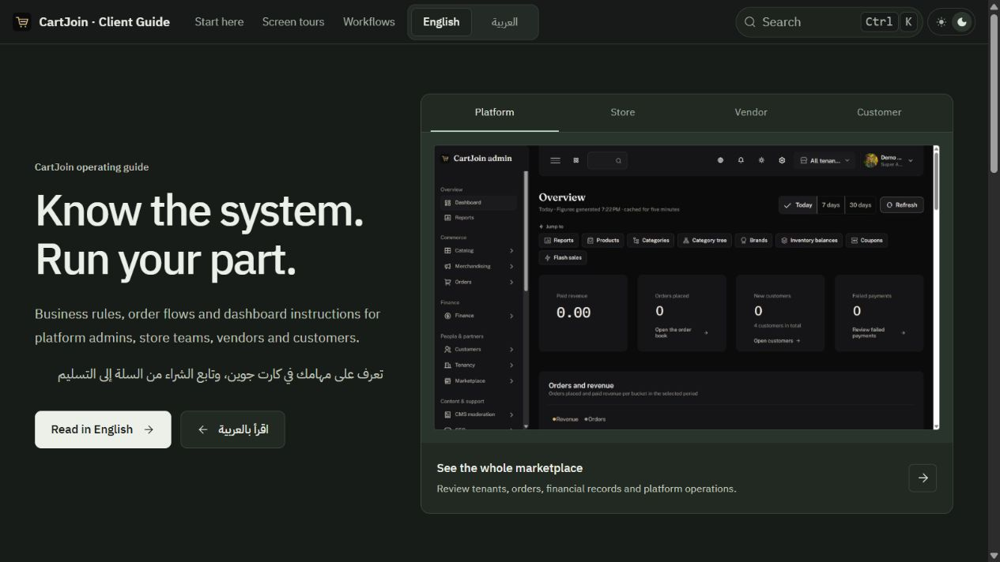

# CartJoin Client Docs

English and Arabic user documentation for the CartJoin multitenant marketplace. The guides explain each dashboard’s capabilities, business rules, data flows and restrictions.

Built with **Next.js, React, Fumadocs, MDX and Mermaid**, with right-to-left support for Arabic.



## Included

- Four role handbooks: platform admin, tenant operator, vendor and customer.
- 44 capability guides per language covering steps, rules, data flow and troubleshooting.
- 208 documentation pages across English and Arabic.
- 131 reviewed dashboard captures with interactive explanations and enlargement.
- 68 short screenshot-based video tours with English/Arabic captions and transcripts.
- 12 diagram blocks explaining business flows and relationships.
- Searchable capabilities, role-based navigation, language switching and light/dark themes.

Coverage includes catalog, inventory, checkout, vendor-split orders, invoices, payments, shipping, returns, refunds, marketing, rewards, settlements, support and platform operations.

## Run locally

Install [Bun](https://bun.sh/) and a Node.js version compatible with the installed Next.js release.

```sh
git clone https://github.com/mahmoudkhairy159/CartJoin-Client-Docs.git
cd CartJoin-Client-Docs
bun install --frozen-lockfile
bun run dev
```

Open [http://localhost:3100/docs](http://localhost:3100/docs).

The docs app runs independently of the CartJoin backend and dashboards. No credentials or environment variables are required to read the included guides and media. Python and FFmpeg are only needed for source extraction or media regeneration.

## Guide entry points

| Role | English | العربية |
| --- | --- | --- |
| Platform admin | `/docs/en/roles/admin` | `/docs/ar/roles/admin` |
| Tenant operator | `/docs/en/roles/tenant` | `/docs/ar/roles/tenant` |
| Vendor | `/docs/en/roles/vendor` | `/docs/ar/roles/vendor` |
| Customer | `/docs/en/roles/customer` | `/docs/ar/roles/customer` |

The capability library lives at `/docs/en/features` and `/docs/ar/features`. The visual learning hub lives at `/docs/en/learn` and `/docs/ar/learn`.

## Validate and build

```sh
bun run docs:check
bun run types:check
bun run build
```

With a docs server running on port 3100:

```sh
node scripts/check-rendered-routes.mjs
```

Checks cover language parity, guide structure, links, screenshots, captions, tours and route coverage. They do not run backend or dashboard application test suites.

The current configuration uses Next.js standalone output. After building, copy the public/static assets before starting it. In PowerShell:

```powershell
Copy-Item -Path public -Destination .next/standalone/public -Recurse -Force
Copy-Item -Path .next/static -Destination .next/standalone/.next/static -Recurse -Force
$env:PORT = '3100'
node .next/standalone/server.js
```

Generate media before starting the production server so its asset inventory includes new files. Stop the development preview before running a production build for verification.

## Repository structure

| Path | Purpose |
| --- | --- |
| `app/` | Routes, layouts, fonts and shared styles |
| `components/` | Navigation, role controls, screenshots, tours and diagrams |
| `content/docs/en/` | English MDX guides |
| `content/docs/ar/` | Arabic MDX guides |
| `content/system-tours.json` | Bilingual tour steps, explanations and media settings |
| `content/feature-library.json` | Capability summaries and audience mapping |
| `public/screenshots/` | Dashboard screenshots used in the guides |
| `public/videos/` | MP4 tours, posters and WebVTT captions |
| `scripts/` | Content checks, source extraction and video generation |
| `evidence/` | Source/capture metadata and verification records |

## Maintain the guides

1. Review changes in the relevant CartJoin source repository and dashboard.
2. Update English and Arabic together. Distinguish observed behavior from planned or unverified behavior.
3. Refresh affected screenshots, explanations and videos. Keep credentials, payment secrets and unrelated personal records out of captures.
4. Run the documentation checks and inspect both languages in the browser.

MDX links use canonical language-root paths such as `/en/workflows/commerce`; the app adds `/docs`. Run `python scripts/canonicalize-links.py` to normalize generated guide links.

Role selection filters documentation navigation; it does not implement application authorization. Actual permissions and record states determine the actions available in the dashboards.

### Source evidence

`scripts/source-inventory.py` expects sibling repositories named `CartJoin-Backend`, `CartJoin-Admin-Dashboard-Frontend`, `CartJoin-Tenant-Dashboard-Frontend`, `CartJoin-Vendor-Dashboard-Frontend` and `CartJoin-Storefront-Frontend`. These are not required to run the docs app.

The extraction script rewrites generated source appendices and route/coverage sections. Review its diff and preserve authored additions. `evidence/source-inventory.json` records reviewed versions; a source commit does not establish deployment parity.

### Screenshots and videos

Tours live in `content/system-tours.json`. Focus rectangles use percentages of the source image. Update `content/screenshot-sizes.json` when replacing images.

Install Python, Pillow and FFmpeg to regenerate clips. The current builder uses Windows Segoe UI at `C:/Windows/Fonts/segoeui.ttf`.

```sh
python scripts/build-tours.py
# Or regenerate selected tours:
python scripts/build-tours.py customer-discover tenant-orders vendor-earnings
```

Feature and role overviews use 12 seconds per screen; detailed task tours use 10 seconds per step. Videos are silent illustrations assembled from real demo screenshots, not recordings proving that a transaction completed. Captions and transcripts explain each screen in English and Arabic.

Capture dates and verification limits appear in the bilingual coverage pages and [verification record](evidence/verification.md). Demo balances, policies and counts are illustrative. Raw capture-session text and local runtime files are excluded from Git.

## Credits

Adapted from an existing Fumadocs documentation template for CartJoin. UI refinement follows [unslop](https://heydamir.design/unslop) by Damir Sokolovsky ([@heydamir](https://x.com/heydamir)), licensed CC BY 4.0. IBM Plex font files retain their bundled OFL license in `app/fonts/plex/`.

---

دليل استخدام كارت جوين بالعربية والإنجليزية لإدارة المنصة وإدارة المتجر والبائع والعميل، مع صور تفاعلية وجولات فيديو مترجمة وقواعد العمل وتدفق البيانات. ابدأ من `/docs/ar/start` بعد تشغيل التطبيق.
