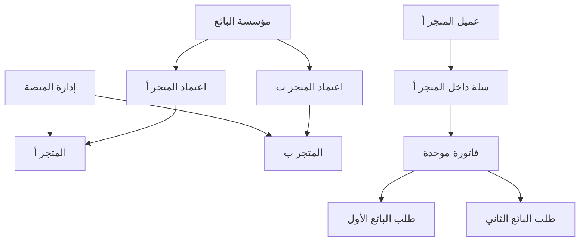
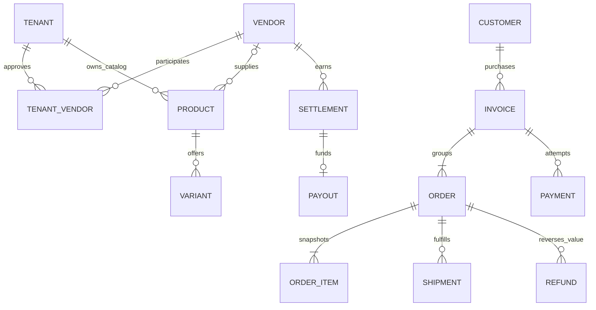

## أربعة أطراف ومسؤوليات مختلفة

| الطرف | النطاق | المسؤولية | الحد |
|---|---|---|---|
| إدارة المنصة | متابعة عامة مخولة | المؤسسات وضوابط المنصة والتحقيق | لا تملك تلقائياً كل تعديلات تشغيل المتجر |
| إدارة المتجر | متجر محدد للجلسة | الكتالوج والشركاء والطلبات والمال والمحتوى | لا تتصفح بيانات متجر آخر الخاصة |
| البائع | هوية البائع + متجر نشط معتمد | منتجاته وطلباته وتنفيذها ومستحقاته | لا يرى بنود بائع آخر أو هوية المشتري في موارد الفاتورة المحجوبة |
| العميل | حسابه داخل متجر التسوق | الشراء والتاريخ وطلبات ما بعد الشراء | لا يصل للموظفين أو حسابات الآخرين |

## قواعد عامة

هذه خريطة علاقات للعمل وليست مخطط قاعدة البيانات الكامل. توضح الملكية وروابط الشراء وتختصر توزيع وسائل الدفع وجداول السجلات المالية. أسماء الكيانات التقنية ثابتة لتسهيل المقارنة.

- يحدد سياق الطلب هوية المتجر، ولا يغيرها حقل في نموذج عمل.
- يعامل سجل المتجر الآخر كغير موجود برمز 404. رفض الصلاحية 403 حالة مختلفة.
- تتحقق هوية البائع واعتماد مساحة العمل معاً. اعتماد أ لا يمنح اعتماد ب.
- رموز الأصناف وروابط المنتجات والكوبونات فريدة ضمن المتجر.
- الخادم مرجع حساب السعر والخصم والضريبة والشحن، وتحتفظ الطلبات بلقطة الشراء.
- حالة الدفع والطلب والشحنة والصرف أحداث مختلفة.
- تصحح السجلات المالية باسترداد أو إشعار دائن أو تعديل وقيد معاكس، دون محو الدليل.
- قد تكتمل المهام والتكاملات بعد انتهاء طلب الشاشة.

## المشترك والمعزول

قد تكون مؤسسة البائع والبيانات الجغرافية عامة. أما علاقة المتجر بالبائع وكتالوجه وسلته وطلباته وسياقه المالي فمقيدة بنطاقها. كون البائع عاماً لا يجعل منتجه سجلاً مشتركاً تلقائياً بين المتاجر.

## المصطلحات

| المصطلح | المعنى |
|---|---|
| المتغير / SKU | الخيار القابل للشراء من المنتج |
| الفاتورة | مستند شراء يجمع طلباً أو عدة طلبات بائعين |
| الطلب | وحدة تنفيذ لمجموعة بائع محددة |
| الحجز | كمية أو قيمة مرتبطة مؤقتاً ولم تستهلك بعد |
| الاسترداد | عكس قيمة شراء محصلة |
| الإرجاع | عملية مادية بعد التسليم تشمل طلباً وفحصاً |
| التسوية | كشف فترة لمستحقات البائع وخصوماته |
| دفعة الصرف | محاولة تحويل مقابل تسوية معتمدة |
| عدم التكرار | إعادة نفس الأمر لا تنشئ نتيجة مكررة |

المصدر: دستور الخادم ووحدات المتجر والبائع والفاتورة والطلب ومسارات الواجهات الأربع. راجع [الأدلة](/ar/evidence) للمسارات وإصدارات المصدر.
