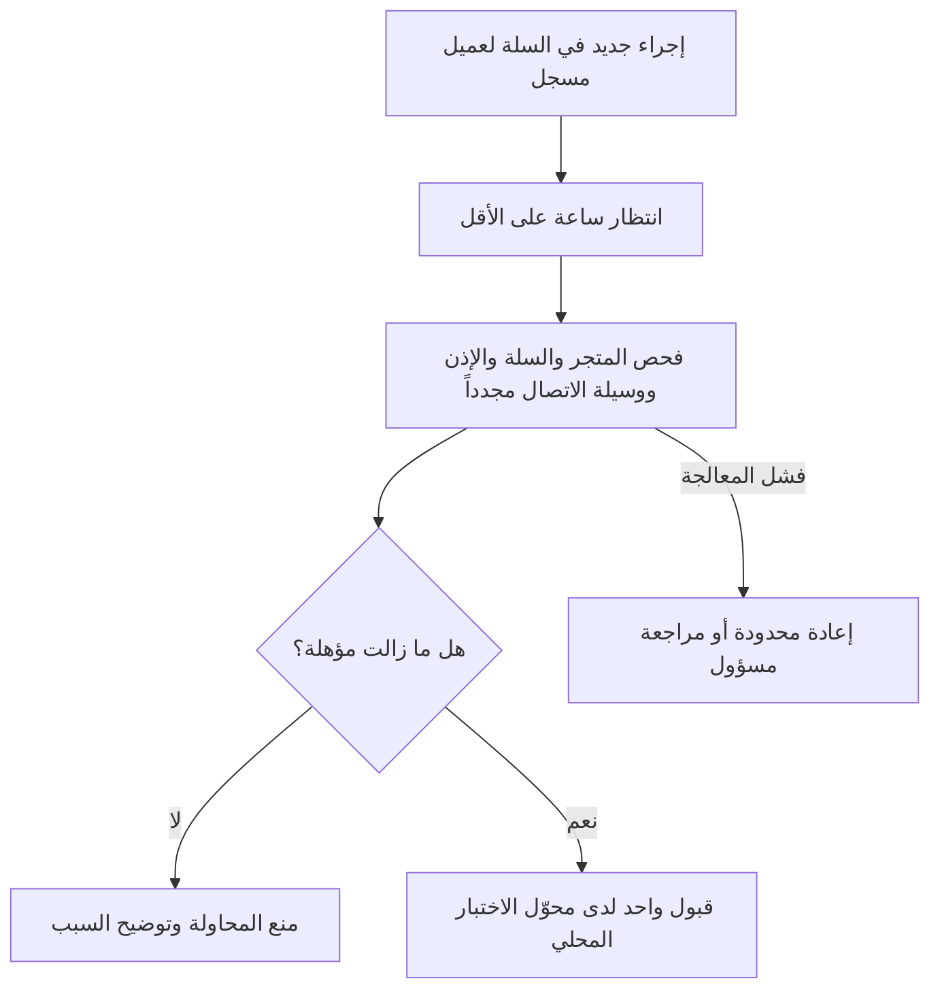

## ماذا تقدم هذه الميزة؟

تتضمن لوحة المتجر **فحص تذكيرات السلة** لاختبار أهلية التذكير بشكل مقيد. الميزة معطلة افتراضياً. قبول الاختبار سجل محلي فقط، ولا يعني تسليم رسالة أو استعادة طلب أو تحقيق إيراد.

يبدأ التذكير من إجراء جديد في السلة لعميل مسجل الدخول فقط. فتح السلة أو تحديث أسعارها لا يُعد نشاط شراء، ولا تُضاف تواريخ نشاط افتراضية للسلال القديمة.

## للعميل

افتح **الحساب ← الملف الشخصي والعناوين ← اختياراتك التسويقية** للسماح بـ **تذكيرات السلة ← الرسائل النصية** لهذا المتجر أو سحب الإذن. تظل اختياراتك لدى المتاجر الأخرى مستقلة. السماح بعروض البريد الإلكتروني لا يسمح بتذكير نصي بالسلة.

يشترط الفحص توثيق رقم الهاتف صراحة. سحب الإذن قبل المعالجة يوقف التذكير. تغيير السلة أو انتهاء صلاحيتها أو تسجيل محاولة طلب لاحقة لدى المتجر يوقف الحالة القديمة أيضاً. يبقى متجر التسجيل الأول إحصائية فقط ولا يقيد حسابك بمتجر واحد.

## خطوات الاستخدام

افتح **فحص تذكيرات السلة** بصلاحية الموظف المناسبة. يوضح كل صف مرجع السلة وآخر إجراء مرصود وعدد محاولات المعالجة والموعد النهائي والنتيجة. تميز الأسباب بين سحب الإذن وتغيير الاتصال أو السلة ونقص المخزون وعدم إتاحة عرض المورد وصيانة المتجر أو قيود الفوترة.

ينتظر أول فحص ساعة على الأقل بعد إجراء العميل. تنتهي الحالة بعد 24 ساعة من ذلك الإجراء، وبحد أقصى ثلاث محاولات معالجة. يُسمح بقبول اختبار واحد فقط لكل عميل في المتجر خلال كل 24 ساعة متحركة.

| النتيجة | معناها | الإجراء المناسب |
| --- | --- | --- |
| بانتظار المعالجة | سُجلت الحالة في طابور دائم. | حدّث الصفحة بعد تشغيل المعالج. |
| قُبلت لدى محوّل الاختبار | نجحت الفحوص وسُجل قبول محلي. | لا تحسبها رسالة مسلمة أو عملية بيع. |
| مُنعت المحاولة | منعها شرط تجاري أو شرط إذن. | اقرأ السبب؛ الإعادة لا تتجاوز القيد. |
| بانتظار إعادة محدودة | حدث فشل مؤقت مع وجود محاولات متبقية. | راجع المشكلة؛ يمكن للمخول إعادة المحاولة مع سبب. |
| تحتاج مراجعة مسؤول | استُنفد عدد المحاولات. | تحقق من السبب ولا تعِد ضبط الحالة بشكل متكرر. |
| انتهى الموعد النهائي | انتهت نافذة التذكير الثابتة. | لا تُسمح محاولة أخرى لهذه الحالة. |

## تدفق البيانات والنتيجة

## إعادة المحاولة

يمكن للموظف المخول إعادة فشل مؤقت فقط. اكتب شرحاً قصيراً لما راجعته دون أرقام هواتف أو بريد إلكتروني أو أسرار. تحافظ الإعادة على الموعد النهائي الأصلي وعدد المحاولات المتبقي وتفحص كل الشروط مجدداً. لا تُعيد تفعيل حالة ممنوعة أو منتهية أو مقبولة.

## القيود والقرارات

يدعم هذا الإصدار محوّل اختبار محلي مقيد للرسائل النصية ولا يرسل حملات فعلية. تظل تذكيرات البريد وتصميم الحملات وتتبع التسليم وتقارير التحويل التسويقي ضمن الخطة. قد تمنع محاولة طلب ملغاة أو غير مدفوعة التذكير تحفظياً، لكنها لا تظهر أبداً كنتيجة بيع ناجحة للتذكير.
