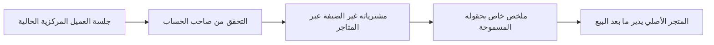

## خطوات الاستخدام

### سجل الدخول بحساب العميل الحالي

افتح **دخول العملاء** في موقع كارت جوين العام المنفصل واستخدم بيانات حساب العميل التي تستخدمها في المتاجر. لا تنشئ حسابًا آخر لكل مستأجر. طلب انضمام التاجر ودخول لوحات الموظفين رحلتان منفصلتان.

بعد الدخول، يعرض **مشترياتك عبر المتاجر** مشتريات الحساب كسجلات طلبات لكل متجر. يظهر اسم المتجر ومرجع الطلب وحالة الطلب والدفع والتوصيل وإجمالي الشراء الأصلي وعملته ووقت الإنشاء. استخدم أزرار الصفحات عند وجود مشتريات أخرى.

<SystemScreenshot src="/docs/screenshots/platform-purchases-ar.png" alt="يعرض الملخص الخاص بصاحب الحساب اسم المتجر ومرجع الطلب والحالات والإجمالي الأصلي دون ملاحظات التشغيل أو العناوين." />

<video style={{ width: "100%", height: "auto" }} controls playsInline preload="none" poster="/docs/screenshots/platform-purchases-ar.png" aria-label="جولة ملخص مشتريات العميل الخاص">
  <source src="/docs/videos/platform-purchases-ar.mp4" type="video/mp4" />
  <track kind="captions" src="/docs/videos/platform-purchases-ar.vtt" srcLang="ar" label="العربية" default />
</video>

> **جولة صور بنص توضيحي ودون صوت. لقطة تطوير.** تعرض الصورة والجولة مشتريات حساب تجريبي محلي، وليستا إثبات دفع حي أو توصيل من مزود فعلي.

## فهم الملخص

| ما تراه | معناه |
|---|---|
| عدة طلبات لعملية شراء | قد يقسم السوق شراء متجر واحد إلى طلبات بائعين |
| إجماليات وعملات منفصلة | مبالغ الطلبات الأصلية، وليست رصيدًا مشتركًا أو مجموعًا عالميًا محولًا |
| فصل التوصيل عن الدفع | حالة التوصيل لا تثبت تحصيل النقد |
| متجر لم يعد ظاهرًا في الاكتشاف | يبقى طلبك المملوك في الملخص الخاص حتى إن أصبح المتجر غير عام أو غير نشط |
| غياب شراء ضيف | لا تُربط طلبات الضيف تلقائيًا بتطابق البريد أو الهاتف |

للفاتورة التفصيلية والتوصيل والدعم والإرجاع والأرصدة، استخدم المتجر الذي اشتريت منه ومسار الخدمة المصرح فيه. تنطبق سياسات المتجر وشروط الشراء المحفوظة.

## القيود والقرارات

لا يستخدم الملخص إلا صاحب الحساب الموثق. لا يستطيع عميل آخر أو مشغل متجر اختيار معرف عميل لتصفحه. لا يحتوي الملخص على لقطة عنوان أو ملاحظات موظفين أو ملف خاص أو دليل ناقل أو بيانات اعتماد دفع أو كشف بائع أو رصيد ولاء أو محفظة.

يبقى `tenant_id` الخاص بأول تسجيل إسنادًا إحصائيًا فقط. لا يغيره الدخول أو الشراء في متجر آخر ولا يقيد المشتريات المعروضة. تبقى علاقات المتاجر وسجلاتها المالية مرتبطة بمتجرها المالك.

تخص جلسة المنصة تبويب المتصفح الحالي. سجل الخروج عند الانتهاء. عند فشل التحميل أعد المحاولة، وعند انتهاء الجلسة سجل الدخول مجددًا. لا يستطيع الحساب المحظور أو غير النشط أو المحذوف عالميًا استخدام الملخص. تقييد متجر محلي ليس تعليقًا عامًا للعميل.

راجع [اكتشاف المتاجر المشاركة](/ar/features/global-discovery) و[حدود الحساب المركزي](/ar/roadmap/global-platform).

## عند غياب طلب

تحقق من الدخول بالحساب المستخدم للشراء. احتفظ باسم المتجر ومرجع الطلب عند التواصل مع المتجر المالك. تستخدم مشتريات الضيف إيصالها ومسار تتبعها؛ ولا يدمج تطابق بيانات التواصل هذه الطلبات في الحساب. غياب المتجر عن الاكتشاف لا يحذف ملخص مشترياتك المملوكة.

## عند فشل التحميل أو تسجيل الخروج

استخدم إعادة المحاولة بعد فشل تحميل مؤقت. عند انتهاء الجلسة أعد تحميل صفحة الحساب وسجل الدخول بحسابك الحالي. إذا أبلغ تسجيل الخروج عن فشل فأعد المحاولة، ولا تفترض أن إغلاق الصفحة أكمل الخروج. استخدم الاستعادة والدعم المصرح بهما في المتجر المالك عند تعذر الوصول إلى بيانات حسابك.

## تدفق البيانات والنتيجة

تثبت الجلسة المركزية هويتك. يختار الخادم المشتريات المملوكة لحسابك فقط ويعيد ملخصًا محدودًا بأسماء المتاجر وحقول الطلب المسموحة. لا يرشح بمتجر التسجيل الأول ولا يدمج الأرصدة أو ينقل المشتريات أو يمنح التاجر وصولًا إلى متاجر أخرى. تبقى الخدمة التفصيلية لدى المتجر الأصلي.

