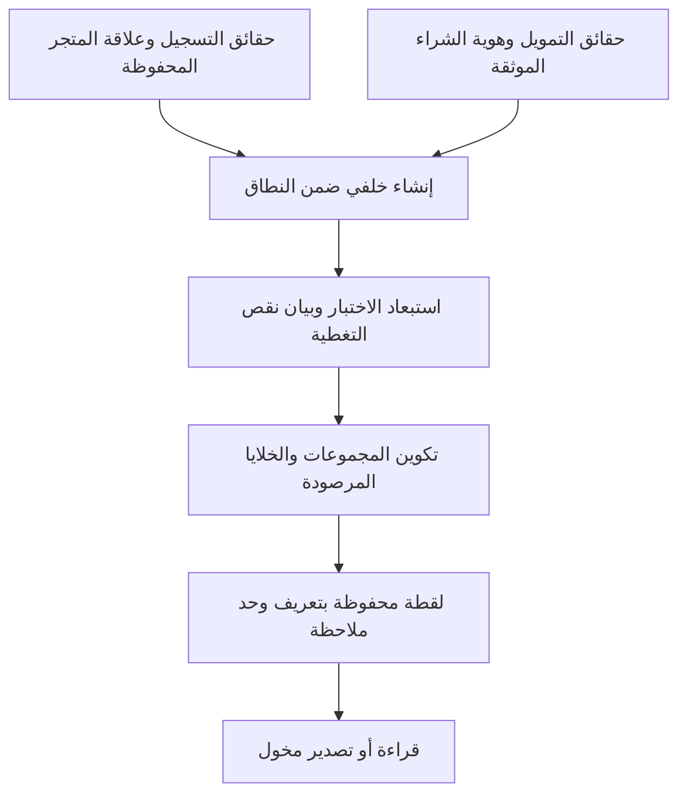

> **إصدار تطوير · ١٩ نوفمبر ٢٠٢٦.** نُشر التقرير في الخادم ولوحات المشغلين الثلاث، مع تحقق بالمتصفح بالعربية والإنجليزية. تستخدم هذه الجولات المحلية بيانات مصطنعة ومضبوطة؛ ولا تثبت نشاط عملاء حقيقياً أو نشراً حياً.

## ما القرار الذي يساعدك التقرير على اتخاذه؟

استخدم مجموعات الشراء لفهم عودة المشترين في الأشهر التالية. يجمع كل صف العملاء بحسب أقدم شراء ممول مؤهل تدعمه الأدلة المحفوظة داخل النطاق المختار. يصف ذلك التاريخ المعروف، ولا يثبت أنه أول شراء على الإطلاق عند نقص الأدلة القديمة. وتعرض الأعمدة التالية عدد العملاء أنفسهم الذين اشتروا مجدداً. الطرد الثاني من بائع آخر داخل عملية الشراء نفسها لا يصنع عملية شراء متكررة.

هذا تقرير لأعداد العملاء. استخدم التقارير المالية لفهم الإيرادات والاستردادات والأرباح.

## افصل بين ثلاث مراحل

| المرحلة | معناها |
| --- | --- |
| تسجيل الحساب | إنشاء حساب عميل مركزي في CartJoin. متجر التسجيل الأول معلومة لإحصاءات مصدر التسجيل. |
| أول علاقة بالمتجر | أول علاقة سجلها النظام بين العميل وهذا المتجر. لا تثبت هذه العلاقة شراءً. |
| أقدم شراء مؤهل محفوظ | أقدم شراء ممول مؤهل تدعمه الأدلة المعروفة والمحفوظة داخل نطاق التقرير. |

قد يسجل العميل لدى المتجر الأول، ثم يزور المتجر الثاني ويشتري منه أولاً. لا يحصل المتجر الثاني على نشاط العميل الخاص لدى المتجر الأول. ربط شراء ضيف بحساب موجود لا ينشئ تسجيلاً جديداً.

## خطوات الاستخدام

افتح **التقارير ← مجموعات العملاء** في اللوحة المناسبة. اختر النافذة الشهرية المدعومة وراجع النطاق ووقت إنشاء التقرير وآخر وقت للملاحظة قبل مقارنة الصفوف. يستطيع المشغل المخول طلب إنشاء التقرير عبر مهمة خلفية؛ انتظر نتيجتها ولا تعتبر التقرير المنتظر أو الفاشل تقريراً بلا عملاء.

اقرأ تسلسل الأشهر في الصف: **مشترو الشريحة** هو عدد عملاء المجموعة، و**M1** هو الشهر الميلادي التالي، و**M2** الشهر الذي يليه. يُحسب العميل مرة واحدة كحد أقصى في الشهر اللاحق حتى إن أجرى عدة عمليات شراء.

مثلاً: إذا كانت المجموعة تضم ٢٠ مشترياً وعاد خمسة منهم في الشهر التالي المكتمل، فمعدل تكرار الشراء في M1 هو ٢٥٪. قد يختلف هؤلاء الخمسة عمن يعودون في M2؛ فلا تعني الأعمدة اشتراكاً متصلاً أو سلسلة شراء بلا انقطاع.

## قراءة الخلايا غير المكتملة

| حالة الخلية أو التقرير | التفسير |
| --- | --- |
| شهر مكتمل بلا مشترين عائدين | صفر صحيح داخل المجموعة المؤهلة. |
| شهر لم تكتمل ملاحظته | عدد حتى الآن، دون نسبة نهائية. |
| شهر مستقبلي | لم يُرصد بعد؛ لا تعتبره صفراً في العودة للشراء. |
| عدد مجموعة مؤقت | شهر تكوين المجموعة لم يكتمل، وقد يزيد عدد عملائها. |
| لقطة مفقودة | لا يتوفر تقرير محفوظ؛ ولا يثبت ذلك غياب العملاء. |
| إنشاء تقرير منتظر أو فاشل | الطلب الجديد غير جاهز. تحتفظ أي لقطة محفوظة سابقة بحد ملاحظتها الخاص. |
| تنبيه تغطية | بعض أدلة الوقت أو الهوية أو التمويل التاريخية لا تدعم تصنيفاً موثوقاً. |

تعتمد الأشهر وحد الملاحظة توقيت UTC. الحد حصري عند 00:00 UTC في بداية يوم الملاحظة: تُدرج فقط الحقائق المعروفة قبل تلك اللحظة، ويُستبعد اليوم الحالي بتوقيت UTC. تحتفظ المهمة المتأخرة بحد طلبها الأصلي؛ ولا يمدد وقت اكتمال إنشاء التقرير لاحقاً نافذة الملاحظة. النافذة المدعومة محدودة باثني عشر شهر مجموعات.

## ما الشراء المؤهل؟

يتطلب الشراء المؤهل دليلاً محفوظاً على اكتمال تمويل حقيقي، بما فيه وسائل الرصيد الداخلي الصالحة عند انطباقها. لا يؤهل الدفع عند الاستلام غير المحصل، ولا التمويل غير المكتمل، ولا الشراء التجريبي. ولا ينبغي لمحاولة اختبار فاشلة وحدها أن تستبعد شراءً ممولاً حقيقياً مستقلاً جاء بعدها.

تُحسب الفاتورة مرة واحدة عبر طلباتها الفرعية. يستخدم الشراء القديم بلا فاتورة مجموعة خاصة بالطلب. الاسترداد الكامل لاحقاً لا يمحو الحقيقة التاريخية بوقوع شراء ممول؛ لذلك لا يحل هذا التقرير محل صافي الإيرادات.

لا يعوض النظام وقت التمويل المفقود بوقت إنشاء الطلب أو تعديله. لا يمكن تصنيف العميل بثقة ضمن مجموعة أول شراء إذا كانت لديه أدلة شراء أقدم لم تُحسم. يظهر التاريخ القديم المفقود أو غير المرتبط كنقص في التغطية، ولا يُعاد تخمينه من الملكية الحالية. راجع هذه المعلومات قبل مقارنة المتاجر أو الفترات.

## جولات لوحات التحكم

تستخدم المعاينات المحلية مشتريات مصطنعة. تعتمد المقاطع المشروحة على لقطات فعلية للشاشات؛ ولا تعرض مدفوعات أو عمليات توصيل حقيقية.

### مدير المنصة: قارن المجموعة داخل النطاق المحدد

راجع نطاق الترويسة قبل قراءة إجماليات الاكتساب أو جدول الشرائح. لا تمثل علاقات المتاجر حسابات مركزية مستقلة.

<SystemTour tour="feature-customer-cohorts-admin" />

### المستأجر: افهم تكرار شراء عملاء متجرك

اقرأ إسناد التسجيل منفصلاً عن العلاقات وشرائح الشراء. ثلاثة تسجيلات وأربع علاقات لا تعني سبعة مشترين فريدين.

<SystemTour tour="feature-customer-cohorts-tenant" />

### المورد: قارن مشترياتك المؤهلة فقط

تحدد مساحة المتجر المعتمدة نطاق التقرير. لا يؤهل دفع مورد آخر طلبك الفرعي الملغى وغير المدفوع. لا تتاح أعداد التسجيل والعلاقات هنا.

<SystemTour tour="feature-customer-cohorts-vendor" />

## القيود والقرارات

تؤدي إزالة حساب الموظف الذي طلب التصدير أو متجره إلى حظر الوصول فورًا. يحتفظ الملف الخاص بموعد انتهاء الصلاحية الأصلي البالغ 24 ساعة، ثم تحذفه مهمة التنظيف المجدولة حتى إذا لم يعد مالكه موجودًا.

يرى مشغل المتجر حقائق الاكتساب والشراء الخاصة بمتجره. يرى مشغل البائع مجموعات الشراء المرتبطة ببنود بائعه المحفوظة داخل مساحة المتجر المعتمدة حالياً؛ ولا يحصل على تفصيل مصدر التسجيل أو هويات العملاء أو نشاط المتاجر الأخرى. يحتاج الطلب الفرعي المختار الخاص به إلى دليل محفوظ على اكتمال تسويته. لا يؤهل تمويل طلب فرعي لبائع آخر طلباً فرعياً ملغياً وغير مدفوع لهذا البائع. يجب على مشغل المنصة التمييز بين مجموعة متجر ومجموعة عالمية؛ جمع أعداد المشترين في المتاجر لا ينتج عدداً عالمياً للعملاء الفريدين.

يمكن لربط ضيف موثق أن يصل الشراء بالحساب فقط إذا دعمه دليل محفوظ وكان حد التقرير يشمل وقت الربط. لا يخمن التقرير الهوية السابقة من تشابه رقم هاتف أو ملكية طلب حالية قابلة للتغيير.

## تدفق البيانات والنتيجة

لا تغير قراءة التقرير المشتريات أو الهوية أو الأرصدة أو الموافقات. تفصل المهام الخلفية والتسوية بين تجهيز التقرير وعرض الصفحة. تتطلب القراءة وطلب الإنشاء والتصدير صلاحيات منفصلة: `reports.show` و`reports.generate` و`reports.export`. لا تكفي صلاحية القراءة وحدها للإنشاء أو التصدير. يستخدم التصدير لقطة محفوظة موجودة، ويبقى خاصاً بحساب الموظف الذي طلبه لمدة ٢٤ ساعة من وقت طلب التصدير. تُراجع الصلاحيات والنطاق واعتماد مساحة البائع مجدداً عند الوصول إلى التصدير؛ ولا يتوفر رابط تنزيل عام.

## عند حدوث مشكلة

راجع النطاق والتواريخ أولاً. لإنشاء التقرير ثلاث محاولات تلقائية كحد أقصى، مع انتظار خمس دقائق على الأقل بعد المحاولة الفاشلة. قد تعني حالة الانتظار أن المهمة تنتظر هذه الإعادة. بعد استنفاد المحاولات، اطلب من المسؤول التحقق. تكرار **طلب توليد التقرير** للنطاق والنافذة الشهرية وحد UTC أنفسها يعيد المهمة نفسها، ولا يعيد ضبط عدد المحاولات المستنفد. يتيح يوم ملاحظة جديد بتوقيت UTC إنشاء مهمة جديدة. تنبيه التغطية سبب للتحقق من الأدلة، وليس إذناً بملء المجهول بأصفار. استخدم التقارير المالية إذا كان سؤالك عن المال لا عن المشترين العائدين.

موضوعات مرتبطة: [التقارير والتصدير](/ar/features/reports) · [حساب العميل المركزي](/ar/features/global-customer-account).
