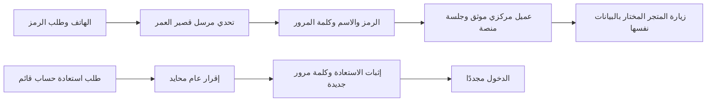

<SystemTour tour="feature-global-customer-account" />

## خطوات الاستخدام

افتح **دخول العملاء** في موقع منصة كارت جوين المستقل. يمكن للعميل الحالي الدخول ببياناته المعتادة. لإنشاء حساب اختر **إنشاء حساب** وأدخل رقم الهاتف مع رمز الدولة ثم اطلب رمز التحقق. أدخل الرمز المرسل المكون من ستة أرقام واسمك وكلمة مرور جديدة مع تأكيدها. عند إكمال العملية بنجاح تُسجل جلسة دخولك في المنصة.

لا يلزم إدخال بريد إلكتروني. لا يسجلك إنشاء الحساب في التسويق ولا يفتح طلب اشتراك كتاجر. لا تشارك رمز التحقق مع أي شخص.

<SystemScreenshot src="/docs/screenshots/global-customer-ar-signup.webp" alt="يطلب نموذج إنشاء حساب العميل الهاتف بشكل منفصل عن دخول العملاء الحاليين." />

بعد طلب الرمز احتفظ بوسيلة التواصل نفسها واستخدم الرسالة الأحدث. أدخل الرمز واسمك وكلمتي مرور متطابقتين في خطوة الإثبات. تُترك حقول الأسرار فارغة عمدًا في العرض.

<SystemScreenshot src="/docs/screenshots/global-customer-ar-proof.webp" alt="تعرض خطوة الإثبات حقول الرمز والاسم وكلمة المرور دون إظهار رمز تحقق أو كلمة مرور." />

<video style={{ width: "100%", height: "auto" }} controls playsInline preload="none" poster="/docs/screenshots/global-customer-ar-signup.webp" aria-label="إنشاء حساب عميل مركزي أو استعادته">
  <source src="/docs/videos/global-customer-ar-tour.mp4" type="video/mp4" />
  <track kind="captions" src="/docs/videos/global-customer-ar.vtt" srcLang="ar" label="العربية" default />
</video>

> **جولة من لقطات شاشة فعلية مع ترجمة ودون صوت.** تعرض شاشات التطوير المحلية تسجيل عميل تجريبي وحسابه الفارغ وإقرار الاستعادة العام. لا تظهر الرموز أو كلمات المرور أو رموز الجلسات. يتوقف عرض الاستعادة قبل تغيير كلمة المرور، ولا يعرض مزود رسائل حقيقيًا أو شراءً حيًا.

## هوية واحدة بين المتاجر

هوية العميل مركزية. استخدم بيانات الدخول نفسها عند التسوق في متاجر المستأجرين المشاركة. يحتفظ كل موقع بجلسته الخاصة في المتصفح؛ لا يسجلك الدخول إلى المنصة تلقائيًا في نطاق آخر. تبقى الطلبات والدعم والإرجاع وأرصدة المتجر لدى متجرها المالك.

العميل الذي يسجل أول مرة من المنصة العامة ليست له جهة تسجيل أولى من المستأجرين. أما من سجل أول مرة من متجر مستأجر فيبقى متجر التسجيل الأصلي لإحصاءات مصدر التسجيل فقط. لا تقيد أي من القيمتين المتاجر التي يستطيع العميل الدخول إليها. لا ينشئ التسجيل العام وحده عضوية في كل متجر؛ تتكون العلاقة بالمتجر بعد زيارة موثوقة أو شراء داخله.

<SystemScreenshot src="/docs/screenshots/global-customer-ar-account.webp" alt="العميل التجريبي الجديد مسجل الدخول وملخص مشترياته الخاص فارغ دون عرض رصيد متجر." />

## استعادة حساب قائم

اختر **نسيت كلمة المرور؟** وأدخل الهاتف أو البريد المرتبط بحسابك. لا تؤكد الاستجابة وجود الحساب عمدًا. إذا وُجد حساب مؤهل مطابق وكان الإرسال متاحًا فاتبع تعليمات الاستعادة وأدخل الرمز واختر كلمة مرور جديدة مع تأكيدها. بعد نجاح إعادة التعيين سجل الدخول بالكلمة الجديدة؛ لا تصدر الاستعادة جلسة منصة جديدة تلقائيًا.

يمكنك استخدام مدير كلمات المرور مع الحقول المسماة بوضوح. حافظ على إمكانية الوصول إلى وسيلة التواصل عبر إجراءات خدمة الحساب المصرح بها. استعادة طلب التاجر ودخول الموظفين مساران منفصلان.

<SystemScreenshot src="/docs/screenshots/global-customer-ar-recovery.webp" alt="يقبل نموذج استعادة العميل الهاتف أو البريد الإلكتروني لحساب قائم." />

الإقرار التالي عام عمدًا؛ لا يثبت وجود الحساب أو نجاح الإرسال. استخدم التعليمات المرسلة إذا وصلت إلى وسيلة تواصل تخصك فقط. لا تمثل الصورة تغييرًا مكتملًا لكلمة المرور.

<SystemScreenshot src="/docs/screenshots/global-customer-ar-ack.webp" alt="لا يكشف الإقرار العام وحقول إعادة التعيين الفارغة وجود حساب العميل." />

## القيود والقرارات

يشترط إثبات الهاتف قبل إنشاء عميل بالتسجيل العام أو إصدار جلسة. التحدي إثبات مؤقت غير قابل للتخمين وليس حسابًا موثقًا. لا يُعاد استخدامه بعد الإكمال. لا يستبدل تسجيل هاتف مرتبط بحساب قائم ذلك الحساب؛ استخدم الدخول أو الاستعادة.

تنتهي صلاحية رمز التسجيل بعد خمس دقائق، وله عدد محاولات محدود وفترة انتظار لإعادة الإرسال. يستبدل طلب رمز جديد التحدي السابق. توضح الشاشة وقت السماح بطلب آخر، ويطبق الخادم مستقلًا حدود وسيلة التواصل والشبكة. لا ينشئ تعذر الإرسال المؤقت حسابًا غير موثق.

لا تنتقل قيمة محفظة أو نقاط ولاء أو طلبات أو سجلات عملاء بين المتاجر بسبب التسجيل أو تغيير كلمة المرور. لا توجد عملية شراء موحدة بين المتاجر.

## عند تعذر التحقق

راجع وسيلة التواصل والرمز، بما يشمل رمز الدولة عند التسجيل. إذا انتهت صلاحية الرمز فاطلب آخر واستخدم الرسالة الأحدث فقط. انتظر العد التنازلي بعد كثرة الطلبات. إذا تعذر إرسال الرسائل مؤقتًا فحاول لاحقًا. لا تعرض الشاشة صندوق رسائل تجريبيًا أو رمزًا مقترحًا.

إذا كان لك حساب فارجع إلى الدخول أو الاستعادة. لا يعد الإقرار العام بطلب الاستعادة دليلًا على إنشاء حساب أو وصول الرسالة إلى جهازك.

## تدفق البيانات والنتيجة

تطلب المنصة تحدي تسجيل قصير العمر لهاتفك. بعد إثبات الرمز المرسل وصحة بيانات الحساب ينشئ الخادم عميلًا مركزيًا واحدًا بلا جهة مستأجر أولى ويعيد جلسة منصة محدودة. تتحقق الاستعادة منفصلًا من إثبات حساب قائم وتغير كلمة مروره ثم تعيدك للدخول. تبقى الزيارات والمشتريات مقيدة بمتجرها.

## مسارات مرتبطة

راجع [ملخص مشترياتك الخاص](/ar/features/cross-store-purchases) لفهم طلباتك عبر المتاجر أو [اكتشف المتاجر المشاركة](/ar/features/global-discovery). يشرح هذا الدليل التنفيذ المعتمد في بيئة التطوير. يظل تفعيل مزود الرسائل الحقيقي والنشر الحي عمل إصدار منفصلًا، ولا يتاح رمز اختبار عام داخل الواجهة.
