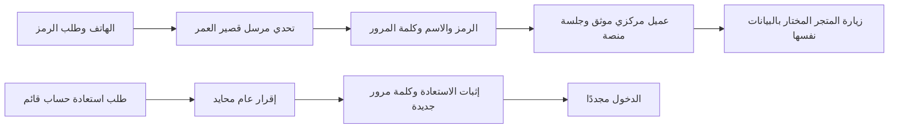

<SystemTour tour="feature-global-customer-account" />

## خطوات الاستخدام

افتح **دخول العملاء** في موقع منصة كارت جوين المستقل. يمكن للعميل الحالي الدخول ببياناته المعتادة. لإنشاء حساب اختر **إنشاء حساب** وأدخل رقم الهاتف مع رمز الدولة ثم اطلب رمز التحقق. أدخل الرمز المرسل المكون من ستة أرقام واسمك وكلمة مرور جديدة مع تأكيدها. عند إكمال العملية بنجاح تُسجل جلسة دخولك في المنصة.

لا يلزم إدخال بريد إلكتروني. لا يسجلك إنشاء الحساب في التسويق ولا يفتح طلب اشتراك كتاجر. لا تشارك رمز التحقق مع أي شخص.

<SystemScreenshot src="/docs/screenshots/global-customer-ar-signup.webp" alt="يطلب نموذج إنشاء حساب العميل الهاتف بشكل منفصل عن دخول العملاء الحاليين." />

بعد طلب الرمز احتفظ بوسيلة التواصل نفسها واستخدم الرسالة الأحدث. أدخل الرمز واسمك وكلمتي مرور متطابقتين في خطوة الإثبات. تُترك حقول الأسرار فارغة عمدًا في العرض.

<SystemScreenshot src="/docs/screenshots/global-customer-ar-proof.webp" alt="تعرض خطوة الإثبات حقول الرمز والاسم وكلمة المرور دون إظهار رمز تحقق أو كلمة مرور." />

<video style={{ width: "100%", height: "auto" }} controls playsInline preload="none" poster="/docs/screenshots/global-customer-ar-signup.webp" aria-label="إنشاء حساب عميل مركزي أو استعادته">
  <source src="/docs/videos/global-customer-ar-tour.mp4" type="video/mp4" />
  <track kind="captions" src="/docs/videos/global-customer-ar.vtt" srcLang="ar" label="العربية" default />
</video>

> **جولة من لقطات شاشة فعلية مع ترجمة ودون صوت.** تعرض شاشات التطوير المحلية تسجيل عميل تجريبي وحسابه الفارغ وإقرار الاستعادة العام. لا تظهر الرموز أو كلمات المرور أو رموز الجلسات. يتوقف عرض الاستعادة قبل تغيير كلمة المرور، ولا يعرض مزود رسائل حقيقيًا أو شراءً حيًا.

## هوية واحدة بين المتاجر

هوية العميل مركزية. استخدم بيانات الدخول نفسها عند التسوق في متاجر المستأجرين المشاركة. يحتفظ كل موقع بجلسته الخاصة في المتصفح؛ لا يسجلك الدخول إلى المنصة تلقائيًا في نطاق آخر. تبقى الطلبات والدعم والإرجاع وأرصدة المتجر لدى متجرها المالك.

العميل الذي يسجل أول مرة من المنصة العامة ليست له جهة تسجيل أولى من المستأجرين. أما من سجل أول مرة من متجر مستأجر فيبقى متجر التسجيل الأصلي لإحصاءات مصدر التسجيل فقط. لا تقيد أي من القيمتين المتاجر التي يستطيع العميل الدخول إليها. لا ينشئ التسجيل العام وحده عضوية في كل متجر؛ تتكون العلاقة بالمتجر بعد زيارة موثوقة أو شراء داخله.

<SystemScreenshot src="/docs/screenshots/global-customer-ar-account.webp" alt="العميل التجريبي الجديد مسجل الدخول وملخص مشترياته الخاص فارغ دون عرض رصيد متجر." />

## تعيين كلمة المرور أو إعادة تعيينها

اختر **تعيين أو إعادة تعيين كلمة المرور** وأدخل الهاتف أو البريد الإلكتروني المرتبط بحسابك. استخدم الخيار نفسه إذا أنشأ المتجر حسابًا لك وتحتاج إلى اختيار كلمة مرورك الأولى. إذا طابقت البيانات حسابًا مؤهلًا وكان الإرسال متاحًا، فاستخدم الرمز الذي يصلك لاختيار كلمة مرور وتأكيدها. بعد حفظها، ارجع إلى تسجيل الدخول واستخدمها هناك.

إذا وصلك رمز ضمن دعوة، فأدخل وسيلة التواصل التي استلمته عبرها واختر **لديّ رمز بالفعل**. يفتح هذا الخيار خطوة التحقق ويظل الرمز صالحًا حتى انتهاء مدته.

يمكنك استخدام مدير كلمات المرور مع الحقول المسماة بوضوح. حافظ على إمكانية الوصول إلى وسيلة التواصل عبر إجراءات خدمة الحساب المصرح بها. استعادة طلب التاجر ودخول الموظفين مساران منفصلان.

<SystemScreenshot src="/docs/screenshots/global-customer-ar-recovery.webp" alt="يقبل نموذج استعادة العميل الهاتف أو البريد الإلكتروني لحساب قائم." />

تظهر الرسالة نفسها للطلبات المؤهلة والطلبات التي لا تطابق حسابًا. انتظر وصول الرمز إلى هاتفك أو بريدك الإلكتروني قبل المتابعة. تعرض الصورة رسالة الإقرار والحقول التي تملؤها بعدها.

<SystemScreenshot src="/docs/screenshots/global-customer-ar-ack.webp" alt="لا يكشف الإقرار العام وحقول إعادة التعيين الفارغة وجود حساب العميل." />

## تغيير وسيلة تسجيل الدخول

في واجهة المتجر، افتح **الحساب ← الملف الشخصي ← تغيير وسيلة تسجيل الدخول**. أدخل رقم الهاتف أو البريد الإلكتروني الجديد وكلمة مرورك الحالية. أدخل الرمز المكوّن من ستة أرقام المرسل إلى وسيلة التواصل الجديدة وأكّد بكلمة مرورك الحالية. تنتهي صلاحية الرمز بعد خمس دقائق. ينهي التحديث جلساتك الحالية، ويمكنك بعدها تسجيل الدخول بالوسيلة الجديدة.

لإغلاق حسابك، أكّد الإجراء في ملفك الشخصي بكلمة مرورك الحالية. يؤدي الإغلاق إلى إنهاء جلساتك وإيقاف الإشعارات الفورية. تُحفظ سجلات الحساب والمشتريات، ويمكن لدعم المنصة استعادة الحساب المغلق من لوحة الإدارة.

افتح **جلسات تسجيل الدخول** في ملفك الشخصي بالمتجر أو في صفحة حساب المنصة لإنهاء جلسة واحدة أو تسجيل الخروج من جميع الأجهزة. قد لا تظهر الجلسات الأقدم حتى تسجّل الدخول مجددًا، ويشمل تسجيل الخروج من جميع الأجهزة هذه الجلسات.

استخدم **تنزيل بياناتك** في ملفك الشخصي بالمتجر لطلب ملف JSON ببيانات الحساب والعناوين وعلاقات المتاجر والطلبات وأرصدة المحفظة والولاء والتقييمات وعضوية المجموعات وإعدادات الموافقة. أكّد بكلمة مرورك الحالية وارجع للتحقق من حالة الطلب. يتوفر الملف لمدة تصل إلى 24 ساعة.

يستطيع موظفو المنصة المخوّلون معاينة حالة حسابين مكررين بإدخال معرّفيهما. تُظهر المعاينة أنواع السجلات التي تحتاج إلى مراجعة، إلى جانب التقييمات المتداخلة والالتزامات المالية. لا تدمج المعاينة الحسابات أو تنقل الأرصدة.

في ملفك الشخصي بالمتجر، استخدم رقم الحالة ومعرّف الحساب الذي سيستمر كما حددهما الدعم. سجّل الدخول إلى كل حساب على حدة ووافق على معرّف الحساب نفسه خلال 15 دقيقة. يمكن للموظفين المخوّلين نقل سجل المشتريات والتقييمات المؤهل والعناوين المحفوظة إلى الحساب المستمر. قد تبقى الحالة مفتوحة بسبب التزامات أو وسائل دفع داخلية أو قيود المتجر أو قرارات إشراف معلّقة. يحتفظ الحساب المستمر بتفضيلات التسويق وصلاحيات مجموعاته.

يستطيع الموظف المخوّل محو الملف الشخصي لحساب مغلق بعد معالجة الالتزامات المفتوحة. يزيل الإجراء بيانات الدخول والعناوين المحفوظة وتسجيلات الإشعارات الفورية وغيرها من بيانات الملف، ويسحب تقييمات العميل وأسئلته العامة. تُحفظ السجلات المالية والتشغيلية اللازمة وفق جدول الاحتفاظ المنطبق. يتعذّر استعادة الملف بعد محوه.

عند توفر الميزة، اختر **ربط حساب Google** في ملفك الشخصي بالمتجر. أدخل كلمة مرورك الحالية وأكمل التحقق في Google ثم عد لتأكيد الربط. استخدم عنوان البريد الإلكتروني الموثق نفسه في الحسابين.

قبل إزالة البيانات، يراجع الموظف الطلبات والمرتجعات والمبالغ المستردة والنزاعات المفتوحة، إلى جانب التزامات المحفظة والولاء. تُحفظ السجلات اللازمة للمحاسبة والمطالبات وفق جدول الاحتفاظ المنطبق. تُزال بيانات تسجيل الدخول القابلة لإعادة الاستخدام وبيانات التتبّع والبيانات الاختيارية عند انتهاء الغرض منها. عند مراجعة حسابين مكررين، يجب التحقق من التحكم في الحسابين وتسوية الالتزامات في دفاترها الحالية. إذا قيّم الحسابان المنتج نفسه في المتجر نفسه، يُحتفظ بتقييم الشراء الموثق والمعتمد للحساب المستمر متى توفر، وتُراجع أي قرارات إشراف معلّقة على التقييم الآخر.

## القيود والقرارات

يشترط إثبات الهاتف قبل إنشاء عميل بالتسجيل العام أو إصدار جلسة. التحدي إثبات مؤقت غير قابل للتخمين وليس حسابًا موثقًا. لا يُعاد استخدامه بعد الإكمال. لا يستبدل تسجيل هاتف مرتبط بحساب قائم ذلك الحساب؛ استخدم الدخول أو الاستعادة.

تنتهي صلاحية رمز التسجيل بعد خمس دقائق، وله عدد محاولات محدود وفترة انتظار لإعادة الإرسال. يستبدل طلب رمز جديد التحدي السابق. توضح الشاشة وقت السماح بطلب آخر، ويطبق الخادم مستقلًا حدود وسيلة التواصل والشبكة. لا ينشئ تعذر الإرسال المؤقت حسابًا غير موثق.

لا تنتقل قيمة محفظة أو نقاط ولاء أو طلبات أو سجلات عملاء بين المتاجر بسبب التسجيل أو تغيير كلمة المرور. لا توجد عملية شراء موحدة بين المتاجر.

## عند تعذر التحقق

راجع وسيلة التواصل والرمز، بما يشمل رمز الدولة عند التسجيل. إذا انتهت صلاحية الرمز فاطلب آخر واستخدم الرسالة الأحدث فقط. انتظر العد التنازلي بعد كثرة الطلبات. إذا تعذر إرسال الرسائل مؤقتًا فحاول لاحقًا. لا تعرض الشاشة صندوق رسائل تجريبيًا أو رمزًا مقترحًا.

إذا كان لك حساب فارجع إلى الدخول أو الاستعادة. لا يعد الإقرار العام بطلب الاستعادة دليلًا على إنشاء حساب أو وصول الرسالة إلى جهازك.

## تدفق البيانات والنتيجة

تطلب المنصة تحدي تسجيل قصير العمر لهاتفك. بعد إثبات الرمز المرسل وصحة بيانات الحساب ينشئ الخادم عميلًا مركزيًا واحدًا بلا جهة مستأجر أولى ويعيد جلسة منصة محدودة. تتحقق الاستعادة منفصلًا من إثبات حساب قائم وتغير كلمة مروره ثم تعيدك للدخول. تبقى الزيارات والمشتريات مقيدة بمتجرها.

## مسارات مرتبطة

يتطلب إرسال الرسائل إعداد مزود خدمة الرسائل النصية أو البريد الإلكتروني للقناة المستخدمة. تعرض الجولة المحلية الشاشات ببيانات تجريبية، ولا توثّق إرسالًا فعليًا أو تشغيل الميزة في بيئة الإنتاج.

راجع [ملخص مشترياتك الخاص](/ar/features/cross-store-purchases) أو [اكتشف المتاجر المشاركة](/ar/features/global-discovery).
