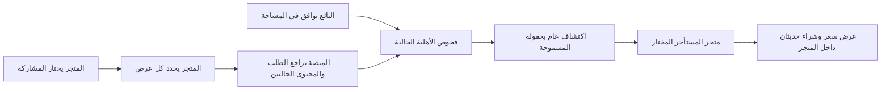

> **دليل التطوير · ١٨ نوفمبر ٢٠٢٦.** تستخدم الصور والجولات حسابات تجريبية محلية. نُفذت ضوابط النشر، ولا يعني ذلك إطلاقًا تجاريًا حيًا أو اعتماد مزودي الخدمة.

الفيديوهات القصيرة أدناه جولات بصور فعلية لشاشات التطوير مع نصوص توضيحية ودون صوت. تتوقف جولات المراجع قبل حفظ القرار.

يتطلب النشر الإنتاجي نطاق متجر HTTPS معتمدًا. قد تستخدم لقطات القبول المحلية عنوان HTTP محليًا دقيقًا؛ ولا يُقبل إلا في التطوير والاختبار، ويُرفض في القراءة والكتابة بالإنتاج.

## خطوات الاستخدام

ابدأ بدورك أدناه. يتصفح العميل العروض العامة، ويختار موظف المتجر النشر، ويتحكم البائع بموافقة المساحة، ويقرر مراجع المنصة أهلية إدراج المحتوى الحالي.

## للمتسوق: اكتشف العرض ثم ادخل متجره

افتح **اكتشف المتاجر** في منصة كارت جوين. تعرض علامة **المتاجر** المتاجر المعتمدة، بما فيها المتاجر التي لم تشارك أي منتجات بعد. اختر **زُر المتجر** لتصفّح متجر. تعرض علامة **المنتجات** السلع التي شاركتها المتاجر، وتعرض علامة **البائعون** البائعين المستقلين الذين يبيعون تلك السلع. اختر **المزيد من المتاجر** أو **المزيد من المنتجات المشاركة** لمتابعة التصفّح.

اختر **عرض في المتجر** لفتح المتجر المختار بلغتك. راجع السعر الحالي والخيارات المتاحة والتوصيل والشروط هناك قبل الشراء. لا يعرض الدليل سعر دفع. استخدم حساب العميل الحالي دون تسجيل جديد لكل متجر.

<SystemScreenshot src="/docs/screenshots/platform-discovery-ar.webp" alt="يعرض اكتشاف كارت جوين منتجات مختارة صراحة واسم متجرها وبائعها مع رابط إلى المتجر لمعرفة السعر الحالي." />

<video style={{ width: "100%", height: "auto" }} controls playsInline preload="none" poster="/docs/screenshots/platform-discovery-ar.webp" aria-label="جولة استكشاف المنتجات والمتاجر والبائعين">
  <source src="/docs/videos/platform-discovery-ar.mp4" type="video/mp4" />
  <track kind="captions" src="/docs/videos/platform-discovery-ar.vtt" srcLang="ar" label="العربية" default />
</video>

<SystemScreenshot src="/docs/screenshots/platform-discovery-ar-handoff.webp" alt="يعرض متجر المستأجر المختار تفاصيل المنتج وخياراته وأسعاره الحالية في معاينة التطوير المحلية." />

لكل متجر سلة ودفع وفاتورة وتوصيل وإرجاع وأرصدة مستقلة. ظهور البائع عبر متجر لا يمنحه اعتمادًا في كل المتاجر. راجع [ملخص مشترياتك الخاص](/ar/features/cross-store-purchases).

## لموظف المتجر: اختر المشاركة والعروض

افتح **الاكتشاف العام** في لوحة متجرك بصلاحية إدارة نشر الاكتشاف.

1. حدد السماح بظهور المتجر وأدخل نطاقه المعتمد عبر HTTPS دون مسار صفحة أو معاملات أو بيانات دخول، ثم احفظ.
2. ابحث عن منتج وحدده واختر **إرسال العرض المختار**. كرر ذلك فقط للمنتجات التي تريد مشاركتها علنًا.
3. راجع القرار والسبب المعروضين. اعتماد المتجر والنطاق مستقل عن اعتماد كل عرض.
4. لمنتج البائع، اطلب موافقة البائع على الاكتشاف داخل المساحة نفسها. اعتماد مشاركته في السوق لا يكفي.

<SystemScreenshot src="/docs/screenshots/tenant-discovery-ar.webp" alt="تفصل ضوابط لوحة المتجر بين موافقة المشاركة واختيار المنتج ونتيجة مراجعة كل عرض." />

<video style={{ width: "100%", height: "auto" }} controls playsInline preload="none" poster="/docs/screenshots/tenant-discovery-ar.webp" aria-label="جولة نشر المتجر في الاكتشاف العام">
  <source src="/docs/videos/tenant-discovery-ar.mp4" type="video/mp4" />
  <track kind="captions" src="/docs/videos/tenant-discovery-ar.vtt" srcLang="ar" label="العربية" default />
</video>

إيقاف مشاركة المتجر يخفي عروضه من الاكتشاف فورًا. يخفي **سحب العرض** العرض المحدد فقط. لا يغير أي منهما المشتريات السابقة أو كتالوج المتجر نفسه. تحتاج إعادة المشاركة أو تغيير النطاق مراجعة متجر جديدة.

إذا رفضت المنصة متجرك، عالج سبب الرفض وأبقِ المشاركة مفعّلة ثم احفظ اختيار المتجر مرة أخرى، حتى إن لم يتغير النطاق. يعود الطلب إلى انتظار المراجعة ويظل مخفيًا حتى اعتماد جديد. حفظ طلب قيد المراجعة أو معتمد دون تغيير لا يعيد بدء مراجعته.

## للبائع: موافقة مستقلة لكل مساحة متجر

اختر مساحة المتجر المعتمدة ثم افتح **الاكتشاف العام**. اسمح بظهور عروضك المؤهلة في هذه المساحة أو اسحب الموافقة واحفظ. تحتاج صلاحية موافقة الاكتشاف. تحتفظ مساحاتك الأخرى باختياراتها المستقلة.

<SystemScreenshot src="/docs/screenshots/vendor-discovery-ar.webp" alt="تخص موافقة البائع مساحة المتجر المعتمدة المختارة وتعرض العروض المختارة المملوكة له فقط." />

<video style={{ width: "100%", height: "auto" }} controls playsInline preload="none" poster="/docs/screenshots/vendor-discovery-ar.webp" aria-label="جولة موافقة البائع على الاكتشاف العام">
  <source src="/docs/videos/vendor-discovery-ar.mp4" type="video/mp4" />
  <track kind="captions" src="/docs/videos/vendor-discovery-ar.vtt" srcLang="ar" label="العربية" default />
</video>

موافقتك تسمح بالنظر في النشر؛ ويظل اختيار المتجر لكل عرض واعتماد المنصة مطلوبين. يخفي سحب الموافقة عروضك من الاكتشاف فورًا، ولا يلغي المشاركة في السوق أو الطلبات أو التزامات التسوية.

## لمراجع المنصة: افحص الطلب الحالي

افتح **الاكتشاف العام** بصلاحية المراجعة. راجع هوية المتجر وتحقق من ملكية النطاق وعرضه محتوى المستأجر الصحيح. افحص المنتج الحالي ومحتواه العام وملكية البائع قبل مراجعة العرض. سجل سببًا واضحًا وأكد التحقق ثم احفظ **اعتماد** أو **رفض / سحب الاعتماد**.

<SystemScreenshot src="/docs/screenshots/admin-discovery-ar.webp" alt="تفصل مراجعة المنصة قرارات نطاق المتجر عن العروض وتحتفظ بأسباب المراجعة وفحوص الأهلية." />

<video style={{ width: "100%", height: "auto" }} controls playsInline preload="none" poster="/docs/screenshots/admin-discovery-ar.webp" aria-label="جولة مراجعة المنصة لنشر الاكتشاف">
  <source src="/docs/videos/admin-discovery-ar.mp4" type="video/mp4" />
  <track kind="captions" src="/docs/videos/admin-discovery-ar.vtt" srcLang="ar" label="العربية" default />
</video>

إذا تغير الطلب أو المنتج أثناء المراجعة، حدّث وافحصه مجددًا. لا يعتمد القرار القديم محتوى بديلًا. تُحفظ قرارات المراجعة. يتطلب تغيير اسم المنتج أو صورته أو رابطه أو بائعه أو إصدار مراجعته أو سعر المتغير أو نشاطه مراجعة عرض جديدة.

## القيود والقرارات

### لماذا قد يختفي عرض معتمد؟

| الفحص | الإجراء المناسب |
|---|---|
| غياب موافقة المتجر أو اعتماده المستقل | احفظ الاختيار المقصود واطلب مراجعة المنصة |
| غياب موافقة البائع أو اعتماد المساحة أو نشاط البائع | صحح المشاركة والموافقة في المساحة نفسها |
| منتج غير منشور أو تغير بعد المراجعة أو بلا خيار متاح في المخزون | صحح الكتالوج والمخزون واطلب مراجعة جديدة بعد التغيير الجوهري |
| متجر معلق أو في الصيانة أو مقيد المبيعات بسبب الفوترة | عالج القيد التشغيلي أو الاشتراك |
| عامل الخلفية لم يحدث العرض بعد | حدّث بعد معالجة العامل واطلب من التشغيل مراجعة الإخفاقات |

يعيد الدليل فحص الأهلية في كل طلب ويخفي العرض القديم أو المسحوب أثناء انتظار العامل. تُجدول المطابقة كل دقيقة بمحاولات محدودة. هذا موعد جدولة وليس ضمان زمن عند توقف العامل. يستطيع المراجع رؤية آخر فحص وحالة التشخيص.

## تدفق البيانات والنتيجة

تبقى اختيارات المتجر والبائع سجلات تشغيل خاصة حتى تسمح المراجعة المستقلة والأهلية الحالية بنشر الحقول العامة المسموحة. ينقل الرابط إلى المتجر المالك للسعر الحديث والشراء داخله. يخفي فشل الفحص العرض العام ويترك المشتريات السابقة دون تغيير.

لا تدخل بيانات العميل الخاصة أو كميات المخزون أو التكلفة أو المستندات أو الكشوف أو ملاحظات التشغيل في حقول الدليل. لا ينشر الاكتشاف كتالوج المتجر كاملًا بصورة تلقائية.
