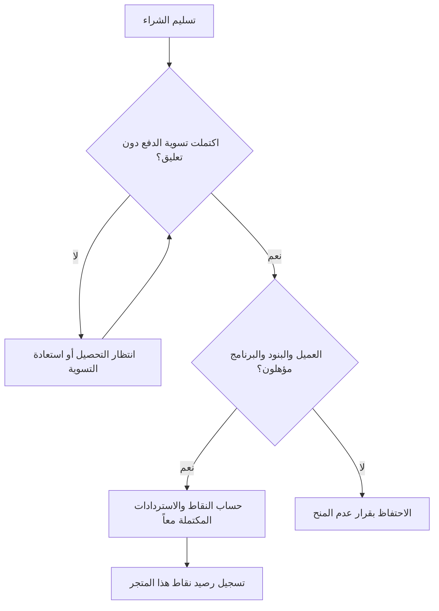

## خطوات الاستخدام

تراجع الإدارة البرنامج والمستويات والحسابات والتعديلات والتقارير. يفتح العميل «حسابي ← الولاء» لمراجعة النقاط وانتهائها ثم يعاين الاستخدام ويطبقه في السلة.

في لوحة إدارة المنصة، افتح نظرة عامة على الولاء لمراجعة النقاط القائمة والمحجوزة والمتاحة والأرصدة السالبة. استخدم محدد المتجر لحصر التقرير، وأزرار التنقل لمراجعة صفوف المتاجر. تشمل بطاقات الإجماليات جميع المتاجر في النطاق المحدد عبر كل الصفحات.

<SystemTour tour="feature-loyalty" compact />

يمكن لمشغّلي المنصة طلب تسوية أرصدة الولاء وتحديث حالة كل تشغيل. تقارن التسوية الرصيد مع سجل النقاط ودفعاتها وحجوزاتها. يمكن للمشغّل الذي يحمل صلاحيتَي التسوية ومراقبة المخاطر بدء التحقيق في التنبيه أو إغلاقه مع تسجيل السبب. تُرد النقاط المصروفة عند إلغاء طلب ممول، ويمكن تسوية نقاط سلعة مرتجعة ممولة بالكامل بنقاط الولاء بصورة مستقلة عن الاسترداد النقدي.

## القيود والقرارات

النقاط ليست رصيداً نقدياً بالمحفظة. معدل الكسب المعروض للمتسوقين يأتي من برنامج ولاء المتجر نفسه، وليس معدلاً ثابتاً. يجب توافق المعاينة مع السياسة الحالية عند التطبيق. لا تستخدم النقاط المحجوزة مجدداً. تعمل النقاط المستبدلة كوسيلة دفع: تخفض المبلغ الواجب دفعه ولا تخفض القيمة الخاضعة للضريبة في الشراء. يحدد التسليم وتسوية الدفع معاً أهلية الكسب. وقد تستهلك مرحلة الإرسال النقاط أو يحررها الإلغاء أو يعدلها الاسترداد.

## متى تظهر النقاط بعد التسليم؟

يمكن استخدام حساب العميل نفسه في متاجر كارت جوين، لكن لكل متجر برنامج ولاء ونقاط مستقلة. متجر التسجيل الأول إحصائية فقط ولا يمنع الكسب في متجر آخر. لا تنتقل النقاط تلقائياً بين المتاجر.

يكتسب الشراء المؤهل النقاط بعد **التسليم الفعلي واكتمال تسوية الدفع** دون تعليق للمراجعة المالية. في الدفع عند الاستلام قد تُسلّم الشحنة بينما يظل الدفع غير محصّل؛ تنتظر النقاط التحصيل والتسوية. لا تمنح عمليات التسليم أو الدفع التجريبية ومشتريات الضيوف والمشتريات المستردة بالكامل نقاطاً حقيقية.

**مثال:** بمعدل نقطة لكل ١٠ وحدات نقدية، يكسب الشراء المؤهل بقيمة ١٠٠ وحدة ١٠ نقاط بعد اكتمال التسليم والتسوية. وفي الدفع عند الاستلام لا تُمنح نقاط بعد. عند اكتمال التسوية، إذا سبق استرداد ٥٠ وحدة، يتبقى ٥ نقاط مؤهلة. لا تكرر تحديثات الدفع أو التسليم منح النقاط. هذا مثال توضيحي للقاعدة وليس صورة لمعاملة حقيقية.

## الاسترداد والنقاط المحجوزة ومكافأة الشراء الأول

قد يخفض تعديل مالي النقاط المكتسبة دون إرجاع وحدات فعلية. يجمع النظام الاستردادات المكتملة ويحسب المكافأة المتبقية وفق قواعد المنح الأصلية وترتيب التقريب الأصلي. وتُستعاد النقاط المستخدمة مقابل الوحدات المرتجعة بصورة مستقلة عن عكس النقاط المكتسبة من الشراء.

يزيل الإرجاع أو الاسترداد الكامل مكافأة الشراء الأول لذلك الطلب مرة واحدة. وإذا منح الشراء الأول مكافأة فقط، فلا يمنح الشراء التالي مكافأة شراء أول جديدة. ولا يعيد تغيير برنامج المتجر منح نقاط إضافية لقرار مكافأة سبق اكتماله.

إذا استُخدمت النقاط بالفعل، يطبق المتجر الحد المضبوط للرصيد السالب. تسدد الأرصدة اللاحقة هذا الدين أولاً. وقد يحرر الاسترداد حجز نقاط السلة إذا لم يعد مدعوماً برصيد كافٍ؛ راجع السلة قبل الدفع. تظل النقاط المرتبطة بشراء آخر محمية. وإذا منع الحد عكس النقاط بالكامل، يتوقف الاستخدام الجديد للنقاط للمراجعة ويُحفظ سجل مخاطر مقيّد الوصول. يستطيع المسؤول المخوّل استئناف الحساب بعد مراجعة التسوية المعلّقة؛ لا يستطيع العميل تجاوز التعليق بإلغاء شراء آخر. ويظل سجل الحركات محفوظاً.

يحمي التسليم الجزئي الفعلي للشحن النقاط المرتبطة بالشراء من التحرير التلقائي. تظل الصلاحية المنتهية محجوزة للمراجعة المالية؛ لا يجدد إثبات الشحن الصلاحية ولا يخصم النقاط تلقائياً. وتظل حجوزات السلة غير المرتبطة بطلب خاضعة للانتهاء المعتاد.

## لمسؤولي المتجر: مراجعات المكافآت الفاشلة

افتح **العملاء ← الولاء ← تقارير الولاء ← مراجعة مكافآت الطلبات**. يستطيع صاحب صلاحية التسوية مراجعة حتى ٥٠ مراجعة فاشلة وعدد المحاولات وموعد المحاولة التالية والحالات التي تحتاج تدخلاً. الشراء غير المدفوع أو غير المسلّم ينتظر أدلة؛ لا يُعرض باعتباره فشلاً تقنياً.

<SystemTour tour="feature-order-reward-checks" compact anchor="reward-check-screen-guide" />

الصورة من شاشة العرض المحلية الفعلية بتاريخ ١٨ نوفمبر ٢٠٢٦. الحالة الفارغة حقيقية ولا تمثل فشل دفع في الإنتاج.

1. راجع سجلات الدفع والتسليم والاسترداد وعالج السبب الأصلي.
2. اختر **طلب مراجعة أخرى**، وأدخل ما تمت مراجعته أو تصحيحه، ثم أكد الطلب.
3. حدّث القسم. تقرأ المهمة الأدلة الحالية دون تحصيل دفع أو تسجيل تسليم أو منح النقاط نفسها مرتين. ويُسجل المسؤول وسبب طلبه للمراجعة.

تتم المعالجة تلقائياً بحد أقصى خمس محاولات للأدلة نفسها. يمكن أن تستأنف الأدلة الجديدة مراجعة منتظرة، لكن تكرار الأحداث نفسها لا يعيد رصيد المحاولات المستنفد. لا يملك العميل أو المورد تشغيل مراجعات المتجر. ويستخدم مسؤولو المنصة مراقبة مخاطر الولاء الحالية؛ لا يغير هذا القسم رصيد العميل يدوياً.

## تدفق البيانات والنتيجة

إصدار البرنامج ← أرصدة مكتسبة وحساب ← معاينة وحجز ← توزيع على الطلبات ← استهلاك أو تحرير ← انتهاء وتعديلات الاسترداد.

## عند حدوث مشكلة

راجع مساحة العمل والصلاحية وحالة السجل وأخطاء الحقول أولاً. إذا ظهرت مهلة بعد إرسال إجراء، افحص السجل وتاريخه قبل إعادة المحاولة. صعّد المشكلة مع اسم الشاشة ومعرف السجل والتوقيت؛ لا تتضمن بيانات الدخول أو أسرار الدفع.

## المراجع وحدود التحقق

كتابة إرشادية مبنية على وثائق الوحدة ومسارات الواجهات ومصدر الخادم. وجود المسار لا يثبت اختبار كل إجراء حياً. راجع [تغطية الشاشات](/ar/coverage) و[مرجع الأدلة](/ar/evidence) للمصادر والحقول. الصور لحسابات عرض محلية ويُذكر تاريخ الالتقاط بجوار كل شرح؛ وهي ليست نتائج إنتاج.

`Modules/Loyalty/` · `documentation/modules/`

مسارات الشاشات ومراجع المصدر

{/* SCREEN_MAP */}
## مواضع الخاصية في الواجهات

وجود المسار يثبت التنقل ولا يمنح كل الإجراءات. قد توجد وظائف إضافية داخل تفاصيل سجل مرتبط.

| Dashboard | Frontend entry paths |
|---|---|
| [admin](/ar/roles/admin) | `/loyalty` |
| [tenant](/ar/roles/tenant) | `/loyalty` |
| [customer](/ar/roles/customer) | `/account/loyalty` |

[المسارات والحقول والحالات من المصدر](/ar/evidence/loyalty)
{/* /SCREEN_MAP */}

