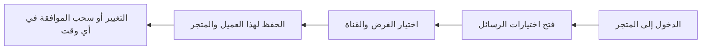

## خطوات الاستخدام

سجّل الدخول إلى المتجر، ثم افتح **الحساب ← الملف الشخصي والعناوين ← اختياراتك للرسائل التسويقية**. اختر البريد الإلكتروني أو الرسائل النصية بشكل مستقل لكل من **عروض المتجر** و**تذكيرات السلة**. يُحفظ كل تغيير فوراً؛ انتظر رسالة «تم حفظ اختيارك لهذا المتجر». إذا فشل الحفظ، يبقى اختيارك السابق دون تغيير.

تبدأ جميع الخيارات متوقفة، ويمكنك إيقافها مجدداً في أي وقت. الموافقة على عروض بالبريد الإلكتروني لا تسمح برسالة نصية أو تذكير بالسلة.

<SystemScreenshot src="/docs/screenshots/customer-marketing-consent-ar.png" alt="لوحة اختيارات العميل للرسائل مع إعدادات مستقلة للعروض وتذكيرات السلة." />

<video controls playsInline preload="none" poster="/docs/screenshots/customer-marketing-consent-ar.png" width="1280" height="720">
  <source src="/docs/videos/customer-marketing-consent-ar-tour.mp4" type="video/mp4" />
  <track src="/docs/videos/customer-marketing-consent-ar.vtt" kind="captions" srcLang="ar" label="العربية" default />
  <track src="/docs/videos/customer-marketing-consent-en.vtt" kind="captions" srcLang="en" label="English" />
</video>

تعرض الجولة المصورة، ومدتها ١٢ ثانية، حالات تجريبية محفوظة بالفعل: جميع الخيارات متوقفة ← السماح بتذكير السلة عبر رسالة نصية ← سحب الموافقة. وهي لقطات متتابعة من النظام المحلي بتاريخ ١٨ نوفمبر ٢٠٢٦، وليست تسجيلاً متصلاً. لم تُرسل أي رسالة. فعّل الترجمة المصاحبة لمتابعة الشرح.

## حساب واحد واختيارات مستقلة

تستخدم حساب عميل CartJoin نفسه في المتاجر المختلفة، لكن لكل متجر اختيارات رسائل مستقلة. موافقتك لدى المتجر الأول لا تمنح المتجر الثاني أي إذن. يظل متجر التسجيل الأول معلومة إحصائية؛ ولا يحدد المتاجر التي يمكنك التسوق منها.

## تدفق البيانات والنتيجة

يُسجّل التغيير المؤكد للمتجر الحالي والعميل والغرض والقناة، مع وقت التغيير ونسخة نص الموافقة التي راجعتها.

## تستمر الرسائل الضرورية

تحديثات الطلبات والإيصالات وإشعارات المدفوعات ورسائل أمان الحساب رسائل ضرورية، وتستمر مستقلة عن اختيارات التسويق. اعتبار إشعار مقروءاً أو الاشتراك في موضوع داخل صندوق الإشعارات لا يمنح موافقة تسويقية.

## القيود والقرارات

يتحكم العميل في اختياراته بنفسه. لا تتيح هذه الشاشة لمسؤولي المنصة أو المتجر أو البائع منح الموافقة نيابة عنه. يسجل النظام التغييرات مع نسخة نص الموافقة ووقتها؛ ولا تكرر محاولات الحفظ المتطابقة سجل التغيير. الحساب المحظور أو المحذوف أو غير النشط أو حساب الضيف غير مؤهل عند فحص الإذن التسويقي.

تحفظ هذه الأدوات التفضيلات ولا تطلق حملة أو ترسل تذكيراً. استعادة السلة وتفعيل مزودي الإرسال عمل منفصل. لا يرسل هذا الإصدار بريداً تسويقياً أو رسائل نصية فعلية. الموافقة إذن للنظر في إرسال رسالة، وليست ضماناً لوصولها.

## عند حدوث مشكلة

إذا تعذر تحميل الاختيارات، اضغط **حاول مرة أخرى**؛ لم تتغير أي موافقة. إذا فشل الحفظ، أعد المحاولة بعد عودة الاتصال. إذا تغير نص الموافقة، حدّث الصفحة وراجعه قبل الاختيار من جديد. تأكد من وجودك في المتجر المقصود قبل تغيير الاختيار.

موضوع مرتبط: [الإشعارات وقوائم المتابعة](/ar/features/notifications).
