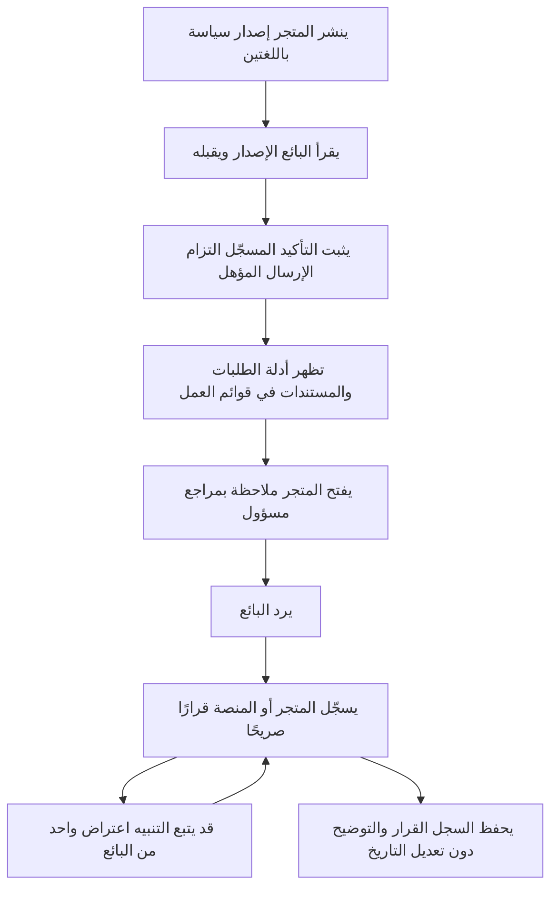

تربط عمليات السوق توقعات خدمة المتجر بقبول البائع والملاحظات المسجّلة والأدلة
الأصلية. افتح **عمليات السوق** في لوحتك؛ يحدد دورك الإجراءات المتاحة. تتوفر هذه
الشاشات في نسخة التطوير المختبرة، ويبقى النشر الحي منفصلًا.

## خطوات الاستخدام

**فريق المتجر:** انشر سياسة بالعربية والإنجليزية تحدد أنواع المستندات المطلوبة
وساعات الإرسال الاختيارية. ينشئ كل نشر إصدارًا ثابتًا؛ اختر متطلبات تستطيع
متابعتها. يقرأ البائع الإصدار الحالي ويقبله داخل مساحة المتجر المختارة. يحتاج
الإصدار اللاحق إلى قبول جديد، ويظل القبول السابق محفوظًا.

افتح حالة لبائع مشارك مؤهل، وحدد المراجع المسؤول واكتب الملاحظة. اختر الطلب أو
المستند المرتبط عند الحاجة. اقرأ الأدلة قبل تسجيل تنبيه أو حل أو صرف النظر عن
الحالة. موعد متابعة الحالة منفصل عن التزام إرسال الطلب.

قبل تفعيل عرض بائع خارجي أو إعادة نشره، يتحقق النظام من قبول سياسة المتجر
الحالية ومستنداتها المطلوبة. يكون الدليل معتمدًا وله ملف محفوظ وساريًا ومؤرخًا
حيث تشترط السياسة ذلك. يوضح منع النشر المتطلب الناقص وتبقى المسودة غير منشورة.
اطلب من البائع قبول السياسة أو تقديم الدليل للمراجعة المخولة. عند غياب سياسة
خدمة تظل قواعد الوضع والاستحقاق والمشاركة مطبقة. لا تفرض شروط بأثر رجعي على
تصحيح العروض النشطة أو المخزون أو إلغاء النشر أو خدمة الطلبات السابقة.

<SystemTour tour="tenant-marketplace-operations" compact />

## الرد أو الاعتراض من لوحة البائع

تحقق من مساحة العمل، ثم افتح **عمليات السوق** واقرأ **السياسة الحالية** قبل
قبولها. تعرض القائمة حالات مؤسستك في هذه المساحة فقط. افتح الحالة واقرأ الحوار
ثم أرسل توضيحًا واضحًا. يحتفظ تحديث الحالة نفسها بمسودتك، وتطلب المغادرة التعامل معها.

يطلب الاعتراض إعادة النظر في تنبيه مسجّل. يسمح باعتراض واحد لكل تنبيه، حتى بعد
حل الحالة؛ وقد يسمح تنبيه جديد باعتراض جديد. لا يعاد الاعتراض على تنبيه صُرف
النظر عنه. بعد الإرسال انتظر المراجعة البشرية؛ لا يعني الإرسال إلغاء التنبيه.

<SystemTour tour="vendor-marketplace-operations" compact />

## مراجعة المنصة وقوائم العمل

**مسؤول المنصة:** تحقق من مرشح المتجر وافتح الحالة واقرأ **سجل الحالة** قبل
القرار. يوضح الاسم والوقت من سجّل كل خطوة. اختر نتيجة صريحة واكتب التوضيح.
تغيير الإسناد إجراء مستقل مسجّل، ويستخدم المراجعين المؤهلين في المتجر المعني.

يحتفظ الموعد غير المعدّل بقيمته المسجّلة بدقة. لتعديله أدخل التاريخ والوقت
المحليين معًا؛ ولإزالته امسحهما معًا. إذا غيّر مراجع آخر الحالة، حدّثها واحتفظ
بمسودتك وأعد النظر وفق آخر مراجعة. لا تنشر المنصة سياسة المتجر ولا تقبلها نيابة عن البائع.

<SystemTour tour="admin-marketplace-operations" compact />

استخدم قوائم العمل لمتابعة تأخر الإرسال، وانتهاء المستندات، والأدلة المطلوبة
غير المكتملة، والمشاركات التي تحتاج متابعة، والعروض قيد المراجعة، والمرتجعات
المفتوحة، واستثناءات المستحقات. افتح السجل الأصلي حيث تتوفر شاشة تفاصيل له.
ظهور السجل سبب للفحص وليس إثباتًا لخطأ البائع. احتفظ بعملة كل مبلغ ولا تجمع عملات مختلفة.

يزول الطلب من قائمة تأخر الإرسال بعد إرسال الطلب كله. يبقى الموعد الأصلي ودليل
الإرسال محفوظين، وتحتاج الحالة المفتوحة قرار مراجعة صريحًا. الإرسال المكتمل
متأخرًا ليس عمل إرسال غير منجز. يتحقق إسناد الإلغاء من هوية الفاعل بالنسبة
لمتجر الطلب أو بائعه أو مشتريه، ولا يستخدم متجر أول تسجيل للعميل.

## القيود والقرارات

- يرى فريق المتجر متجره فقط. يحتاج البائع مساحة عمل معتمدة ونشطة، ويرى مؤسسته
  فقط. يحتاج موظف المنصة صلاحيات العرض والمراجعة. يكون مسؤول الحالة مؤهلًا في متجرها.
- تحتفظ السياسات والقبولات وأحداث الحوار بتاريخها الأصلي. تتطلب المراجعة نتيجة
  صريحة وتوضيحًا من عشرة أحرف على الأقل.
- لا يوقف التنبيه أو صرف النظر البائع، ولا يرد قيمة طلب أو يغير عمولة أو يخصم
  مبلغًا أو يعدّل صرف المستحقات. استخدم الإجراء المصرح به لكل مهمة.
- اعتماد المستند وانتهاؤه ومشاركة المتجر وقبول السياسة ضوابط منفصلة. غياب
  المستند أو التاريخ ليس ضمانًا لصلاحية دائمة.
- تعتمد متابعة الإرسال على سياسة مقبولة قبل تأكيد مسجّل. لا يعيد قبول لاحق
  كتابة التزام قديم. الملصق أو الطرد الواحد لا يثبت إرسال الطلب كله؛ يبقى التاريخ المفقود مجهولًا.
- العروض قيد المراجعة ليست عروضًا مرفوضة. يبقى سجل الرفض ومسار مراجعة النشر
  وربط حالات شركة الشحن بدورة الطلب قيد العمل.

## تدفق البيانات والنتيجة

تبقى كل حالة مرتبطة بمتجرها وبائعها. يوضح سجل الموظفين هوية المراجع التي أمكن
التحقق منها؛ ويعرض سجل البائع أدوار الفرق دون معرفات الموظفين. تعرض القوائم
مراجع آمنة دون بيانات المشترين أو الحسابات البنكية أو ملفات الامتثال. لا تعيد
تغييرات الحالة كتابة الحسابات الأصلية للطلب.

## عند حدوث مشكلة

تحقق من مساحة العمل والصلاحية وإصدار السياسة وحالة الملاحظة. عند تعارض المراجعة
حدّث قبل القرار. تستخدم إعادة المحاولة الإيصال نفسه إذا لم يتغير التوضيح
والقرار. اقرأ التاريخ بعد انقطاع الطلب. يعني إشعار متابعة الطلبات المعلّقة أن
المعالجة لم تكتمل؛ ولا يثبت عدم وجود طلبات متأخرة.

## الأدلة وحدود التحقق

التقطت الصور في ١٨ نوفمبر ٢٠٢٦ باستخدام سياسة وحالة محليتين موضحتين كأمثلة
تجريبية. اختُبر الرد والاعتراض والإسناد وصرف النظر دون اتهام حقيقي أو تغيير مالي
أو اتصال بمزود حي. المقاطع جولات صامتة من صور النظام مع ترجمة، وليست تسجيلًا
حيًا للشاشة. تغطي الاختبارات عزل البيانات ونسخ السياسات والمراجعات والخصوصية؛
وتظل بقية الخارطة في [مراحل التنفيذ](/ar/roadmap/phases).

[دليل المتجر](/ar/roles/tenant) · [دليل البائع](/ar/roles/vendor) ·
[دليل المنصة](/ar/roles/admin) · [مراجعة المستندات](/ar/features/vendors)
