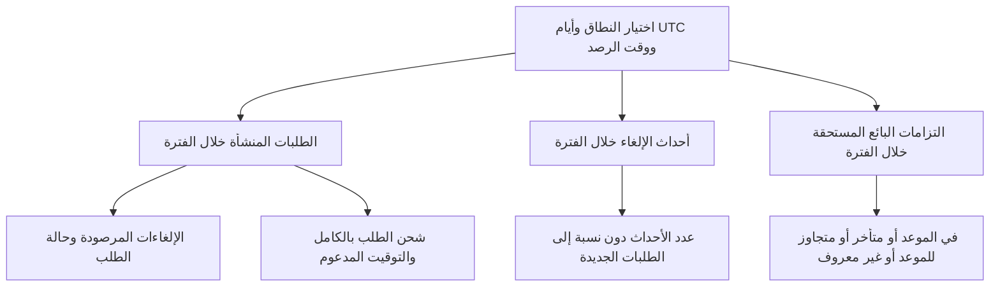

> **نقطة تطوير · ١٩ نوفمبر ٢٠٢٦.** نُفذت التقارير ولوحات الموظفين الثلاث واختُبرت محليًا، بما يشمل التحقق بالمتصفح بالعربية والإنجليزية والتصدير الخاص وعزل مساحات العمل ووصول لوحة المفاتيح على الجوال. تستخدم ٢٤ لقطة فعلية وستة مقاطع مترجمة مدة كل منها ٢٤ ثانية بيانات مصطنعة مضبوطة؛ والمقاطع تسلسلات إرشادية من الصور. يبقى الإطلاق الحي منفصلًا.

## ما الذي يساعدك التقرير على فهمه؟

استخدم التقرير لمتابعة تقدم الطلبات بعد إنشائها، والإلغاءات التي تم رصدها، ومدى الالتزام بمواعيد الشحن التي قبلها البائع. وحدة القياس هي الطلب الفرعي، وليست العميل أو الفاتورة أو الإيراد. قد تنشئ عملية شراء واحدة عدة طلبات فرعية عندما تضم منتجات المتجر ومنتجات بائعين.

يحتفظ العميل بحساب مركزي واحد بين المتاجر. متجر تسجيله الأول لا يحدد ملكية الطلب ولا صلاحية الموظف للاطلاع عليه.

## خطوات الاستخدام

مكان التقرير في لوحة التحكم هو **التقارير ← تشغيل الطلبات**. ابدأ بالتحقق من المتجر أو مساحة عمل البائع المعتمدة. يستطيع مسؤول المنصة اختيار متجر محدد أو عرض الإجمالي العام. يرى المستأجر طلبات متجره، بما فيها منتجاته ومنتجات البائعين. ويرى البائع طلباته الأصلية فقط داخل مساحة العمل المعتمدة الحالية.

1. **تحقق من النطاق.** تأكد من المتجر أو مساحة عمل البائع المحددة قبل قراءة الأعداد.
2. **اختر التواريخ.** حدد مدة لا تتجاوز 93 يومًا شاملًا وفق التوقيت العالمي UTC، وتنتهي بحد أقصى أمس. الاختيار الافتراضي هو آخر 30 يومًا مكتملًا.
3. **اطلب الإنشاء وانتظر النتيجة.** اطلب إنشاء التقرير إذا لم تتوفر نسخة مطابقة. انتظار المهمة أو فشلها لا يعني عدم وجود طلبات.
4. **اقرأ وقت الرصد المحفوظ والتغطية.** ثم قارن الأعداد والنسب المتاحة. صدّر النسخة الخاصة بالنطاق والفترة اللذين تريد مراجعتهما.

لكل نسخة وقت رصد حصري عند 00:00 UTC. مثلًا، وقت رصد 20 نوفمبر يشمل الأدلة المحفوظة قبل بداية ذلك اليوم. لا يتغير الوقت إذا تأخر تنفيذ المهمة. وصول دليل لاحق يحمل تاريخ حدوث قديم لا يعيد كتابة نسخة ذات وقت رصد أسبق.

## ميّز بين مجموعات القياس الثلاث

| المجموعة | ما الذي يدخل فيها؟ | ما السؤال الذي تجيب عنه؟ |
| --- | --- | --- |
| الطلبات المنشأة | الطلبات الفرعية المنشأة خلال الأيام المحددة | ماذا حدث لهذه الطلبات حتى وقت الرصد؟ |
| أحداث الإلغاء | الإلغاءات التي حدثت خلال تلك الأيام، حتى لو كان الطلب أقدم | كم حدث إلغاء وقع خلال الفترة؟ |
| الالتزامات المستحقة | مواعيد الشحن الأصلية المقبولة للبائع والمستحقة خلال الفترة | هل تم الوفاء بهذه الالتزامات المسجّلة؟ |

قد يظهر إلغاء طلب قديم ضمن أحداث الإلغاء دون أن يدخل في مجموعة الطلبات المنشأة خلال الفترة. لا تقسم عدد تلك الأحداث على عدد الطلبات الجديدة.

## مثال عملي: اليوم نفسه في ثلاث لوحات

هذا **مثال تجريبي ببيانات مصطنعة ومضبوطة**، وليس نشاط مبيعات حقيقيًا. الفترة المختارة هي **10 نوفمبر 2026**؛ تاريخا البداية والنهاية هما 10 نوفمبر. ووقت الرصد المحفوظ هو **19 نوفمبر 2026 عند 00:00 UTC، دون تضمين تلك اللحظة**: لا يدخل إلا الدليل المحفوظ قبلها. يحدد اليوم المختار وقت إنشاء الطلبات، بينما يحدد وقت الرصد مقدار ما كان معروفًا عن تاريخها اللاحق.

| لوحة التحكم والنطاق | الطلبات المؤهلة المنشأة في 10 نوفمبر | طلبات منتجات المتجر | طلبات البائعين | الطلبات المنشأة في ذلك اليوم والملغاة حتى وقت الرصد | نسبة الإلغاء المرصودة | أحداث الإلغاء في 10 نوفمبر |
| --- | --- | --- | --- | --- | --- | --- |
| مسؤول المنصة، جميع المتاجر | 9 | 2 | 7 | 2 | 22.22%، أي 2 من 9 | 3 |
| المستأجر، المتجر أ | 8 | 2 | 6 | 2 | 25.00%، أي 2 من 8 | 3 |
| البائع أ، مساحة عمل المتجر أ المعتمدة | 6 | لا تُعرض | 6 | 2 | 33.33%، أي 2 من 6 | 3 |

**لماذا تختلف الأعداد؟** يشمل عرض المنصة طلبًا مؤهلًا إضافيًا من المتجر ب. ويشمل عرض مستأجر المتجر أ طلباته الثمانية فقط. أما البائع أ فيرى طلباته الأصلية الستة داخل المتجر أ. لا يظهر صف طلبات منتجات المتجر في لوحة البائع؛ هذا قيد على نطاق العرض، ولا يعني أن المتجر أ ليس لديه طلبات لمنتجاته. يُستبعد طلب اختباري مثبت من كل مجموعة ينطبق عليها؛ والطلبات الاختبارية المستبعدة لا تُضاف إلى الطلبات المؤهلة.

**لماذا توجد ثلاثة أحداث إلغاء وطلبان ملغيان فقط ضمن مجموعة الإنشاء؟** أُنشئ طلبان من الطلبات الملغاة في 10 نوفمبر. أما الطلب الآخر فأُنشئ في **5 أكتوبر** وأُلغي في **10 نوفمبر**، بعد 36 يومًا. يدخل إلغاؤه في عدد أحداث ذلك اليوم، لكن الطلب نفسه لا يدخل في مقام الطلبات المنشأة فيه. لذلك تكون نسبة الإلغاء للمستأجر **طلبين من 8**، وليست ثلاثة من 8. ويمكن احتساب الإلغاء الأقدم عند مراجعة مجموعة إنشائه الأصلية في أكتوبر.

### نتيجة الالتزام غير المعروفة لا تعني صفرًا

في هذا المثال، لدى المتجر أ والبائع أ **ستة التزامات شحن مقبولة تستحق في 10 نوفمبر**. يُستبعد من تقييم الالتزام إلغاء واحد مثبت قبل الموعد، مع إثبات عدم وجود تسليم سابق للناقل. ومن الالتزامات الخمسة المتبقية، تم اثنان في الموعد، وشُحن واحد متأخرًا، وتجاوز واحد موعده دون شحن كامل مسجّل، وظلت نتيجة واحد غير معروفة.

نسبة الالتزام بالموعد **غير متاحة لأن الأدلة اللازمة غير مكتملة**. ليست النسبة 0%، ولا يكفي ثبوت حالتين في الموعد لنشر تقييم كامل مقداره حالتان من خمس. وتظل طلبات منتجات المتجر أ الاثنتان ضمن تقدم الطلبات والإلغاءات، دون اختراع موعد التزام خاص بالبائع لها.

## تدفق البيانات والنتيجة

تنشئ الفترة المحددة ثلاث مجموعات مستقلة من الأدلة. ويحفظ إنشاء التقرير النتائج المدعومة عند وقت رصد ثابت.

## كيف تقرأ الإلغاءات المرصودة؟

تجيب نسبة الإلغاء عن سؤال: **كم طلبًا من هذه الطلبات المنشأة له إلغاء مثبت حتى وقت الرصد؟** وهي ليست الاحتمال النهائي لإلغاء الطلب. تظل الطلبات المفتوحة ضمن المجموعة، لذلك قد ترتفع النسبة عند اختيار وقت رصد لاحق.

لا يوجد حد يلغي احتساب الإلغاء بعد 30 يومًا. يمكن احتساب إلغاء مثبت بعد 45 يومًا من إنشاء الطلب ضمن مجموعته الأصلية. استرداد المال حدث مالي مستقل، ولا يعني تلقائيًا إلغاء الطلب.

توضح فئات المبادرة بالإلغاء: **العميل، البائع، موظف المستأجر، موظف المنصة، النظام، أو غير معروف**. ملكية البائع للطلب لا تثبت أنه بادر بالإلغاء أو تسبب في المشكلة. الفاعل غير المعروف لا يتحول إلى إجراء من النظام. لا يعرض التقرير أرقام الموظفين أو بيانات العملاء أو تعليقات الإلغاء الخاصة.

يميز التقرير أيضًا الإلغاء قبل التأكيد وبعده، مع فئة مستقلة عندما يتعذر إثبات الترتيب. إذا كان المقام صفرًا أو كانت الأدلة اللازمة ناقصة، تظهر النسبة غير متاحة، وليست 0%.

## كيف تقرأ حالة الطلب والشحن؟

تعرض حالة الطلب وضعه عند وقت الرصد: مفتوح، أو في حالة نهائية حينها، أو غير معروف. الحالة النهائية وصف للسجل في ذلك الوقت، وليست وعدًا بعدم وجود إرجاع أو استرداد لاحق.

يتطلب إثبات شحن الطلب بالكامل دليلًا محفوظًا يغطي كامل الكمية المطلوبة. ملصق الشحن أو شحن طرد واحد أو وقت التسليم وحده لا يثبت توقيت شحن الطلب بالكامل.

افصل بين وجود دليل على شحن الطلب بالكامل ومعرفة توقيته الدقيق. قد يتوفر الدليل ويظل التوقيت غير معروف. غياب الدليل يختلف عن وجود إثبات بأن الشحن لم يكتمل.

تعرض ملخصات الزمن العينات المدعومة من إنشاء الطلب إلى الشحن ومن تأكيده إلى الشحن. تحقق من عدد العينات بجوار الوسيط والمئين التسعين. تُقرب المدد إلى أسفل لأقرب ثانية كاملة، وتُحسب المئينات بطريقة الرتبة الأقرب. غياب الساعة اللازمة لا يتحول إلى مدة صفرية.

## كيف تقرأ التزامات شحن البائع؟

تستخدم هذه المجموعة الالتزامات **المستحقة خلال الفترة**، وليس الطلبات المنشأة خلالها. وتقارن السياسة والموعد الأصليين اللذين قبلهما البائع بأدلة الشحن المحفوظة. لا يوجد وعد موحد بالشحن خلال 48 ساعة.

تظل طلبات منتجات المتجر ظاهرة في تقدم الطلبات والإلغاءات، لكنها غير خاضعة لهذا القياس الخاص بالتزامات البائع؛ فلا يوجد حاليًا إعداد التزام شحن لطلبات المتجر نفسه. تقدير مدة التوصيل القابل للتعديل ليس موعدًا نهائيًا للشحن. وقد يكون طلب البائع غير مراقب أيضًا عند غياب دليل السياسة المقبولة أو التأكيد، أو عند تعطيل ساعة الالتزام.

| النتيجة | المعنى |
| --- | --- |
| في الموعد | ثبت شحن الطلب بالكامل عند الموعد الأصلي أو قبله. |
| شحن متأخر | ثبت شحن الطلب بالكامل بعد الموعد. |
| تجاوز الموعد دون شحن مسجّل | انقضى الموعد دون إثبات شحن الطلب بالكامل؛ وقد يشمل طلبًا أُلغي لاحقًا. |
| إلغاء قبل الاستحقاق | ثبت الإلغاء قبل الموعد أو عنده، مع إثبات عدم وجود تسليم سابق للناقل؛ ويُستبعد من تقييم الالتزام. |
| غير معروف | لا تكفي الأدلة لإثبات نتيجة عادلة أو ترتيب الأحداث. |

الإلغاء بعد الموعد لا يمحو تجاوزًا وقع بالفعل. وعندما يتعذر إثبات ترتيب حدثين في التوقيت نفسه، تظل النتيجة غير معروفة. عدم وجود التزامات مؤهلة يعني أن النسبة غير متاحة، وليس أداءً مثاليًا.

هذه المقاييس لا تفرض عقوبة تلقائية على البائع، ولا تغير ترتيبه، ولا توقف مستحقاته، ولا تعدل اعتماده.

## تحقق من تغطية الأدلة قبل اتخاذ قرار

اقرأ التغطية والإتاحة قبل تفسير النسبة. بدء حفظ الأدلة لا يعيد بناء حالات الطلب أو ملكيته أو شحنه القديمة من بيانات اليوم القابلة للتعديل. يجب أن يظل غياب وقت الإنشاء أو الالتزام الأصلي وتعارض الأدلة المادية وحدود القراءة ظاهرًا.

تُستبعد الأنشطة الاختبارية بأدلة موثوقة ومحفوظة من الدفع أو الشحن. يمكن إدراج الطلب غير المدفوع أو الدفع عند الاستلام ضمن الطلبات التشغيلية؛ اكتمال الدفع ليس شرطًا. فشل محاولة دفع اختبارية وحده لا يستبعد طلبًا حقيقيًا مستقلًا.

استخدم الأعداد المدعومة للتحقق من المشكلة عندما تكون الأدلة ناقصة، واترك النسب غير المتاحة كذلك. الدليل غير المعروف لا يعني عدم وجود نشاط أو نجاح التسليم أو خطأ البائع.

## شرح الاستخدام لكل لوحة

اتبع خطوات لوحة التحكم الخاصة بك باستخدام المثال التجريبي السابق. ابدأ بالنطاق، ثم الطلبات المنشأة والإلغاءات، وأخيرًا أدلة الشحن والالتزامات المقبولة.

التقطت هذه الشاشات المحلية الفعلية في ١٩ نوفمبر ٢٠٢٦. كل مقطع مدته ٢٤ ثانية هو تسلسل إرشادي من الصور بنصوص توضيحية، وليس تسجيلًا متصلًا أو نشاطًا تجاريًا حيًا.

### مسؤول المنصة: قارن المتاجر دون خلط مجموعات القياس

ابدأ بالنطاق المحدد. يعرض المثال العام **9 طلبات مؤهلة منشأة وإلغاءين مرصودين بنسبة 22.22%**. وطلبا منتجات المتجر وطلبات البائعين السبعة كلها أعداد طلبات فرعية. عند تضييق النطاق إلى المتجر أ، يصبح عدد الطلبات المنشأة 8؛ لا يعني ذلك اختفاء طلب. راجع مجموعة أحداث الإلغاء المستقلة قبل تفسير عددها، وهو 3. استخدم عرض متجر محدد للتحقق من عملياته، واترك نتائج الالتزام غير المعروفة ظاهرة.

<SystemTour tour="feature-order-operations-admin" anchor="order-operations-admin-walkthrough" />

### المستأجر: راجع سير العمل في متجرك

تأكد من اختيار المتجر أ، ثم اقرأ **طلباته الثمانية المؤهلة: طلبان لمنتجات المتجر وستة طلبات للبائعين**. ينتج عن **الإلغاءين المرصودين نسبة 25.00%** لهذه المجموعة. راجع من بادر بالإلغاء وحالة الطلب لتحديد ما يحتاج إلى متابعة؛ ملكية البائع للطلب لا تعني تلقائيًا أنه تسبب في الإلغاء. تحقق من دليل الشحن وعدد عينات التوقيت قبل مقارنة السرعة. ويشمل العدد المستقل لأحداث الإلغاء، وهو 3، الطلب الأقدم المنشأ في أكتوبر.

<SystemTour tour="feature-order-operations-tenant" anchor="order-operations-tenant-walkthrough" />

### البائع: راجع مساحة عملك المعتمدة فقط

تأكد أولًا من مساحة عمل المتجر أ المعتمدة. يرى البائع أ **ستة طلبات مؤهلة تخصه وإلغاءين مرصودين بنسبة 33.33%**. طلبات منتجات المتجر وطلبات البائعين الآخرين خارج نطاق هذا العرض؛ وغياب صف طلبات منتجات المتجر مقصود. راجع التزاماتك المقبولة المستحقة وسبب أي نتيجة غير معروفة. لا تكشف هذه الأعداد نشاط العملاء في المتاجر الأخرى، ولا تفرض النتيجة غير المعروفة عقوبة تلقائية.

<SystemTour tour="feature-order-operations-vendor" anchor="order-operations-vendor-walkthrough" />

## القيود والقرارات

صلاحيات العرض والإنشاء والتصدير مستقلة. يرتبط التصدير بالموظف الذي طلبه، ويستخدم رابطًا خاصًا تنتهي صلاحيته بعد 24 ساعة. تُراجع الصلاحيات واعتماد مساحة عمل البائع عند تنفيذ المهمة وعند تنزيل الملف.

تغيير النطاق أو التواريخ يتطلب النسخة المطابقة. لا تقارن عنوان فترة جديدة بنتائج نسخة قديمة. مجموع الطلبات الفرعية على مستوى المنصة لا يمثل عدد العملاء الفريدين.

## أدلة مرتبطة

- [عمليات السوق](/ar/features/marketplace-operations): السياسات والقبول والحالات التشغيلية الفردية.
- [التجهيز والتعبئة](/ar/features/packing) و[الشحن](/ar/features/shipping): العمل الفعلي الذي تنتج عنه أدلة الشحن.
- [التقارير](/ar/features/reports): صلاحيات التقارير والتصدير.
- [مجموعات العملاء](/ar/features/customer-cohorts) و[مسار التسوق](/ar/features/shopping-funnel): مجموعات وأسئلة أعمال مختلفة.

[أدلة المصدر وحدود الواجهات](/ar/evidence/order-operations).
