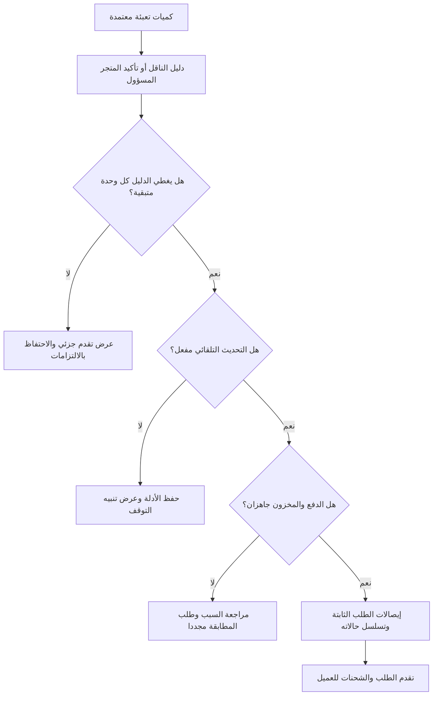
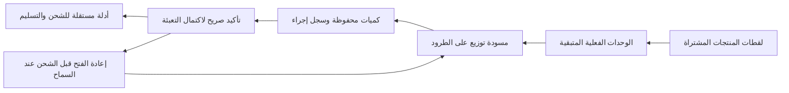

## وظيفة الشاشة

افتح الطلب ← **التعبئة والطرود**. يعمل مشغّل المتجر داخل متجره، ويعمل المورد
داخل مساحة المتجر المعتمدة والمختارة وعلى طلبات البائع الخاصة به. يستطيع مسؤول
المنصة الاطلاع على التعبئة دون تعديلها. تحقّق من المتجر والبائع ورقم الطلب أولًا.

تحدّد التعبئة **الوحدات الموجودة داخل كل طرد**. تأكيدها لا يحجز شركة شحن، ولا
يشحن الطلب، ولا يثبت التسليم، ولا يحصّل دفعة مالية.

## خطوات الاستخدام

1. قارن **الوحدات المشتراة** و**الوحدات المستردّة** و**المتبقي المطلوب**. تقلّل
   الوحدات المستردّة التي تمت تسويتها فقط الكمية المطلوب تعبئتها. التعديل المالي
   وحده لا يحذف وحدة من الطرد.
2. افحص **طرود الطلب**. عند امتلاك صلاحية إنشاء الطرود، اختر **إضافة طرد فارغ**
   واقرأ التأكيد. ينشئ ذلك طردًا بلا حجز شحن أو توزيع وحدات. إذا كانت نتيجة
   الإنشاء غير مؤكّدة، حدّث وافحص القائمة قبل إضافة طرد آخر.
3. اختر **إضافة توزيع**، وحدّد الطرد والمنتج المشترى، وأدخل كمية صحيحة موجبة.
   يمكنك تقسيم وحدات المنتج على طرود مختلفة. يُسمح بسطر واحد لكل منتج داخل
   الطرد نفسه، ولا يجوز تجاوز الكمية المتبقية.
4. اكتب توضيحًا من ١٠ إلى ٤٬٠٠٠ حرف، واختر **حفظ مسودة التعبئة**. يُسمح
   بالمسودة الجزئية. تحقّق من الإصدار والسجل الجديدين. حذف كل التوزيعات وحفظها
   يُفرغ المسودة عمدًا، ولا يحذف الطرد.

## التأكيد وإعادة الفتح وإلغاء الطرد

يتاح **تأكيد اكتمال التعبئة** بعد حفظ توزيع كل الوحدات المتبقية واحتواء كل طرد
نشط على منتج. راجع الكميات المحفوظة، واكتب توضيحًا جديدًا، ثم أكّد. احفظ أي
تعديلات غير محفوظة أولًا.

يُثبّت التأكيد هذا الإصدار. قبل تسليم أي طرد للشحن، يستطيع مشغّل مخوّل كتابة
السبب واختيار **إعادة فتح التعبئة**. تبقى السجلات السابقة متاحة. لا يمكن إضافة
طرود جديدة إلى سجل تعبئة مؤكّد قبل إعادة فتحه.

للطرد غير المستخدم، اكتب السبب واختر **إلغاء طرد غير مستخدم** واقرأ التأكيد.
يبقى الطرد في السجل وتُحذف توزيعاته الحالية. لا يمكن إلغاء طرد سبق تسليمه للشحن
أو حجزه بهذه الطريقة. هذا الإجراء لا يلغي حجز شركة الشحن ولا يحذف ملف ملصق خاص.

## العمل مع مشغّل آخر بأمان

إذا تغيّر الطلب أو أحد الطرود أو التتبع أو الوحدات المستردّة بعد قراءتك، فقد
يرفض الخادم الإجراء القديم. تبقى الكميات والتوضيح في الشاشة. اختر **تحديث من
الخادم**، ووافق على استبدال الكميات غير المحفوظة عند السؤال، ثم راجع السجل الحالي.
يحتفظ التحديث بالتوضيح، ولا يطبّق الكميات القديمة تلقائيًا على الإصدار الجديد.

بعد انقطاع استجابة الحفظ، تعيد المحاولة دون تغيير استخدام سجل الإجراء نفسه.
تغيير التوضيح أو الكميات ينشئ إجراءً مختلفًا. افحص **سجلات التعبئة** بدل افتراض
أن انتهاء مهلة الاستجابة يعني عدم تسجيل شيء.

<SystemTour tour="packing-manifest" compact />

## قراءة دليل شركة الشحن بصورة مستقلة

يُحدّث التبديل بين العربية والإنجليزية شرح جاهزية التعبئة دون تحديث السجل
أو استبدال الكميات والتوضيح غير المحفوظين.

تعني عبارة **دليل التسليم للشحن محفوظ** بقاء الرصد بصورة مستقلة عن حالة الطرد
القابلة للتعديل. تغيير الحالة لا يجعل الطرد الذي سُلّم للشحن غير مستخدم مجددًا.
يبقى الدليل المحفوظ مانعًا لإعادة الفتح أو الإلغاء. وقد يتطلب الرصد الجديد تحديث
نسخة التعبئة القديمة قبل إرسال إجراء آخر.

تُعرّف عبارة **رصد تجريبي — لم ينفّذ إجراء شحن فعلي** رصدًا من محوّل اختبار محلي.
لا تثبت حجز شركة شحن فعليًا أو تسليمًا أو سدادًا. تظهر التنبيهات نفسها للمتجر
والمورد والمنصة ضمن صلاحيات كل طرف. قد تكون كميات التعبئة للقراءة فقط بينما
يبقى إجراء آخر للطرود متاحًا بصلاحية منفصلة.

أصبح رصد شركة الشحن الموثّق وتأكيد المتجر الصريح جزءًا من جاهزية تنفيذ الطلب
الكامل. يبقى التحديث التلقائي للحالة متوقفًا إلى حين اعتماد بوابة الإصدار.
تحديث طرد واحد لا يثبت شحن كل الوحدات أو تحصيل الدفع عند الاستلام.

<SystemTour tour="carrier-evidence" compact />

## فهم التنفيذ الجزئي

تعرض لوحة **التنفيذ الفعلي للطلب** الوحدات المطلوبة والوحدات المسلّمة للناقل
والوحدات التي استلمها العميل. مثلاً، **استلام وحدة واحدة من ثلاث** يعني وجود
دليل مؤهل لوحدة واحدة، مع انتظار تأكيد الوحدتين الأخريين. لا يعني ذلك تسليم
الطلب بالكامل. قارن كمية كل شحنة ونتيجتها الفعلية. يبقى وقت التسليم للناقل
غير معروف عندما يثبت المصدر الاستلام فقط دون معرفة وقت التسليم السابق للناقل.

يبقى تنبيه **دليل اختبار** ظاهرًا للأمثلة التجريبية. لا تكمل أرصاد الاختبار
النقص في أدلة التسليم الحقيقي. تعني عبارة **التحديث التلقائي متوقف** حفظ الأدلة
وانتظار تفعيل التحديث وجاهزية الطلب؛ ولا تعني فشل الحفظ.

<SystemTour tour="physical-fulfillment" compact />

## تسجيل تأكيد يتحمل المتجر مسؤوليته

يمكن لمراجع المتجر ذي صلاحية التأكيد الفعلي المنفصلة استخدام **تسجيل تأكيد
المتجر** بعد اعتماد التعبئة الكاملة:

1. افحص الشحنة وإثبات الاستلام الفعلي أو مستند التسليم للناقل.
2. اختر الشحنة والنتيجة الصحيحتين: **تم التسليم للناقل** أو **استلم العميل**.
3. أدخل الوقت الفعلي المعروف بتوقيتك المحلي. لا تضع الوقت الحالي مكان وقت
   تاريخي مجهول للتسليم للناقل.
4. اختر صراحةً واقعة حقيقية أو واقعة اختبار، واكتب من ١٠ إلى ٤٬٠٠٠ حرف توضح
   كيف تحققت من الواقعة.
5. اختر **حفظ التأكيد الفعلي** وراجع الأعداد المحدثة. تعيد المحاولة المطابقة
   للسجل نفسه التأكيد الأصلي.

يستطيع المورد متابعة شحناته وتعبئة الكميات المشتراة التابعة له؛ لكن ادعاءه
اليدوي لا يقوم مقام التأكيد المستقل للمتجر. اطلاع المنصة للقراءة فقط. لم تعد
قائمة تغيير حالة الطلب العامة تعرض الشحن أو التسليم؛ استخدم مسار الأدلة.
لا يعتمد التأكيد تحويلًا بنكيًا ولا يحصّل الدفع عند الاستلام، ولا يغيّر البائع
المحفوظ عند الشراء أو ينقل الوحدات بين الشحنات بعد التسليم للناقل.

## معالجة التوقف وإعادة المحاولة

اقرأ حالة المطابقة والتوضيح أولًا. نقص أدلة الشحنة يتطلب تحققًا فعليًا، بينما
تحتاج مشكلة الدفع أو المخزون إلى مراجعة المتجر. بعد معالجة السبب، يستطيع
مشغل مخوّل بصلاحية منفصلة كتابة توضيح واختيار **طلب المطابقة مجددًا**. تبقى
الأدلة ولقطة الإخفاق السابق وإيصال إعادة المحاولة محفوظة. حدّث السجل المتعارض
بعد مراجعة واعية بدل تكرار إجراءات معدلة من إصدار قديم.

بمجرد حفظ دليل تسليم أي شحنة للناقل، يُمنع الإلغاء وبدء محاولة دفع بديلة حتى
إذا بقيت حالة الطلب الكامل «مؤكد». تبقى حجوزات المخزون والأرصدة المرتبطة
التزامات للمراجعة؛ لا يسمح انتهاء مدتها بتحرير وحدات شُحنت بالفعل. تابع مع
المتجر عبر مسار التصحيح أو الإرجاع أو التسوية المناسب.

## القيود والقرارات

- الاطلاع على الشحنات وإنشاء الطرود وإدارة التعبئة صلاحيات منفصلة. قد يستطيع
  الحساب قراءة السجل دون تعديله.
- اطلاع المنصة للقراءة فقط. يرى العميل معلومات تتبع الطرد دون توضيحات التعبئة
  أو سجل الموظفين أو الإجراءات الداخلية.
- لا تبدأ تعبئة جديدة لطلب معلق أو ملغى أو مسترد أو تم تسليمه. قد تمنع مراجعة
  التسوية أو الدفعة الفاشلة أو المستردّة العمل أيضًا. يحتفظ الطلب المؤهّل غير
  المدفوع بحالته المالية عند تأكيد التعبئة.
- بيانات الشحن القديمة لا تصبح دليلًا تاريخيًا موثوقًا بمجرد فتح الشاشة. لا
  يستطيع المورد تحويل تسليم سابق للشحن إلى خطة تعبئة جديدة.
- تظهر التوضيحات لمشغّلي المتجر والمورد والمنصة المخوّلين. لا تضع بيانات التواصل
  مع العميل أو المستندات الخاصة فيها.

## تدفق البيانات والنتيجة

يتطلب تحديث الطلب الكامل تعبئة معتمدة وأدلة مؤهلة لكل وحدة متبقية وجاهزية
مالية. التعبئة وحدها لا تحصّل الدفع ولا تمنح النقاط. يبقى المنسق التلقائي
متوقفًا في بيئة التطوير.

تابع إلى [إعداد الشحن والتتبع](/ar/features/shipping) أو
[ملصقات المزود والشحن التجريبي](/ar/features/shipping-providers).
