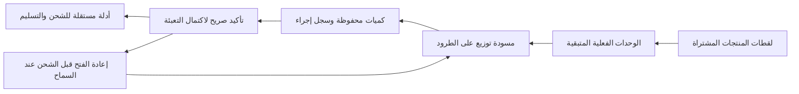

## وظيفة الشاشة

افتح الطلب ← **التعبئة والطرود**. يعمل مشغّل المتجر داخل متجره، ويعمل المورد
داخل مساحة المتجر المعتمدة والمختارة وعلى طلبات البائع الخاصة به. يستطيع مسؤول
المنصة الاطلاع على التعبئة دون تعديلها. تحقّق من المتجر والبائع ورقم الطلب أولًا.

تحدّد التعبئة **الوحدات الموجودة داخل كل طرد**. تأكيدها لا يحجز شركة شحن، ولا
يشحن الطلب، ولا يثبت التسليم، ولا يحصّل دفعة مالية.

## خطوات الاستخدام

1. قارن **الوحدات المشتراة** و**الوحدات المستردّة** و**المتبقي المطلوب**. تقلّل
   الوحدات المستردّة التي تمت تسويتها فقط الكمية المطلوب تعبئتها. التعديل المالي
   وحده لا يحذف وحدة من الطرد.
2. افحص **طرود الطلب**. عند امتلاك صلاحية إنشاء الطرود، اختر **إضافة طرد فارغ**
   واقرأ التأكيد. ينشئ ذلك طردًا بلا حجز شحن أو توزيع وحدات. إذا كانت نتيجة
   الإنشاء غير مؤكّدة، حدّث وافحص القائمة قبل إضافة طرد آخر.
3. اختر **إضافة توزيع**، وحدّد الطرد والمنتج المشترى، وأدخل كمية صحيحة موجبة.
   يمكنك تقسيم وحدات المنتج على طرود مختلفة. يُسمح بسطر واحد لكل منتج داخل
   الطرد نفسه، ولا يجوز تجاوز الكمية المتبقية.
4. اكتب توضيحًا من ١٠ إلى ٤٬٠٠٠ حرف، واختر **حفظ مسودة التعبئة**. يُسمح
   بالمسودة الجزئية. تحقّق من الإصدار والسجل الجديدين. حذف كل التوزيعات وحفظها
   يُفرغ المسودة عمدًا، ولا يحذف الطرد.

## التأكيد وإعادة الفتح وإلغاء الطرد

يتاح **تأكيد اكتمال التعبئة** بعد حفظ توزيع كل الوحدات المتبقية واحتواء كل طرد
نشط على منتج. راجع الكميات المحفوظة، واكتب توضيحًا جديدًا، ثم أكّد. احفظ أي
تعديلات غير محفوظة أولًا.

يُثبّت التأكيد هذا الإصدار. قبل تسليم أي طرد للشحن، يستطيع مشغّل مخوّل كتابة
السبب واختيار **إعادة فتح التعبئة**. تبقى السجلات السابقة متاحة. لا يمكن إضافة
طرود جديدة إلى سجل تعبئة مؤكّد قبل إعادة فتحه.

للطرد غير المستخدم، اكتب السبب واختر **إلغاء طرد غير مستخدم** واقرأ التأكيد.
يبقى الطرد في السجل وتُحذف توزيعاته الحالية. لا يمكن إلغاء طرد سبق تسليمه للشحن
أو حجزه بهذه الطريقة. هذا الإجراء لا يلغي حجز شركة الشحن ولا يحذف ملف ملصق خاص.

## العمل مع مشغّل آخر بأمان

إذا تغيّر الطلب أو أحد الطرود أو التتبع أو الوحدات المستردّة بعد قراءتك، فقد
يرفض الخادم الإجراء القديم. تبقى الكميات والتوضيح في الشاشة. اختر **تحديث من
الخادم**، ووافق على استبدال الكميات غير المحفوظة عند السؤال، ثم راجع السجل الحالي.
يحتفظ التحديث بالتوضيح، ولا يطبّق الكميات القديمة تلقائيًا على الإصدار الجديد.

بعد انقطاع استجابة الحفظ، تعيد المحاولة دون تغيير استخدام سجل الإجراء نفسه.
تغيير التوضيح أو الكميات ينشئ إجراءً مختلفًا. افحص **سجلات التعبئة** بدل افتراض
أن انتهاء مهلة الاستجابة يعني عدم تسجيل شيء.

<SystemTour tour="packing-manifest" compact />

## القيود والقرارات

- الاطلاع على الشحنات وإنشاء الطرود وإدارة التعبئة صلاحيات منفصلة. قد يستطيع
  الحساب قراءة السجل دون تعديله.
- اطلاع المنصة للقراءة فقط. يرى العميل معلومات تتبع الطرد دون توضيحات التعبئة
  أو سجل الموظفين أو الإجراءات الداخلية.
- لا تبدأ تعبئة جديدة لطلب معلق أو ملغى أو مسترد أو تم تسليمه. قد تمنع مراجعة
  التسوية أو الدفعة الفاشلة أو المستردّة العمل أيضًا. يحتفظ الطلب المؤهّل غير
  المدفوع بحالته المالية عند تأكيد التعبئة.
- بيانات الشحن القديمة لا تصبح دليلًا تاريخيًا موثوقًا بمجرد فتح الشاشة. لا
  يستطيع المورد تحويل تسليم سابق للشحن إلى خطة تعبئة جديدة.
- تظهر التوضيحات لمشغّلي المتجر والمورد والمنصة المخوّلين. لا تضع بيانات التواصل
  مع العميل أو المستندات الخاصة فيها.

## تدفق البيانات والنتيجة

يبقى الربط الآلي بين دليل شركة الشحن وحالة الطلب الكامل عملًا تنفيذيًا منفصلًا.
لا يعد هذا الدليل بأن تأكيد التعبئة يغيّر حالة الطلب أو يفعّل نقاط الولاء أو
التسوية أو السداد.

تابع إلى [إعداد الشحن والتتبع](/ar/features/shipping) أو
[ملصقات المزود والشحن التجريبي](/ar/features/shipping-providers).
