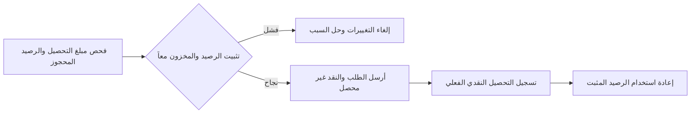

## خطوات الاستخدام

يختار العميل طريقة مفعلة عند الشراء. للتحويل البنكي يرفع الإثبات وينتظر المراجعة. تراجع إدارة المتجر الدفع والدليل قبل القبول أو الرفض. يسجل التحصيل عند الاستلام بعد حدوثه فعلياً فقط.

في المتاجر المصرية المشتركة في Paymob تعرض خطوة الدفع الخيارات المستضافة التي أعدها المتجر. اختر Paymob، ثم أرسل الطلب وانتقل إلى صفحة الدفع المستضافة. يعتمد توافر valU وSympl وApple Pay على إعداد المتجر وأهلية المشتري. يستخدم الزائر الدفع عند الاستلام. تجنّب إظهار بيانات اعتماد البوابة في الإيصالات أو الصور أو رسائل الدعم.

إذا فعّل المتجر حفظ البطاقات لدى باي موب، يمكنك اختيار حفظ بطاقتك هناك. عند الشراء مجدداً بعد تسجيل الدخول، قد يعرض باي موب البطاقات المحفوظة في آخر عملية دفع مستضافة ومكتملة لدى المتجر وحساب التاجر نفسه. إن لم تظهر بطاقة، أدخل بياناتها في صفحة باي موب.

على جهاز مدعوم، يمكن للعميل المسجّل الدخول في متجر مفعّل اختيار التوصيل ثم **مراجعة الطلب باستخدام آبل باي**. راجع العنوان والمبلغ قبل تأكيد الطلب وإتمام الدفع لدى باي موب.

### متابعة الدفع لفاتورة قائمة

افتح صفحة التأكيد أو **حسابي ← الفواتير والطلبات ← الفاتورة** واختر **متابعة الدفع** إذا كان الخيار متاحًا. إذا كان النظام يتحقق من نتيجة المحاولة السابقة، اختر **التحقق من حالة الدفع**. عند طلب إثبات تحويل بنكي، اختر **رفع الإثبات** وانتظر مراجعة المتجر.

إذا كان ملف الفاتورة قيد التجهيز، أعد محاولة تنزيله بعد قليل.

<SystemTour tour="feature-checkout" compact startAt={2} />

<SystemTour tour="feature-payments" compact />

جولة تفصيلية للخطوات

<SystemTour tour="customer" compact startAt={2} />

## القيود والقرارات

يتطلب نجاح الدفع الإلكتروني إشعاراً موثقاً من المزود ولا يكفي رجوع المتصفح. يتطلب التحويل إثباتاً ومراجعة، ويعيد الرفض الحالة لانتظار التأكيد. لا يحتاج الدفع عند الاستلام إثبات تحويل. ترفض البوابة غير المفعلة أو غير المدعومة دون استبدال صامت.

## الدفع عند الاستلام مع رصيد المحفظة أو بطاقات الهدايا أو النقاط

الرصيد الداخلي وتحصيل النقد خطوتان منفصلتان. عند تجهيز طلب مؤهل للدفع عند
الاستلام للإرسال، يثبت النظام خصم رصيد المحفظة وقيمة بطاقات الهدايا والنقاط
المحجوزة مع تجهيز المخزون في معاملة واحدة. إذا فشل تجهيز المخزون، تُلغى هذه
التغييرات. لا يخصم تكرار الخطوة أو تسجيل النقد لاحقاً الرصيد مرة أخرى. يمنع
الحجز المنتهي أو غير المطابق الإرسال؛ اطلب من المتجر حل السبب دون تغيير مبلغ
الشراء المتفق عليه.

إذا تعذر تقسيم عدد قليل من النقاط مرتفعة القيمة بين البائعين دون ضياع جزء من
الخصم، يتوقف الشراء قبل التحصيل. أزل استخدام النقاط للمتابعة أو اشتر منتجات
كل بائع على حدة.

يبقى الدفع عند الاستلام **بانتظار التحصيل** حتى يسجل مسؤول مخوّل التحصيل
الفعلي. إثبات التحويل البنكي المنتظر للموافقة لا يُعامل كدفع عند الاستلام.
بعد الإرسال، لا يمكن استبدال التحصيل المسجل بطريقة أو محاولة دفع جديدة، حتى
لو أُعيدت حالة الطلب القابلة للتعديل. تواصل مع المتجر للتسوية. لا يستطيع
البائع اعتماد دفعة العميل بمجرد تغيير حالة الشحن.

في تجربة مصر، يسجل المتجر تحصيل النقد من العميل ويطابق تحويل شركة الشحن في خطوة مستقلة. يستطيع البائع متابعة سجل تسوياته. يظل تحصيل بوسطة وتحويلاتها الفعلية بانتظار اعتماد التجربة.

## تدفق البيانات والنتيجة

مبلغ الفاتورة ← نية الدفع ← تحقق المزود أو اعتماد موظف مسمى ← حالة الدفع ← تحديث الفاتورة ودفع الطلبات التابعة. تبقى ملفات الإثبات محمية.

## عند حدوث مشكلة

راجع مساحة العمل والصلاحية وحالة السجل وأخطاء الحقول أولاً. إذا ظهرت مهلة بعد إرسال إجراء، افحص السجل وتاريخه قبل إعادة المحاولة. صعّد المشكلة مع اسم الشاشة ومعرف السجل والتوقيت؛ لا تتضمن بيانات الدخول أو أسرار الدفع.

## المراجع وحدود التحقق

كتابة إرشادية مبنية على وثائق الوحدة ومسارات الواجهات ومصدر الخادم. وجود المسار لا يثبت اختبار كل إجراء حياً. راجع [تغطية الشاشات](/ar/coverage) و[مرجع الأدلة](/ar/evidence) للمصادر والحقول. الصور توضيح لحسابات العرض بتاريخ 17 نوفمبر 2026 وليست بيانات إنتاج.

`Modules/Payment/` · `documentation/modules/`

مسارات الشاشات ومراجع المصدر

{/* SCREEN_MAP */}
## مواضع الخاصية في الواجهات

وجود المسار يثبت التنقل ولا يمنح كل الإجراءات. قد توجد وظائف إضافية داخل تفاصيل سجل مرتبط.

| Dashboard | Frontend entry paths |
|---|---|
| [admin](/ar/roles/admin) | `/payments` |
| [tenant](/ar/roles/tenant) | `/payments`, `/payment-gateways` |
| [customer](/ar/roles/customer) | `/account/payments` |

[المسارات والحقول والحالات من المصدر](/ar/evidence/payments)
{/* /SCREEN_MAP */}

## إذا رُفض الدفع الإلكتروني

بعد تأكيد رفض الدفع الإلكتروني، اختر **متابعة التسوق** لإنشاء طلب جديد وفق الأسعار والمخزون الحاليين. إذا انقطع الاتصال أثناء الدفع، راجع الفاتورة بحثًا عن خيار **متابعة الدفع** أو عن تحديث للحالة.

لتحويل بنكي يحتاج إلى تصحيح إثبات، ارفع الإثبات الجديد وانتظر الاعتماد. راجع حالة الاسترداد لمعرفة ما إذا تمت تسويته.

## معاينة التطوير: دون خصم حقيقي

يستخدم الشرح التالي فواتير اختبار محلية وشاشات بالإنجليزية والعربية. تظهر **محاكاة نجاح الدفع** و**محاكاة رفض الدفع** للمحاولات التجريبية المؤهلة فقط عند تفعيل موائم التطوير. لا تطلب بيانات بطاقة ولا تتصل بباي موب ولا تحصل أموالاً. هذه الأدوات غير متاحة في الإنتاج. محاكاة اشتراك المنصة ميزة منفصلة ولها فواتير مستقلة.

<SystemTour tour="feature-test-payments" compact anchor="test-payment-screen-guide" />

يسجل النجاح دفعة اختبار ويحدث الفاتورة وحالات دفع الطلبات التابعة. يحتفظ الرفض بسجل الفشل ويغلق الشراء غير المدفوع. عند انقطاع الاتصال، راجع المدفوعات قبل إنشاء محاولة جديدة. تكرار نفس النتيجة آمن ولا يكرر الأثر؛ لا يمكن تغيير نتيجة محاولة انتهت.
