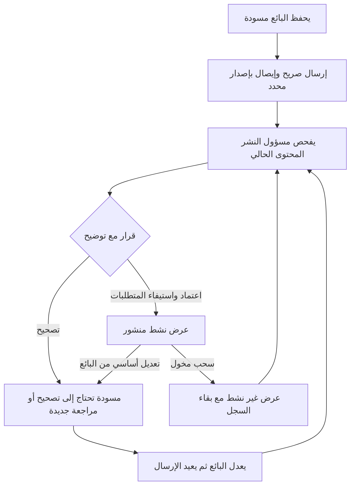

## قبل البدء

استخدم مساحة عمل بائع معتمدة وحسابًا يملك صلاحية المهمة. تعرض واجهة العميل
محتوى الكتالوج المنشور المؤهل دون التوضيحات الخاصة أو سجل الموظفين.

## خطوات الاستخدام

يجهز البائع العرض، ويقرر مسؤول نشر مخول في المتجر أو المنصة نشره. يجمع تبويب
**مراجعة النشر** الإرسال والتوضيح والقرار. حفظ المسودة لا يعني اعتماد العرض.

### البائع: الإرسال والتصحيح وإعادة الإرسال

1. اختر مساحة عمل المتجر الصحيح. احفظ محتوى المنتج بالإنجليزية والعربية وصوره
   وخياراته. راجع الأسعار والمخزون بصورة منفصلة.
2. افتح المنتج ← **مراجعة النشر**. وضح ما أصبح جاهزًا ثم اختر **إرسال المحتوى
   الحالي**. تحقق من حالة **قيد المراجعة** وظهور إيصال الإرسال.
3. إذا أعيد العرض للتصحيح، اقرأ توضيح فريق المتجر في **سجل المراجعة**. عدل
   المحتوى المطلوب واحفظه.
4. ارجع إلى المراجعة ووضح التصحيح ثم أرسل مجددًا. يراجع المتجر الإصدار الجديد
   وتبقى التوضيحات السابقة محفوظة.

<SystemTour tour="vendor-product-review" compact />

تعديل المحتوى العام الأساسي أو الصور في عرض قيد المراجعة أو منشور يعيده إلى
**مسودة** ويلغي صلاحية المراجعة السابقة. يحتاج إلى إرسال جديد صريح. تحديث السعر
والمخزون المعتاد يحتفظ بالمراجعة. يبقى التوضيح غير المرسل أثناء التنقل بين
تبويبات تفاصيل المنتج في الصفحة الحالية؛ لكنه ليس إرسالًا محفوظًا ولا يبقى بعد
إغلاق الصفحة أو إعادة تحميلها.

### مسؤول المتجر: الفحص وتسجيل قرار واضح

1. افتح منتج البائع وتحقق من البائع الظاهر في رأس الصفحة.
2. افتح **مراجعة النشر ← مقارنة المحتوى المرسل بالمحتوى الحالي**. تلخص المقارنة
   مراجع الكتالوج. افحص الأوصاف الفعلية والصور وخيارات المنتج في تبويباتها قبل القرار.
3. اكتب توضيحًا مفيدًا من ١٠ إلى ٤٠٠٠ حرف. اختر **إعادة للتصحيح** للعرض قيد
   المراجعة، أو **الاعتماد والنشر** عند جاهزية المحتوى ومتطلبات النشر.
4. تحقق من الإيصال الجديد والحالة. يحتفظ الاعتماد بالتصحيحات والإرسالات السابقة،
   لكنه لا ينشئ مخزونًا ولا يضمن إمكانية شراء أحد الخيارات.

<SystemTour tour="tenant-product-review" compact />

### مسؤول المنصة: تحقق من حدود المتجر

راجع رابطي **المتجر** و**البائع** في رأس المنتج. مرشح القائمة لا يغير مالك العرض.
استخدم خطوات فحص المحتوى والتوضيح نفسها عند اتخاذ قرار النشر. إذا غيّر مراجع
آخر العرض قبلك، تمنع الشاشة القرار القديم وتحتفظ بتوضيحك. اختر **تحديث المراجعة**
واقرأ المحتوى والسجل الحاليين وأعد تقييم القرار قبل المحاولة.

لسحب عرض منشور اختر **المزيد ← سحب من النشر** واقرأ التأكيد. يصبح العرض **غير
نشط** مع بقاء المشتريات الحالية وإيصالات المراجعة. يحتاج نشره مجددًا إلى استيفاء
المتطلبات الحالية.

<SystemTour tour="admin-product-review" compact />

### مسؤول المتجر: متابعة نتيجة الاستيراد

اختر **المنتجات ← استيراد** وحدد جدول البيانات وابدأ الاستيراد. احتفظ برابط
التقرير للعودة إلى التقدم. يوضح التقرير الصفوف المعالجة والصفوف المحتاجة للمراجعة؛
قد تكتمل المهمة مع وجود تصحيحات. تشمل أرقام الصفوف صف العناوين، وتظهر أول ١٠٠ رسالة.

يحدد رمز المنتج SKU المنتج الموجود داخل هذا المتجر. الخلايا الاختيارية الفارغة
للنوع والحالة والتمييز تحتفظ بقيم المنتج الحالية. يبدأ المنتج الجديد بسيطًا ومسودة
وغير مميز. استخدم أسماء النوع والحالة المعتمدة أو أرقامًا صحيحة؛ ترفض الأرقام
الكسرية. يبقى طلب تفعيل عرض بائع خارجي مسودة مع توجيهك إلى المراجعة الصريحة.
لا يستبدل الاستيراد شاشات الترجمة والصور والأسعار والمخزون. صحح الصفوف الفاشلة
بإجراء استيراد جديد مقصود.

## القيود والقرارات

- عرض المنتج أو تعديله لا يمنح صلاحية النشر. يرسل البائع عروضه في مساحة عمله
  ولا يعتمدها بنفسه.
- قد يمنع النشر غياب قبول سياسة المتجر الحالية أو مستند معتمد وسارٍ أو الاستحقاق
  التجاري. اقرأ المتطلبات الظاهرة؛ غياب المستند ليس اعتمادًا دائمًا.
- تختلف قائمة **العروض قيد المراجعة** عن **تصحيحات النشر**. تحتاج التصحيحات إلى
  إيصال مراجعة فعلي بالإعادة أو إلغاء الصلاحية. لا تصبح المسودات والعروض غير النشطة
  مرفوضة تلقائيًا.
- يرتبط القرار بالإصدار الذي فحصته. يتطلب التعارض قراءة جديدة. بعد انقطاع الرد
  افحص السجل؛ تستخدم إعادة المحاولة المطابقة الإيصال نفسه بدل تكرار القرار.
- تبقى أوصاف المشتريات القديمة وأسعارها لقطات محفوظة. لا توقف المراجعة البائع
  ولا تغير العمولة أو تسترد أموالًا أو تعدل المستحقات.

## تدفق البيانات والنتيجة

## عند حدوث مشكلة

عند التعارض حدّث وافحص قبل القرار. إذا منع متطلب النشر، يظل بإمكان البائع تصحيح
المسودة واستيفاء الدليل الناقص. لا يظهر تقرير استيراد متجر آخر. عند فشل المهمة
راجع تقريرها قبل رفع ملف جديد؛ لا تعيد المهمة المكتملة معالجة الصفوف.

## الأدلة وحدود التحقق

تعرض لقطات ١٨ نوفمبر ٢٠٢٦ مصباحًا واستيرادًا تجريبيين محليين. أرسل البائع العرض
وتلقى تصحيحًا وعدل الوصف باللغتين والأبعاد ثم أعاد الإرسال واعتمده المتجر.
رُفض قرار نشر قديم متزامن لمسؤول المنصة؛ واحتفظ سحب العرض بسجل المراجعة.
سُحب المثال بعد التحقق. استخدم عامل الاستيراد تخزينًا تجريبيًا محليًا دون رفع
سحابي فعلي. المقاطع جولات صور صامتة مع ترجمة وليست تسجيلًا حيًا. تغطي الاختبارات
الصلاحيات والعزل والإصدارات والاستيراد وإعادة المحاولة. لا تثبت الأمثلة نشرًا إنتاجيًا.

[المنتجات والخيارات](/ar/features/products) ·
[سياسات المتجر وقوائم العمل](/ar/features/marketplace-operations) ·
[مستندات البائع](/ar/features/vendors)
