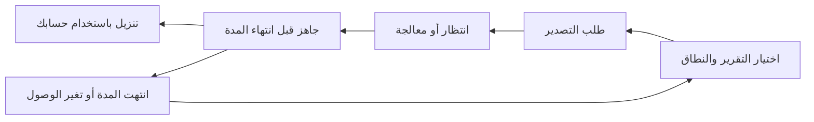

## راجع الحركة المالية حسب العملة

يعرض تقرير الأرباح وتقرير العمولات في لوحة الإدارة الأرقام لكل عملة على حدة.
تعتمد أرقام العمولات على العمولات المعترف بها وعكسها المثبت لبند الطلب الأصلي.
تظهر تسويات البائع اليدوية وحركة الكشوف المغلقة والتحويلات المسجلة كلٌ على حدة.
إذا كان تقرير الأرباح قيد الإعداد، حدّث الصفحة للاطلاع على نتائج التواريخ
المطلوبة. تعرض كل لقطة وقت إنشائها.

## خطوات الاستخدام

افتح التقارير واختر التقرير والفترة والمرشحات، وراجع العملة والنطاق ثم اطلب التصدير إن سمحت الصلاحية. تابع حالة المهمة أو التصدير ونزل الملف بعد اكتماله. تراجع المنصة مركز المهام المتاح.

<SystemTour tour="feature-reports" compact />

## اختر التقرير المناسب لسؤالك

استخدم [شرائح العملاء](/ar/features/customer-cohorts) لمجموعات الشراء المحفوظة و[مراحل التسوق](/ar/features/shopping-funnel) لرحلات القياس الاختياري. يشرح [دليل عمليات الطلبات المسجلة](/ar/features/order-operations) إلغاء الطلبات الفرعية وإرسال الطلب بالكامل والتزامات البائع الأصلية؛ وقد وصلت هذه الميزة إلى نقطة تطوير محلية مختبرة، مع بقاء الإطلاق الحي منفصلًا. هذه مجموعات قياس مختلفة، ولا يصح جمعها.

## مراجعة أداء الكوبونات

اختر **الكوبونات** لعرض الاستخدامات المحجوزة والمؤكدة والخصومات والمبالغ المستردة بعد التسوية حسب الرمز والعملة. تعرض لوحتا المتجر والمنصة أيضًا حصة كل بائع. تُحسب الفاتورة المشتركة مرة واحدة في إجماليات المتجر حتى لو ظهرت لدى أكثر من بائع.

الاستخدامات المحجوزة هي الحجوزات التي بدأت خلال الفترة المحددة وما زالت معلّقة. تعرض تكلفة الخصم الوفورات المؤكدة، وتظهر المبالغ المستردة في تاريخ تسويتها. يحدّث التصدير المصرّح به التقرير للفترة المحددة.

تظهر أسماء الدفعات بجوار الأكواد المُنشأة ضمن جدول الأداء حسب الكود. استخدم **أداء دفعات الكوبونات** لمراجعة المجاميع حسب العملة، و**أداء دفعات الكوبونات حسب البائع** لمراجعة نصيب كل بائع. يوضّح [دليل دفعات الكوبونات](/ar/features/coupons) كيفية إنشاء الأكواد وتنزيلها.

## تنزيل تقرير خاص

1. اختر التقرير والفترة والمرشحات. راجع مساحة العمل قبل الضغط على **تصدير**.
2. انتظر أثناء وجود التصدير في قائمة الانتظار أو قيد المعالجة. يمكنك متابعة قراءة التقرير أثناء ذلك.
3. عندما يصبح الملف جاهزًا، اختر **تنزيل**. تنزّل الواجهة مرفق JSON باستخدام حسابك المسجّل.
4. احفظ الملف في مكان آمن؛ فقد يتضمن معلومات العملاء أو النشاط التجاري. تنزيله لا يجعله متاحًا للعامة.

يتاح الملف لمدة **24 ساعة من طلب التصدير**، وليس من أول تنزيل له. بعد انتهاء المدة، اطلب تصديرًا جديدًا. وقد يتوقف الوصول قبل ذلك إذا تغيرت صلاحياتك أو الموافقة على مساحة العمل. نسخ معرّف المهمة أو عنوان التنزيل لا يمنح موظفًا آخر حق الوصول.

| واجهتك | نطاق الملف |
|---|---|
| مدير المنصة | النطاق والمرشحات المختارة عند طلب التصدير. تغيير المرشح لا يغيّر ملفًا موجودًا. |
| المستأجر | تقرير المستأجر الحالي؛ لا يستطيع مستأجر آخر استرجاعه. |
| البائع | تقرير البائع داخل مساحة المستأجر المعتمدة والمختارة. بدّل المساحة قبل طلب تقرير آخر. |

إذا تعذر التنزيل، تأكد من الدخول بالحساب الذي طلب الملف، واستمرار صلاحية التصدير، واختيار مساحة العمل الصحيحة. ثم اطلب تصديرًا جديدًا عند الحاجة. فشل التصدير لا يعني اكتمال الملف. وتظل ملفات الربح القديمة التي تستخدم تعريف حساب غير مدعوم غير متاحة؛ أنشئ نتيجة حديثة قبل إعادة التصدير.

تشمل نقطة التطوير اختبارات قبول الخادم وتنزيلات فعلية من المتصفح بالعربية والإنجليزية في الواجهات الثلاث. تستخدم الجولات بيانات تجريبية معزولة، ولا تمثل نشرًا حيًا أو نتائج إنتاجية.

## اتبع الشرح الخاص بلوحتك

صور فعلية للنظام التجريبي المحلي التُقطت في 19 نوفمبر 2026. الحسابات والأرقام مصطنعة، وساعة النظام مضبوطة على 21 نوفمبر. شرح مصور مع ترجمة، وليس تسجيلًا متصلًا أو معاملة إنتاجية.

### إدارة المنصة

<SystemTour tour="feature-report-exports-admin" compact anchor="private-report-admin" />

### إدارة المتجر

<SystemTour tour="feature-report-exports-tenant" compact anchor="private-report-tenant" />

### إدارة البائع

<SystemTour tour="feature-report-exports-vendor" compact anchor="private-report-vendor" />

## القيود والقرارات

طلب التصدير بالطابور ليس ملفاً جاهزاً. العرض لا يمنح التصدير تلقائياً. قد تقيس التقارير الطلبات الموضوعة أو الإيراد المدفوع أو الأرصدة الحالية؛ قارن نفس المقياس والفترة.

## تدفق البيانات والنتيجة

مرشحات النطاق ← استعلام وتجميع ← تصدير بالطابور ← حالة اكتمال وملف ← تنزيل مخول.

## دورة نشاط التجار: سؤال مختلف

يشرح [دليل دورة نشاط التجار](/ar/features/merchant-lifecycle) طلبات الانضمام وتفعيل المتاجر ومساحات البائعين والنشاط التجاري وحالات الفوترة. هذه ميزة تطوير قبل الإصدار تنتظر قبول الإطلاق النهائي. استخدمها لفهم تقدم التاجر؛ فشرائح العملاء تقيس مجموعات الشراء، ومراحل التسوق تقيس الرحلات الاختيارية، وعمليات الطلبات تقيس وقائع الطلبات المسجلة. لا تحل مجموعة محل الأخرى.

دفع الباقة ورسم البائع ورصيده اليدوي والمبلغ المستحق مقاييس مالية مختلفة. تعرض ملخصات الربح التعديلات اليدوية للبائع منفصلة عن رسوم المنصة؛ فإضافة رصيد للبائع لا تزيد عمولة المنصة. تحتاج نتائج الربح القديمة المحفوظة إلى نتيجة حديثة مدعومة قبل التعامل معها كدليل حالي.

## عند حدوث مشكلة

راجع مساحة العمل والصلاحية وحالة السجل وأخطاء الحقول أولاً. إذا ظهرت مهلة بعد إرسال إجراء، افحص السجل وتاريخه قبل إعادة المحاولة. صعّد المشكلة مع اسم الشاشة ومعرف السجل والتوقيت؛ لا تتضمن بيانات الدخول أو أسرار الدفع.

## المراجع وحدود التحقق

كتابة إرشادية مبنية على وثائق الوحدة ومسارات الواجهات ومصدر الخادم. وجود المسار لا يثبت اختبار كل إجراء حياً. راجع [تغطية الشاشات](/ar/coverage) و[مرجع الأدلة](/ar/evidence) للمصادر والحقول. الصور توضيح لحسابات العرض بتاريخ 17 نوفمبر 2026 وليست بيانات إنتاج.

`Modules/Reports/` · `documentation/modules/`

مسارات الشاشات ومراجع المصدر

{/* SCREEN_MAP */}
## مواضع الخاصية في الواجهات

وجود المسار يثبت التنقل ولا يمنح كل الإجراءات. قد توجد وظائف إضافية داخل تفاصيل سجل مرتبط.

| Dashboard | Frontend entry paths |
|---|---|
| [admin](/ar/roles/admin) | `/reports`, `/jobs` |
| [tenant](/ar/roles/tenant) | `/reports` |
| [vendor](/ar/roles/vendor) | `/reports` |

[المسارات والحقول والحالات من المصدر](/ar/evidence/reports)
{/* /SCREEN_MAP */}

