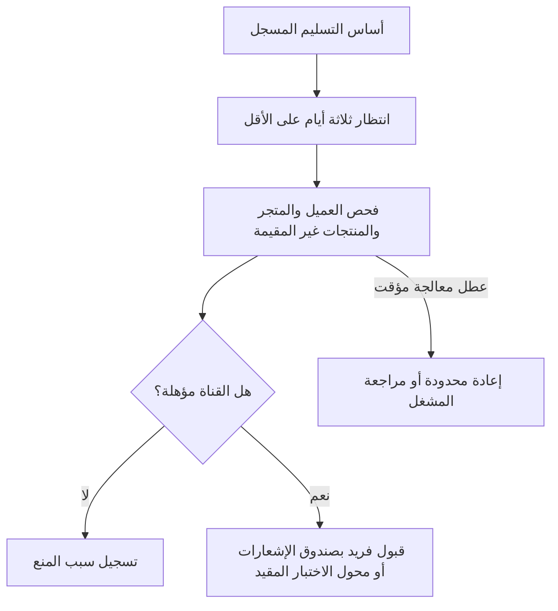

> **إصدار تطوير للاختبار فقط.** اختُبرت معالجة التذكيرات وأدوات مشغل المتجر محليًا. تظل المعالجة معطلة افتراضيًا، ويستخدم المسار الخارجي محوّل رسائل نصية اختباريًا محميًا. لا تدعي هذه الصفحة وجود خدمة تذكير حية.

## ماذا تقدم هذه الميزة؟

تساعد دعوة التقييم العميل في الوصول إلى منتجات ما زال بإمكانه تقييمها بعد التسليم. لا تغير الطلب ولا تمنح شارة شراء موثق ولا تنشر تقييمًا تلقائيًا. أقرب موعد للدعوة هو بعد ثلاثة أيام من أساس التسليم المسجل.

## للعميل

في **الحساب ← الملف الشخصي والعناوين ← اختياراتك للرسائل التسويقية**، يكون إذن تقييم المشتريات مستقلاً عن عروض المتجر وتذكيرات السلة. اختر لكل متجر وقناة بشكل منفصل. حفظ الاختيار يسمح بالنظر في الدعوة ولا يثبت إرسال رسالة.

يستخدم المسار الخارجي الاختباري الجديد الرسائل النصية، ويتطلب هاتفًا موثقًا لم يتغير وإذنًا حاليًا لتقييم المشتريات. اختيار البريد الإلكتروني لا يفعّل إرساله. لرسائل الطلب والأمان الضرورية وصندوق الإشعارات قواعد مستقلة.

افتح **الحساب ← الإشعارات** لقراءة الدعوة المتاحة. يغيّر **تحديد كمقروء** حالة القراءة فقط؛ فلا ينشر تقييماً ولا يمنح موافقة على الرسائل. يحتفظ نص الدعوة بلغة إنشائها عند تبديل لغة الواجهة. تعرض [خطوات العميل](/ar/features/marketing-consent) فيديو لحفظ الاختيارات وسحب الموافقة وحالة القراءة.

<SystemScreenshot src="/docs/screenshots/customer-review-feedback-ar-inbox.webp" alt="صندوق إشعارات العميل التجريبي بواجهة عربية يعرض دعوة التقييم ونصها كاملاً باللغة المستخدمة وقت إنشائها." />

## خطوات الاستخدام

يفتح مشغل المتجر المخول **تذكيرات التقييم**، ويقرأ النتيجة المسجلة ويفحص محاولات القنوات. راجع الموعد النهائي الثابت والمحاولات المتبقية والسبب قبل طلب الإعادة. تتطلب الإعادة صلاحية مستقلة وشرحًا يخلو من بيانات اتصال العملاء والأسرار.

راجع التأكيد بعناية. ألغِ الإجراء إذا كانت الدعوة أو الملاحظة غير صحيحة. يطلب التأكيد فحص الأهلية مجددًا ولا يضمن القبول أو وصول رسالة.

<video style={{ width: "100%", height: "auto" }} controls playsInline preload="none" poster="/docs/screenshots/tenant-review-reminders-ar-checks.webp" aria-label="فحص تذكيرات التقييم وإلغاء تأكيد الإعادة">
  <source src="/docs/videos/tenant-review-reminders-ar-tour.mp4" type="video/mp4" />
  <track kind="captions" src="/docs/videos/tenant-review-reminders-ar.vtt" srcLang="ar" label="العربية" default />
</video>

> **جولة من لقطات شاشة فعلية مع ترجمة ودون صوت.** التُقطت شاشات المتجر يوم 19 نوفمبر 2026 بتوقيت القاهرة من معاينة اختبار محلية معزولة بسجلات اصطناعية. المعالجة معطلة افتراضيًا؛ تفعل هذه المعاينة الخاصة مسار الاختبار المحلي المقيد صراحة لعرض أدواته. أُلغي تأكيد الإعادة في اللغتين ولم تُرسل إعادة محاولة. لا تثبت الإتاحة داخل التطبيق أو قبول اختبار الرسائل تسليمًا خارجيًا أو تقييمًا مقدمًا أو إيرادًا.

## قراءة نتائج القنوات

ملخص الطلب ليس إيصال تسليم. تعني **اكتملت المعالجة** أن فحوص القنوات وصلت إلى نتائجها المسجلة؛ افحص كل قناة قبل تفسير النتيجة.

| ما يظهر للمشغل | معناه |
| --- | --- |
| بانتظار المعالجة | سُجل العمل للمعالجة، ولا يعني إرسال رسالة. |
| متاح داخل التطبيق | دعوة متاحة في صندوق الإشعارات دون إثبات قراءة العميل لها. |
| قُبل لدى محوّل اختبار الرسائل النصية | نتيجة اختبار محلية مقيدة دون إثبات تسليم خارجي. |
| ممنوع بالشروط الحالية | يمنع شرط تجاري أو شرط إذن حالي المحاولة؛ اقرأ السبب. |
| بانتظار إعادة محدودة | يمكن فحص فشل مؤقت مع بقاء المحاولات والموعد النهائي الأصليين. |
| تحتاج مراجعة مسؤول | افحص الفشل المسجل أو استنفاد المحاولات دون إعادة ضبط الحدود. |
| انتهى الموعد النهائي | انتهت النافذة الأصلية ولا تُعرض إعادة أخرى. |
| نتيجة النقل القديم غير معروفة | الإقرار التاريخي ليس دليل تسليم خارجي، والسجل للقراءة فقط. |

<SystemTour tour="feature-review-reminders" />

## القيود والقرارات

يجب إعادة فحص العميل الحالي وعلاقته بالمتجر وصلاحية التقييم والمنتجات التي ما زالت مؤهلة. يُحسب التقييم السابق للمنتج نفسه بهذا المتجر حتى إن ارتبط بطلب أقدم. لا يجوز لتحويل مشتريات ضيف أو تغيير المستلم أو الهاتف أن يعيد توجيه دعوة قديمة.

تحافظ الإعادة على الموعد النهائي الأصلي وميزانية المعالجة المشتركة. لا تعيد تشغيل دعوة مقبولة أو ممنوعة أو مستنفدة المحاولات أو منتهية. إقرارات الإشعارات القديمة مجهولة نتيجة النقل؛ لا تُرسل تلقائيًا مجددًا ولا تُصنف كرسائل تم تسليمها. أدلة الشراء الاختبارية لا تؤهل دعوة فعلية.

## تدفق البيانات والنتيجة

سجل صندوق الإشعارات وقبول محول الاختبار والتسليم الخارجي المؤكد نتائج مختلفة. يجب عرضها منفصلة، ولا تُحسب الدعوات كطلبات أو مبيعات أو تقييمات مقدمة.

## عند حدوث مشكلة

اقرأ السبب أولاً. سحب الإذن أو تقييم المنتج مسبقًا ليس عطلاً في النقل. النتيجة التاريخية المجهولة لا تثبت الفشل. إذا تعذرت الإعادة، افحص السجل بدلاً من إنشاء دعوة أخرى لتجاوز الحدود.

موضوعات مرتبطة: [اختيارات الرسائل لكل متجر](/ar/features/marketing-consent) · [التقييمات والإشراف](/ar/features/reviews).
