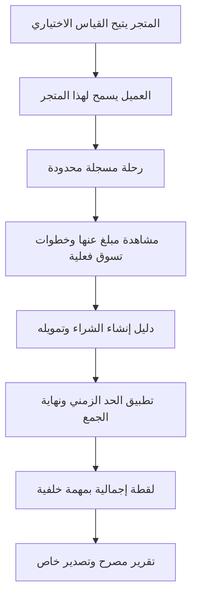

> **نقطة تحقق تطويرية · 19 نوفمبر 2026.** نُفذ القياس الاختياري وتقارير لوحات المشغلين الثلاث واختُبرت محلياً، بما فيها فحوص المتصفح بالعربية والإنجليزية. تستخدم الجولات بيانات مصطنعة مضبوطة، والفيديوهات تسلسل صور مشروح بالنصوص. يبقى الإطلاق الحي منفصلاً.

## ما الذي تساعدك هذه الميزة على فهمه؟

يوضح مسار التحويل أين تتقدم الرحلات المسجلة من مشاهدة منتج مُبلغ عنها إلى شراء مؤهل مكتمل التمويل. يساعد المتجر على بحث العوائق بين الخطوات. وهو يعد رحلات مقاسة، وليس أشخاصاً موثَّقين أو حسابات عملاء فريدة أو إيرادات أو مبيعات مستعادة.

يحتفظ العميل بحساب مركزي واحد بين المتاجر. أما إذن القياس فهو اختيار مستقل للمتجر والمتصفح الحاليين.

## خطوات الاستخدام

**العميل:** افتح أداة قياس التسوق في تذييل المتجر. عندما يتيح المتجر الميزة الاختيارية، يمكنك السماح بالقياس أو إبقاؤه متوقفاً. ارجع إلى الأداة لسحب الإذن. إتاحة المتجر لا تمنح الإذن نيابة عنك، ولا يمنحه اختيار سابق للتسويق أو ملفات الارتباط.

يوقف سحب الإذن إرسال بيانات القياس الجديدة وتقارير مشاهدة المنتجات من هذا المتصفح فوراً. إذا تعذر تأكيد الإيقاف مع المتجر بسبب الاتصال، تعرض اللوحة تأكيداً معلقاً وإجراء لإعادة المحاولة. أبقِ الاختيار متوقفاً وأعد المحاولة عند الاتصال. لا تعلن الواجهة نجاح تأكيد الخادم قبل حدوثه.

يتوقف المتجر عن قبول القياسات عند تأكيد سحب الإذن أو انتهاء تصريح القياس المؤقت. وحتى ذلك الوقت، قد تتأهل أدلة دفع مرتبطة سابقاً بالرحلة ضمن هذه المهلة. إذا أفادت اللوحة بتعذر حفظ الإيقاف المعلق لإعادة التحميل، أبقِ الصفحة مفتوحة وأعد المحاولة؛ فقد يؤدي إغلاقها إلى فقدان الطلب المعلق.

### جولة العميل: الاختيار والمشاهدة والإيقاف وإعادة المحاولة

تابع الفصول الأربعة لتمييز اختيار المتصفح عن تأكيد الخادم. تستخدم التجربة المحلية منتجاً مصطنعاً وفشل اتصال مضبوطاً. المقطع البالغ 24 ثانية تسلسل إرشادي للقطات، وليس تسجيلاً لشراء حي.

<SystemTour tour="feature-shopping-funnel-customer" anchor="screen-guide" />

**مشغل المتجر:** استخدم أداة القياس المستقلة في إعدادات واجهة المتجر لإتاحة الميزة أو تعطيلها. للتغييرات إصدار إشعار، ولا تنتقل أذونات العملاء القديمة بصمت إلى إصدار مختلف. هذه الأداة لا تمنح الإذن نيابة عن العملاء.

**المشغلون:** افتح **التقارير ← مسار التسوق**. راجع المتجر أو مساحة المورد، وأيام دخول الرحلات، والحد الزمني والتغطية قبل تفسير المراحل. اطلب التوليد إذا لم توجد لقطة؛ انتظار المهمة لا يعني تقريراً فارغاً. يحتاج التصدير إذناً مستقلاً وينتج ملفاً خاصاً محدود الصلاحية.

## اقرأ المراحل الخمس

| المرحلة | معناها |
| --- | --- |
| مشاهدة المنتج | يبلغ المتصفح عن عرض منتج مؤهل بعد ظهوره. هذه ملاحظة وليست إثبات انتباه شخص حقيقي. |
| إضافة منتج | تزيد عملية فعلية في سلة الخادم الكمية. لا تخترع القراءة أو إعادة الحساب أو الحذف أو نسخ سلة مدمجة إضافات جديدة. |
| تقديم إتمام الشراء | يصل طلب صحيح البنية إلى خدمة إتمام الشراء. قد تمنع قواعد العمل إنشاء الشراء لاحقاً. |
| إنشاء الشراء | تُحفظ فاتورة جامعة واحدة مع طلباتها الفرعية. لا يمحو فشل تهيئة الدفع اللاحق هذه المرحلة. |
| تمويل الشراء | يؤهل دليل التمويل المحفوظ الشراء ضمن أفق الرحلة وحد جمع البيانات. لا يؤهل الدفع عند الاستلام غير المحصل. |

للرحلة أفق ثابت مدته 24 ساعة منذ قبولها. لا تضاعف المشتريات المتعددة أو طلبات الموردين الفرعية عدد الرحلات في المرحلة. يحفظ الاسترداد اللاحق حقيقة التمويل التاريخية؛ وتوضح التقارير المالية مبالغ الاسترداد وصافي الإيراد بشكل مستقل.

## افهم المجموعات والنسب

تعني **المقبولة للقياس** أن المتجر بدأ رحلة قياس بعد الإذن. وتعني **المرصودة** أن للرحلة ملاحظة مرحلة محفوظة واحدة على الأقل. القبول وحده ليس مشاهدة.

يتطلب المسار المرتب مرحلة سابقة مؤهلة في الرحلة نفسها. كما يحتاج تقديم الشراء وإنشاؤه إلى تطابق السلة وإيصال التقديم. لا تملأ مرحلة لاحقة مرحلة سابقة غير مرصودة. أعداد المراحل الخام وأعداد غياب المراحل السابقة مؤشرات مستقلة؛ لا تجمعها مع المسار المرتب.

تستخدم النسبة من المشاهدة مجموعة مشاهدات المنتج المرتبة. وتستخدم النسبة من المرحلة السابقة مجموعتها المرتبة. فمثلاً، عشر رحلات ممولة من 100 رحلة مشاهدة مقاسة تعني 10% فقط عندما تسمح النافذة والتغطية بنسبة نهائية. لا توجد نسبة ذات معنى عندما يكون المقام صفراً.

## اقرأ الوقت والتغطية بشكل صحيح

أيام الدخول هي أيام قبول الرحلات بالتوقيت العالمي، وليست أيام وصول المدفوعات. يدعم التقرير حتى 93 يوم دخول شاملة. يختار افتراضياً 30 يوم دخول ناضجاً تنتهي قبل يومين بالتوقيت العالمي. يمكن اختيار أمس، لكن قد تبقى آفاق بعض الرحلات غير مكتملة.

الحد الزمني غير شامل ويقع عند 00:00 بالتوقيت العالمي في بداية يوم الملاحظة. تحتفظ المهمة بهذا الحد حتى لو انتهت لاحقاً. اقرأ الحد المحفوظ وإشعار حداثة اللقطة؛ الشاشة ليست عداداً حياً.

قد تمنع الآفاق غير المكتملة، والإيقافات المبكرة للجمع، وبلوغ حد 200 حدث لكل رحلة، أو نقص تغطية المصدر عرض نسب نهائية. هذا لا يعني تحويلاً صفرياً أو تركاً مثبتاً للشراء. يظهر أيضاً نقص الأدلة قبل بدء الجمع أو بعد حد الاحتفاظ بالبيانات الخام البالغ 180 يوماً. لا تعيد السلال القديمة وقوائم المشاهدة المؤقتة بناء تصفح مفقود.

يُستبعد النشاط الاختباري الموثق بأدلة محفوظة موثوقة. ولا يثبت غياب علامة الاختبار أن الملاحظة تمثل شخصاً حقيقياً. لا تلوث محاولة دفع اختبارية فاشلة تحصيلاً حقيقياً مستقلاً مؤهلاً. ولا يعيد دليل شحن اختباري مسجل لاحقاً بتاريخ وقوع قديم كتابة حد زمني سابق.

## جولة مدير المنصة: النطاق العالمي والتغطية

قارن النطاق المحدد وأعداد المراحل العالمية المصطنعة وحدود الأدلة الصريحة. يعد مقطع اللقطات الإرشادي البالغ 18 ثانية رحلات عبر المتاجر، لا أشخاصاً فريدين.

<SystemTour tour="feature-shopping-funnel-admin" anchor="admin-walkthrough" />

## جولة المستأجر: الإتاحة والمراحل والإيقاف المبكر

اختر فصلاً لربط إعداد المتجر والمراحل المقاسة ومثال سحب الإذن المستقل. هذه لقطات محلية فعلية لبيانات مصطنعة؛ والمقطع تسلسل إرشادي للقطات مدته 18 ثانية.

<SystemTour tour="feature-shopping-funnel-tenant" anchor="tenant-walkthrough" />

## القيود والقرارات

| الواجهة أو الاختيار | الحد |
| --- | --- |
| العميل | الإذن اختياري ومستقل لكل متجر وإصدار؛ وتظل اختيارات الدخول والتسوق والتسويق منفصلة. |
| المستأجر | يحتوي التقرير رحلات المتجر المحدد المقاسة فقط. |
| المورد | تظهر مشاركة المورد المحفوظة فقط داخل مساحة متجره المعتمدة. لا يؤهل دفع مورد آخر طلباً فرعياً ملغى غير مدفوع. لا تتاح هنا مقامات زوار المتجر بالكامل أو تسجيلاته. |
| مدير المنصة | ميّز مجموعة المتجر عن الإجمالي العالمي. لا يحدد جمع رحلات المتاجر عملاء عالميين فريدين. |
| سحب الإذن أو تغيير السياسة | يتوقف الجمع الاختياري الجديد عند حده المحفوظ؛ ولا تمدد بيانات دفع أساسية لاحقة الرحلة المقاسة بصمت. تحتفظ اللقطات السابقة بحدها التاريخي. |
| التصدير | أذونات العرض والتوليد والتصدير مستقلة. يعاد فحص حساب المشغل والنطاق واعتماد مساحة المورد؛ وتنتهي صلاحية الملفات الخاصة بعد 24 ساعة. |

لا تحتفظ الميزة بعنوان الإنترنت أو بصمة المتصفح أو بيانات الاتصال أو عناوين التصفح الكاملة لأغراض القياس. تعرض التقارير إجماليات بدلاً من تتبع عميل بعينه أو رموز تصاريح القياس. تظل المشتريات الأساسية قابلة للخدمة عندما يتوقف القياس أو يتعذر.

## جولة المورد: النطاق والمراحل وحدود الأدلة

راجع مساحة المتجر المعتمدة أولاً، ثم قارن مسار المورد وحده بتغطيته واستبعاده. لا يعرض مقطع اللقطات البالغ 18 ثانية تتبعاً لعميل بعينه أو دليل دفع حي.

<SystemTour tour="feature-shopping-funnel-vendor" anchor="vendor-walkthrough" />

## تدفق البيانات والنتيجة

## عند حدوث مشكلة

تابع التسوق عند تعذر القياس الاختياري. عند سحب الإذن، ميّز الإيقاف المحلي عن تأكيد الخادم المعلق واستخدم إعادة المحاولة. في التقرير، راجع النطاق وأيام الدخول والحد المحفوظ وسبب نقص التغطية أولاً. لا يعيد تكرار التوليد ميزانية المحاولات الثلاث المستنفدة للنطاق والنافذة والحد والإصدار نفسها. اطلب فحص الفشل المسجل بدلاً من استبدال القيم المجهولة بصفر.

ذو صلة: [شرائح العملاء](/ar/features/customer-cohorts) · [اختيارات التسويق](/ar/features/marketing-consent) · [التقارير والتصدير](/ar/features/reports).
