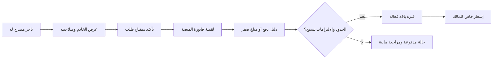

## وظيفة الميزة

تحدد باقة CartJoin فترة الخدمة وسعة المنتجات ومقاعد الموظفين النشطين والبائعين المعتمدين وإتاحة السوق متعدد البائعين. افتح **النظام ← الاشتراك والإعداد** في لوحة المتجر. يستخدم مشرف المنصة **الإدارة ← الاشتراك والإعداد** ثم يختار التاجر.

تستقبل CartJoin حاليًا طلبات انضمام التجار للمشاركة في التجربة التشغيلية. تحاكي أزرار الاختبار تسجيل عملية دفع دون خصم أي مبلغ من وسيلة الدفع. قد تعرض الصور باقات اختبار.

<SystemTour tour="feature-subscriptions" compact />

## قراءة الاتفاق الحالي

| الباقة | شهريًا | الفاتورة السنوية | التوفير السنوي | المنتجات | الموظفون النشطون | البائعون المعتمدون |
|---|---:|---:|---:|---:|---:|---:|
| المتجر | ٤٩٩ ج.م. | ٤٬٩٩٠ ج.م. | ٩٩٨ ج.م. | ٥٠٠ | ٣ | ٠ |
| السوق متعدد البائعين | ١٬٤٩٩ ج.م. | ١٤٬٩٩٠ ج.م. | ٢٬٩٩٨ ج.م. | ٥٬٠٠٠ | ١٠ | ٢٥ |

تشمل العروض القياسية تجربة مجانية لمدة ١٤ يومًا ومهلة قدرها ٧ أيام بعد انتهاء الفترة المدفوعة. تعرض المقارنة إجمالي الفاتورة السنوية وما يعادله شهريًا. مثلًا، تُفوتر باقة المتجر السنوية بمبلغ ٤٬٩٩٠ ج.م. دفعة واحدة، أي ما يعادل نحو ٤١٥٫٨٣ ج.م. شهريًا. تُحتسب رسوم معالجة الدفع وعمولات البائعين بصورة مستقلة عن فاتورة CartJoin.

راجع **نسخة الباقة** ونهاية الخدمة والاستخدام والحدود. تشمل المنتجات المسودات، وتشمل المقاعد الحسابات النشطة غير المحذوفة والمالك، ويحسب البائعون من العلاقات المعتمدة. **دون حد** تختلف عن صفر. يحتفظ التاجر القائم الذي لم ينضم إلى اشتراك بوصوله السابق حتى الانضمام الصريح؛ لا تفرض تجربة أو تسعيرة تلقائيًا.

تقرأ قائمة الإعداد التهيئة الفعلية. اكتمال وسيلة دفع أو كتالوج لا يثبت نجاح شراء حي أو حجز شحنة أو تسليم حساب المالك. أكمل دورة تجارية مسموحًا بها قبل الإطلاق.

## عندما يصل عدة مسؤولين إلى حد الباقة

إذا حاول مسؤولان استخدام آخر مكان متاح لمنتج أو موظف نشط أو بائع معتمد، فقد ينجح أحد الإجراءين وتظهر للآخر رسالة توضح بلوغ السعة. حدّث **الاشتراك والإعداد** للتحقق من الاستخدام الفعلي قبل إتاحة مساحة أو اختيار باقة أكبر. لا يستهلك الإجراء المرفوض مكاناً إضافياً.

يمكن أن ينجح إجراءان مسموحان يعبران حد التنبيه، مع تسجيل التنبيه مرة واحدة للباقة والفترة نفسيهما. إذا انقطع الرد، افحص السجل أو نتيجة الاستيراد قبل إعادة المحاولة.

## استخدام التجربة المجانية

تبدأ التجربة عندما تعتمد CartJoin طلبك وتجهّز متجرك. تسري مزايا الباقة المختارة وحدودها خلال التجربة، ويمكنك البيع بعد استيفاء متطلبات الإطلاق. تعرض صفحة **الاشتراك والإعداد** موعد الانتهاء المحدد. يبقى الموعد نفسه عند تغيير الباقة المختارة أو إعادة محاولة التسجيل.

عند انتهاء التجربة تتوقف المبيعات الجديدة وزيادة السعة. لمتابعة البيع، راجع عرض التفعيل المدفوع وأكّده. تبدأ الفترة المدفوعة عند التسوية، حتى عند التفعيل قبل انتهاء التجربة. لا ينشئ انتهاء التجربة فاتورة تلقائيًا. يمكنك متابعة الطلبات القائمة والوصول إلى سجلات الفوترة التي تسمح بها صلاحياتك.

## خطوات الاستخدام

1. اختر نسخة باقة منشورة واطلب عرضًا من الخادم.
2. راجع المبلغ المستحق الآن ومبلغ التجديد وتغييرات المزايا وتاريخ السريان. تنتهي صلاحية العرض بعد ١٥ دقيقة.
3. أكد العرض الذي راجعته مرة واحدة. تستخدم إعادة التأكيد للطلب نفسه مفتاح الطلب نفسه.
4. راجع فاتورة المنصة المستقلة والنتيجة المسجلة.

تحتسب الترقية المؤهلة في العملة والدورة نفسيهما فرق الفترة المتبقية بدقة. يجدول انخفاض السعر أو الحدود وتغيير العملة أو الدورة وإلغاء قدرات السوق عند التجديد، دون تحويل عملات ضمني. لا تحتاج الفاتورة ذات المبلغ صفر إلى عملية دفع.

يوقف تأكيد الخروج المجدول من السوق التعرض الجديد للبائعين مع استمرار مبيعات المتجر وخدمة السجلات القائمة. لا يعيد إلغاء التغيير المجدول إلا القدرات التي تسمح بها الباقة الحالية والاعتمادات. يُجدول أيضًا تحويل اشتراك المتجر النشط من شهري إلى سنوي عند التجديد. وفق الشروط القياسية، يستحق مبلغ ٤٬٩٩٠ ج.م. عند ذلك التجديد.

## اختيار المزايا لإصدار الباقة

في لوحة إدارة المنصة، افتح **باقات الاشتراك** واختر إنشاء الإصدار التالي لنسخ باقة منشورة. حدد مزايا موظفي المتجر والبائعين والعملاء، ثم عاين السعر ودورة الفوترة والحدود وتغييرات المزايا قبل تأكيد النشر. تتطلب مزايا البائعين باقة سوق متعدد البائعين. تظل الاشتراكات الحالية مرتبطة بالإصدارات التي وافق عليها التجار.

في **الاشتراك والإعداد**، اختر المتجر لعرض مزايا باقته الحالية وأثر حالة الخدمة ونوع المتجر وإعداداته الافتراضية على إتاحتها. يوضح عرض تغيير الباقة المزايا المضافة والمحذوفة. يبدأ سريان حذف ميزة من اشتراك مدفوع بعد تسوية التجديد على الإصدار الجديد.

في لوحة المتجر، افتح **النظام ← التحكم في المزايا**. اختر ميزة وحدد إعدادها الافتراضي. بالنسبة لمزايا البائعين والعملاء، ابحث عن البائع أو العميل داخل المتجر واختر السماح أو المنع أو استخدام الإعداد الافتراضي. يؤدي إيقاف الميزة على مستوى المتجر إلى منع الإجراء للجميع. يظل الاستثناء خاضعًا للباقة والصلاحيات الحالية. يمكن للعملاء عرض عناصر قائمة الرغبات وتنبيهات المخزون الحالية وإزالتها، ويمكن للموظفين متابعة خدمة الطلبات القائمة.

يشمل التحكم الإضافي تصدير جدول الكتالوج وأسئلة المنتجات وإجاباتها وإنشاء القسائم والعروض السريعة واشتراكات ويب هوك، إضافةً إلى إرسال تقييمات العملاء والتصويت عليها. ترث الباقات السابقة إتاحة الإجراءات التي أضيف إليها التحكم. تستخدم الإصدارات المنشورة عبر القائمة الموسّعة اختياراتها المحفوظة. يخضع استخدام القسائم القائمة وتعديل التقييمات وخدمة الطلبات لقواعدها الحالية.

## الفواتير والتعافي

هذه **فواتير خدمات CartJoin**، مستقلة عن فواتير طلبات العملاء والعمولات وصرف البائعين. يمنع سحب الباقة الانضمام الجديد ويحفظ الشروط المقبولة ولقطات الفواتير السابقة.

يسجل رفض الدفع التجريبي دون إلغاء فترة مدفوعة قائمة. تبقى الفاتورة مدفوعة إذا تعطل التفعيل وتظهر حالة تحتاج مراجعة. اطلب من المالية المصرح لها حل مشكلة الاستخدام أو الالتزامات ثم **إعادة محاولة التفعيل المدفوع**. لا تعيد فاتورة قديمة باقة سابقة فوق باقة أحدث.

أكّد عرضًا جديدًا إذا انتهت صلاحية فاتورة غير مدفوعة أو تغيّرت شروطها. يلغي CartJoin الفاتورة القديمة ويحتفظ بها في السجل. إذا كانت الفاتورة غير المدفوعة لا تزال صالحة، فاستخدمها أو اطلب من مالية المنصة إلغاءها قبل تأكيد تغيير آخر.

## اقرأ المعالجة في تقارير التجار

يفصل [تقرير دورة نشاط التجار](/ar/features/merchant-lifecycle) قبل الإصدار بين استعادة الدفع وتطبيق فترة الخدمة المرتبطة. تطبيق الفترة لا يلغي إيقافًا إداريًا مستقلًا. وقد يُطبق التجديد أثناء السماح دون استعادة الوصول، لأنه كان متاحًا أصلًا. راجع شاشة الاشتراك الحالية لمعرفة ما يستطيع التاجر فعله الآن.

الحل بمبلغ صفري ليس تحصيلًا نقديًا. تختلف الفاتورة المدفوعة التي تعذر تطبيقها عن تعثر التفعيل الأول غير المدفوع أو فجوة التجديد. يتتبع التقرير الالتزام الأصلي، ولا يعد كل إعادة محاولة فاشلة تاجرًا إضافيًا. انتهاء التجربة دون دين والإلغاء المقصود عند نهاية الفترة ليسا تعثر تجديد مدفوع. تظل محاكاة الدفع نشاطًا تجريبيًا، لا معالجة تجارية حقيقية.

## الإلغاء والقيود

يجدول الإلغاء بنهاية الفترة ويمكن التراجع عنه قبل سريانه. يعيد التجديد استخدام الفاتورة الحالية لنفس فترة الخدمة والشروط. بعد الموعد المسجل لانتهاء المهلة تقيد المبيعات الجديدة والتوسع في السعة مع بقاء التنفيذ والمرتجعات والاسترداد والسجل والمالية للمصرح لهم. لا تعطل الفوترة هوية المتجر ولا تمحو السجلات.

يستطيع المتسوقون تصفح المتجر ومراجعة السلة أو تقليل كمياتها والرجوع إلى مشترياتهم القائمة. توضّح الواجهة متى يتعذر إضافة منتجات أو بدء شراء جديد، وتتحقق من إتاحة الشراء كل دقيقة في علامة التبويب الظاهرة ما دام الشراء معلّقًا. يرى البائع حالة الإجراءات الاختيارية في مساحة العمل المحددة ويمكنه مواصلة خدمة طلباته القائمة وفق صلاحياته.

## اختيار طريقة تلقي إشعارات الفوترة

من **الاشتراك والإعداد**، يختار مالك المتجر **داخل التطبيق فقط** أو **داخل التطبيق والبريد الإلكتروني**، ويمكنه تحديد موظفي المالية الذين لديهم صلاحية عرض الفوترة. يتحقق كل مستلم من بريده الحالي قبل تلقي الرسائل. الإشعارات داخل التطبيق هي الخيار الافتراضي. عند تفعيل بريد المنصة، يسري اختيار البريد الإلكتروني على الإشعارات الجديدة.

تصل تذكيرات التجربة قبل الانتهاء بسبعة أيام ويوم واحد عندما تسمح مدتها بذلك. تشمل الإشعارات أيضًا التجديد ونهاية مهلة الفترة المدفوعة والتغييرات المجدولة ومشكلات الفوترة واستعادة الوصول وبلوغ ٨٠٪ أو ١٠٠٪ من حد السعة المحدد. افتح الإشعار لمراجعة الخطوة التالية من شاشة الفوترة بعد تسجيل الدخول. تستطيع مالية المنصة مراجعة حالة التسليم وإعادة محاولة حالات الفشل المؤكدة.

## القيود والقرارات

يتطلب تغيير الباقة صلاحية إدارة الاشتراك؛ لا تكفي صلاحية المنتجات لإجراء مالي. يتحقق الخادم من المبالغ والحدود، بما في ذلك الاستيراد والمهام المؤجلة. لا يقبل وضع المتجر عروض بائعين جديدة، ويتطلب السوق باقة مؤهلة وعلاقة بائع معتمدة معًا.

تظهر للموظف حدود الباقة وأسباب تعذّر الإجراء بجوار الإجراءات التي تسمح بها صلاحياته. يرى البائع المعتمد حالة الإجراءات في مساحة عمله، ويرى المتسوق إتاحة الشراء الجديد أو الإجراء الحالي. تبقى صلاحيتا عرض الفوترة وتغيير الباقة لدى موظفي المتجر ومشرفي المنصة المخوّلين.

تمنع مغادرة السوق علاقات البائعين المعتمدة والكتالوج النشط والطلبات والمرتجعات المفتوحة ونوافذ الإرجاع السارية والاستردادات والأموال غير المسواة. لا تحذف الأدلة أو تغير ملكية البائع التاريخية لاجتياز الفحص. تواصل مع المالية أو العمليات بمعرفات السجلات وسبب المنع.

## تدفق البيانات والنتيجة

تعمل لوحة المتجر على سياق متجرها فقط. اختيار تاجر آخر عملية خاصة بمشرف المنصة، ولا يحدد حقل في جسم الطلب هوية المتجر. لا تدير لوحتا العميل والبائع فواتير المنصة.

## عند تعذر الإجراء

اطلب عرضًا جديدًا إذا انتهت صلاحيته. وعند إعادة المحاولة بعد انقطاع الشبكة راجع الفاتورة الحالية قبل التأكيد مجددًا. عند تجاوز السعة قلل الاستخدام الجديد أو اختر باقة مؤهلة. إذا كانت الحالة **مدفوعة ولم تفعل** فاحتفظ بالفاتورة واطلب المطابقة من مالية المنصة؛ لا تدفع ثانية لإخفاء المشكلة.

[دليل انضمام التاجر](/ar/features/merchant-onboarding) · [قواعد الأوضاع](/ar/roadmap/modes)
