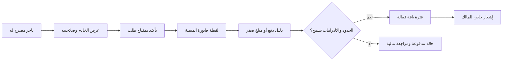

## وظيفة الميزة

تحدد باقة CartJoin فترة الخدمة وسعة المنتجات ومقاعد الموظفين النشطين والبائعين المعتمدين وإتاحة السوق متعدد البائعين. افتح **النظام ← الاشتراك والإعداد** في لوحة المتجر. يستخدم مشرف المنصة **الإدارة ← الاشتراك والإعداد** ثم يختار التاجر.

هذه وظيفة مطورة ومختبرة محليًا. الأسعار في الصور أمثلة اختبار. تحاكي أزرار الاختبار دليل الدفع ولا تخصم أموالًا حقيقية؛ يظل تفعيل المزود الحي والنشر قرارًا منفصلًا.

<SystemTour tour="feature-subscriptions" compact />

## قراءة الاتفاق الحالي

راجع **نسخة الباقة** ونهاية الخدمة والاستخدام والحدود. تشمل المنتجات المسودات، وتشمل المقاعد الحسابات النشطة غير المحذوفة والمالك، ويحسب البائعون من العلاقات المعتمدة. **دون حد** تختلف عن صفر. يحتفظ التاجر القائم الذي لم ينضم إلى اشتراك بوصوله السابق حتى الانضمام الصريح؛ لا تفرض تجربة أو تسعيرة تلقائيًا.

تقرأ قائمة الإعداد التهيئة الفعلية. اكتمال وسيلة دفع أو كتالوج لا يثبت نجاح شراء حي أو حجز شحنة أو تسليم حساب المالك. أكمل دورة تجارية مسموحًا بها قبل الإطلاق.

## خطوات الاستخدام

1. اختر نسخة باقة منشورة واطلب عرضًا من الخادم.
2. اقرأ المبلغ والعملة وتاريخ السريان والصلاحية البالغة ١٥ دقيقة.
3. أكد العرض الذي راجعته مرة واحدة. تستخدم إعادة التأكيد للطلب نفسه مفتاح الطلب نفسه.
4. راجع فاتورة المنصة المستقلة والنتيجة المسجلة.

تحتسب الترقية المؤهلة في العملة والدورة نفسيهما فرق الفترة المتبقية بدقة. يجدول انخفاض السعر أو الحدود وتغيير العملة أو الدورة وإلغاء قدرات السوق عند التجديد، دون تحويل عملات ضمني. لا تحتاج الفاتورة ذات المبلغ صفر إلى عملية دفع.

يوقف تأكيد الخروج المجدول من السوق التعرض الجديد للبائعين مع استمرار مبيعات المتجر وخدمة السجلات القائمة. لا يعيد إلغاء التغيير المجدول إلا القدرات التي تسمح بها الباقة الحالية والاعتمادات.

## الفواتير والتعافي

هذه **فواتير خدمات CartJoin**، مستقلة عن فواتير طلبات العملاء والعمولات وصرف البائعين. يمنع سحب الباقة الانضمام الجديد ويحفظ الشروط المقبولة ولقطات الفواتير السابقة.

يسجل رفض الدفع التجريبي دون إلغاء فترة مدفوعة قائمة. تبقى الفاتورة مدفوعة إذا تعطل التفعيل وتظهر حالة تحتاج مراجعة. اطلب من المالية المصرح لها حل مشكلة الاستخدام أو الالتزامات ثم **إعادة محاولة التفعيل المدفوع**. لا تعيد فاتورة قديمة باقة سابقة فوق باقة أحدث.

يجوز لمالية المنصة إلغاء فاتورة **غير مدفوعة** مع سبب محفوظ للمراجعة، ولا يلغي هذا الإجراء فاتورة مدفوعة. عالج فاتورة التغيير غير المدفوعة قبل طلب تغيير آخر.

## الإلغاء والقيود

يجدول الإلغاء بنهاية الفترة ويمكن التراجع عنه قبل سريانه. ينشئ التجديد فاتورة واحدة ومهلة محددة. بعد المهلة تقيد المبيعات الجديدة والتوسع في السعة مع بقاء التنفيذ والمرتجعات والاسترداد والسجل والمالية للمصرح لهم. لا تعطل الفوترة هوية المتجر ولا تمحو السجلات.

يتلقى المالك إشعارات داخلية خاصة بالعربية والإنجليزية، ومنها تذكير قبل انتهاء التجربة بسبعة أيام ويوم واحد. الإرسال مؤجل وقابل لإعادة المحاولة دون تكرار. تبقى مشكلة التسليم معلقة للتعافي التشغيلي ولا تتراجع عملية فوترة مسجلة بسببها.

## القيود والقرارات

يتطلب تغيير الباقة صلاحية إدارة الاشتراك؛ لا تكفي صلاحية المنتجات لإجراء مالي. يتحقق الخادم من المبالغ والحدود، بما في ذلك الاستيراد والمهام المؤجلة. لا يقبل وضع المتجر عروض بائعين جديدة، ويتطلب السوق باقة مؤهلة وعلاقة بائع معتمدة معًا.

تمنع مغادرة السوق علاقات البائعين المعتمدة والكتالوج النشط والطلبات والمرتجعات المفتوحة ونوافذ الإرجاع السارية والاستردادات والأموال غير المسواة. لا تحذف الأدلة أو تغير ملكية البائع التاريخية لاجتياز الفحص. تواصل مع المالية أو العمليات بمعرفات السجلات وسبب المنع.

## تدفق البيانات والنتيجة

تعمل لوحة المتجر على سياق متجرها فقط. اختيار تاجر آخر عملية خاصة بمشرف المنصة، ولا يحدد حقل في جسم الطلب هوية المتجر. لا تدير لوحتا العميل والبائع فواتير المنصة.

## عند تعذر الإجراء

اطلب عرضًا جديدًا إذا انتهت صلاحيته. وعند إعادة المحاولة بعد انقطاع الشبكة راجع الفاتورة الحالية قبل التأكيد مجددًا. عند تجاوز السعة قلل الاستخدام الجديد أو اختر باقة مؤهلة. إذا كانت الحالة **مدفوعة ولم تفعل** فاحتفظ بالفاتورة واطلب المطابقة من مالية المنصة؛ لا تدفع ثانية لإخفاء المشكلة.

[دليل انضمام التاجر](/ar/features/merchant-onboarding) · [قواعد الأوضاع](/ar/roadmap/modes)
