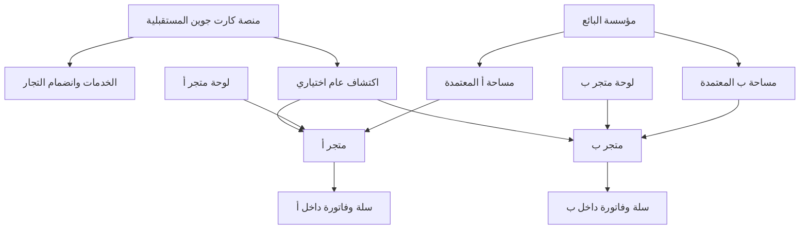

> **معمارية مقترحة لا تنفذها هذه الخارطة.** عزل المستأجر شرط إطلاق في كل مرحلة.

## خمس واجهات بمسؤوليات مستقلة

| الواجهة | الجمهور والغرض | نطاق البيانات |
|---|---|---|
| متجر المستأجر `CartJoin-Storefront-Frontend` | يتصفح العملاء ويشترون من المتجر المحسوم | محتوى المستأجر المنشور وتجارة العميل المصرح بها |
| لوحة المتجر | يدير المالك والموظفون النشاط | مستأجر واحد مع صلاحيات الموظف |
| لوحة البائع | يعمل موظفو البائع في المتاجر المعتمدة | البائع الموثق والمتجر النشط المعتمد |
| لوحة إدارة المنصة | تشغيل المنصة والتحقيق المصرح | صلاحيات منصة صريحة وليست بديلاً غير مقيد لإجراءات المتجر |
| واجهة كارت جوين المستقبلية | الخدمات والباقات والانضمام ثم الاكتشاف والحساب العام | محتوى عام تملكه المنصة وإسقاطات اكتشاف معتمدة؛ تبقى البيانات الخاصة خلف صلاحيات المستأجر |

الواجهة المستقبلية عمل واجهة أمامية منفصل. لا تضف باقات كارت جوين أو قوائم المنتجات بين المتاجر أو انضمام المنصة داخل متجر المستأجر. يمكن مشاركة مكتبات الواجهة، لكن ذلك لا يعني مشاركة بيانات التشغيل.

## الهوية ليست ملكية بيانات العميل

**متطلب مؤكد: حساب عميل مركزي واحد يستخدم في كل واجهات المتاجر دون تسجيل جديد.** تعرف بيانات الدخول نفسها الشخص في جميع المتاجر. تنشأ علاقة المتجر الداخلية تلقائياً دون تكرار عند أول تفاعل مصرح؛ ليست حساباً أو كلمة مرور أو خطوة تسجيل ثانية. يحتفظ المتجر بحالة علاقته وموافقاته وتاريخه التجاري.

| المعلومات | الملكية أو النطاق الموصى به | قاعدة المشاركة |
|---|---|---|
| الهوية العالمية والاعتماد والاسترداد | نطاق حساب العميل المركزي | لا تكشف لموظفي المستأجر |
| علاقة العميل بالمتجر | مستأجر واحد مع حساب العميل المركزي | يرى التاجر علاقته الخاصة فقط |
| الطلبات والفواتير ومحاولات الدفع والمرتجعات | المستأجر الأصلي والعميل المسجل | لا تنقل بمجرد ربط الهويات |
| المحفظة والهدايا والنقاط ومجموعات العملاء | المتجر والعملة والبرنامج القائم | لا ينتقل الرصيد أو الاستحقاق تلقائياً بين المتاجر |
| دفتر عناوين عالمي إن أضيف | خاصية منصة يتحكم فيها العميل | تتحول البيانات المختارة صراحة إلى لقطة عنوان الطلب |
| تفضيلات التسويق | أغراض عالمية وأخرى خاصة بكل متجر | الدخول العالمي ليس موافقة على حملات كل التجار |
| ملخص مشتريات عالمي لاحق | إسقاط خاص بالعميل المصرح | يجلب علاقات الشخص الموثقة فقط ولا يمنح التاجر وصولاً بين المتاجر |

الهدف حساب عميل مركزي مرجعي واحد بدورة اعتماد واسترداد واحدة، مع علاقات متجر للسمات الخاصة عند الحاجة. احفظ سجلات `User` القديمة أثناء ترحيل مرحلي واربط تاريخها بأمان. لا تنشئ سجلاً جديداً بكلمة مرور لكل متجر. المفاهيم هي حساب مركزي وعلاقة متجر وربط قديم موثق؛ يحتاج تصميم الجداول وJWT مراجعة مستقلة.

## tenant_id للعميل يعني مصدر التسجيل فقط

يشترط مالك المنتج إبقاء حقل باسم `tenant_id` في حساب العميل المركزي **لتسجيل المتجر الذي حدث منه أول تسجيل فقط**. هو إسناد إحصائي وليس ملكية أو عضوية أو مساحة نشطة أو حد صلاحية.

| الحدث | tenant_id في العميل المركزي | سياق التجارة النشط |
|---|---|---|
| أول تسجيل من متجر أ | أ، يحدده الخادم | أ |
| دخول العميل نفسه أو شراؤه في ب | يبقى أ دون تسجيل جديد | ب، يحسم بصورة مستقلة |
| تسجيل مستقبلي من موقع كارت جوين العالمي | قيمة فارغة ومصدر تسجيل منصة | لا مستأجر حتى دخول متجر |
| إغلاق متجر المصدر | يبقى الحساب مع حفظ الإسناد أو تفريغ المرجع وفق تصميم الاحتفاظ المعتمد | تبقى علاقات المتاجر الأخرى صحيحة |

لا يتغير الحقل عبر تحديث الملف العادي. لا تحسم منه المتجر النشط ولا تقيد به الدخول العالمي ولا تقبله من جسم نموذج التسجيل ولا تحذف العميل تلقائياً عند حذف متجر المصدر. يمكن لمصدر استحواذ مستقل التمييز بين التسجيل العالمي والترحيل دون اختراع مستأجر.

تبقى حقول `tenant_id` في السلة والطلب والفاتورة ولقطة العنوان والرصيد وعلاقة العميل بالمتجر **حدود ملكية وعزل**. الاسم نفسه على الحساب المركزي له معنى مختلف مقصود يجب توثيقه في النماذج والموارد والتقارير. لا تزل نطاق نموذج `User` الحالي قبل تدقيق جميع مستهلكيه. يفصل الترحيل الإسناد عن الصلاحية ويحفظ المراجع القديمة.

يرى المستأجر إحصاءات التسجيل الخاصة به وعلاقاته بعملائه، ولا يتصفح العملاء العالميين بتغيير مرشح المصدر. تتطلب إحصاءات المنصة صلاحية إدارة صريحة.

## قواعد حسم المستأجر والصلاحيات

- استخرج المستأجر من بنية توجيه أو جلسة موثوقة، لا من معرف يرسل في نموذج المنتج أو السلة أو الشراء.
- استخدم خريطة معتمدة للنطاق أو النطاق الفرعي. ارفض السياق المجهول أو المتعارض ولا تنتقل صامتاً إلى متجر افتراضي.
- يثبت رمز العميل هوية الحساب المركزي. يتحقق كل إجراء خاص من المتجر الموثوق وعلاقته المحلية بصورة مستقلة؛ مصدر التسجيل ليس تفويضًا.
- يبقى الوصول إلى سجل متجر آخر 404. يختلف ذلك عن رفض إجراء غير مخول على سجل صحيح داخل النطاق.
- حافظ على النطاق في مفاتيح التخزين المؤقت والفهارس والرفع وروابط الوسائط الموقعة والتصدير والمهام والأحداث والويب هوك. الهوية العالمية وحدها ليست مفتاح تخزين خاصاً بالمستأجر.
- تبقى رموز الأصناف والروابط والكوبونات فريدة داخل المستأجر. يستخدم الاكتشاف مراجع مستقرة مستقلة إلى العرض الأصلي.
- يظل اعتماد المساحة وملكية البائع إلزاميين حتى مع وجود ملف بائع عام.

## تدفق العميل والطلب

توثيق العميل المركزي متطلب أساسي مبكر لا يعتمد على موقع كارت جوين العالمي. يستطيع عميل قائم الدخول في متجر آخر دون نموذج تسجيل جديد. لا ينشئ الربط الداخلي اشتراكاً تسويقياً ولا ينقل بيانات متجر آخر. يوجه الاكتشاف الزوار إلى المتجر لاحقاً. لا تغير الرحلتان المستأجر المالك للشراء. أعد التحقق من الإتاحة واعتماد البائع والعملة والسعر وأهلية التوصيل داخل المتجر المقصود قبل الشراء.

## خارج النطاق وأدلة الإطلاق

لا استعلامات عامة غير مقيدة على بيانات العملاء أو الطلبات الخاصة، ولا محفظة مشتركة أو فاتورة بين المستأجرين أو دمج تلقائي للحسابات أو وصول للبائع لكل متجر. افحص انتحال المضيف ومعرفات متجر آخر والتخزين والملفات الموقعة والمهام وروابط الاكتشاف القديمة قبل الإطلاق. وثق مسار منصة مصرحاً لكل عملية إدارة مشروعة بين المستأجرين.

الأساس: TenantSetting وUser المقيد وسياق TenantContext وشراء Invoice. راجع [قواعد الملكية الحالية](/ar/business) و[ترحيل الهوية](/ar/roadmap/global-platform) و[بوابات الإطلاق](/ar/roadmap/phases).
