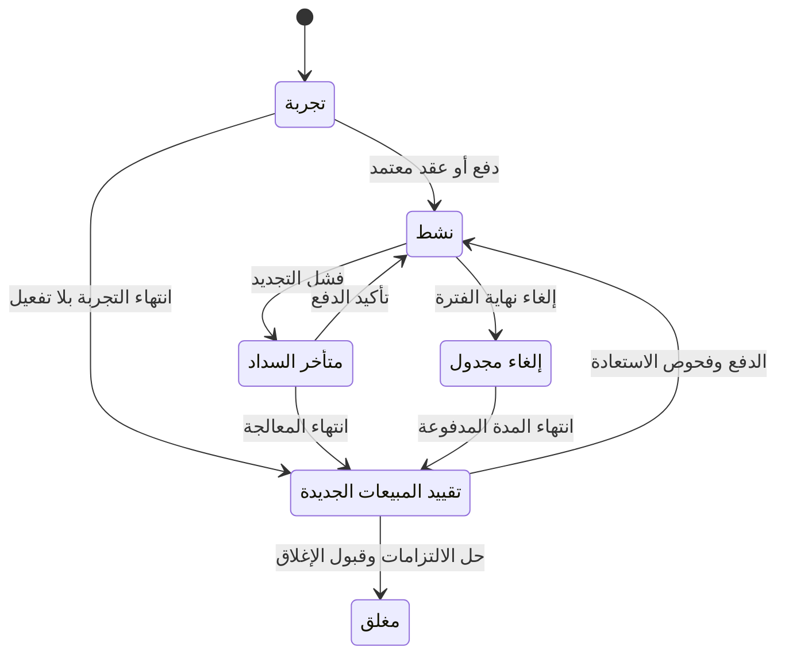

> **سياسة تجارية مقترحة.** أسماء الباقات مؤقتة، ولا تحدد هذه الصفحة أسعاراً أو مزود دفع أو معالجة ضريبية أو عقوداً موقعة.

## نموذج الإيراد الموصى به

اعتمد اشتراك المستأجر أساساً متوقعاً، وقدم الأتمتة والسعة الإضافية وقدرات السوق كباقات أو إضافات واضحة. لا تفرض نسبة منصة افتراضية على كل عملية بيع في الإصدار الأول. تحتاج رسوم الخدمة أو المعاملة الاختيارية خدمة مسعرة بوضوح وقبولاً صريحاً ونسبة إسناد مستقلة في التقارير.

يسمح ذلك للتاجر بحساب التكلفة وللمنصة بتسعير القيمة التشغيلية الأعلى. هذه فرضية تموضع تختبر مع التجار، وليست ضماناً لميزة تنافسية.

| الباقة المؤقتة | التاجر المقصود | اتجاه القدرات |
|---|---|---|
| Store Starter | نشاط مستقل يبدأ بيع منتجاته | أساس التجارة والمحتوى والموظفين والتقارير التشغيلية |
| Store Growth | تاجر يحسن التحويل والتشغيل | سعة أعلى وقدرات محرر واسترجاع وتحليلات وموصلات متحققة |
| Marketplace | نشاط يستضيف بائعين خارجيين معتمدين | أساس المتجر ودورة البائع والإشراف والعمولات والتسويات |
| Enterprise | احتياجات تشغيل متفاوض عليها | شروط وسعة والتزامات خدمة وتكاملات بإصدارات موثقة |

لا تعلن القدرة ضمن الباقة قبل اجتياز بوابة إطلاقها. استخدم إصدارات للباقات حتى لا يغير تعديل السعر شروطاً سبق أن قبلها التاجر.

## افصل أربعة تدفقات مالية

| التدفق | الدافع والمستلم | السجلات والحدود |
|---|---|---|
| اشتراك المنصة أو الإضافة | المستأجر ← يدفع لكارت جوين | فاتورة فوترة منصة وسجل اشتراك مستقلان عن فاتورة مشتريات العميل |
| شراء المنتجات | العميل ← يدفع وفق ترتيب المتجر والبائع المعتمد | مسار الشراء والدفع والاسترداد داخل المستأجر |
| عمولة السوق | تخصم من مستحقات البائع لصالح سوق المستأجر وفق الاتفاق | سجلات عمولة وتسوية علاقة المتجر والبائع |
| اشتراك بائع اختياري | البائع ← يدفع لسوق المستأجر افتراضياً | باقة بائع وإيصال يملكهما المستأجر لاحقاً، لا رسم كارت جوين عالمي |

يحدد أي رسم خدمة لكارت جوين الطرف المتعاقد والأساس والاستثناءات ومعالجة الاسترداد والمستلم. لا تخصمه خفية من عمولة المستأجر. مشاركة بائع عالمي في متجرين لا تنشئ رسماً مزدوجاً تلقائياً. يجب التحقق من المسؤول عن البيع والفوترة قبل الإطلاق التجاري؛ لا ينقل الاكتشاف العالمي المسؤوليات إلى كارت جوين وحده.

## الاستحقاقات والاستخدام

احفظ إصدار الباقة المقبول وتواريخ السريان والوضع والقدرات وسياسة السعة. تفرض الوحدات المالكة الحدود عند إنشاء استخدام جديد، بما يشمل التزامن والاستيراد والمهام. تبقى صلاحية الموظف شرطاً إضافياً.

| الاستخدام | قاعدة العد المقترحة |
|---|---|
| المنتجات | المنتجات الأب غير المؤرشفة بما فيها المسودات؛ تحدد سعة المتغيرات والأصناف بصورة منفصلة |
| مقاعد الموظفين | الموظفون النشطون المصرحون؛ تحتاج حجوزات الدعوات سياسة انتهاء واضحة |
| البائعون | روابط المستأجر والبائع النشطة المعتمدة مع فحص اعتماد ذري |
| التخزين | البايتات المدارة وفق قاعدة موثقة للأصول والمشتقات؛ لا تحذف الأدلة المالية المحتفظ بها لتحقيق الحد |
| الأتمتة والرسائل | تعريف وحدة المحاولة أو التسليم وتكلفة المزود قبل التسعير |

أخطر قبل الوصول إلى الحد واعرض الاستخدام وطريق المعالجة. لا فوترة تجاوز صامتة. لا يحذف انتهاء الباقة أو تقليل الحد البيانات ولا يغير أسعار شراء سابق. امنع الاستخدام الجديد عند الحاجة وقدم التنظيف أو الترقية كخيارات واضحة.

## دورة الاشتراك

السياسة الأولية المقترحة تجربة 14 يوماً قابلة للضبط، دون خصم تلقائي بلا تفويض مقبول، ونافذة معالجة تجديد قابلة للضبط. تحدد المرحلة صفر مدة السماح ومواعيد التذكير والرسوم وجدول الإعادة.

هذه حالات مفاهيمية وليست قيماً معتمدة لتعداد قاعدة البيانات. **قيد الفوترة مختلف عن التعليق الأمني.** يفترض أن يوقف التأخر تعرضاً تجارياً جديداً مع مسار مصرح لإكمال الطلبات والإرجاع والاسترداد والفوترة وأموال البائعين. لا تعد توظيف تعليق المستأجر الصارم دون تحليل. يبقى التعليق الأمني تحكماً فورياً مستقلاً بمعالجة مدققة.

## التغييرات والتعافي والقبول

- تعرض الترقية وقت السريان ومعاينة التناسب المحسوبة من الخادم قبل القبول. لا تفعل الاستحقاق المدفوع إلا بتأكيد الدفع أو رصيد أو عقد مخول مسجل.
- جدول الخفض عند التجديد بعد فحص الاستخدام والالتزامات. تطبق [قواعد خفض الوضع](/ar/roadmap/modes) الأشد عند مغادرة السوق.
- وثق محاولات الدفع وتحقق من الويب هوك. لا تكرر الإعادة الفاتورة أو الخصم أو التفعيل.
- سجل نجاح الفوترة وفشل التهيئة كاستثناء قابل للإعادة أو التعويض. لا تمنح الوصول من إعادة توجيه المتصفح وحدها.
- احتفظ بالفواتير والشروط الأصلية عند إيقاف الباقة. تحتاج سياسات الإلغاء والاسترداد والاحتفاظ بالبيانات شروطاً معتمدة قبل الإطلاق.

تشمل أدلة الإطلاق فحص الحدود المتزامن وفشل التجديد والتعافي وإعادة الويب هوك وإلغاء الترقية والعرض القديم والتعافي من الدفع بلا تهيئة وخدمة المشتريات القائمة أثناء قيد الفوترة. راجع [المراحل](/ar/roadmap/phases) و[القرارات التجارية](/ar/roadmap/decisions).
