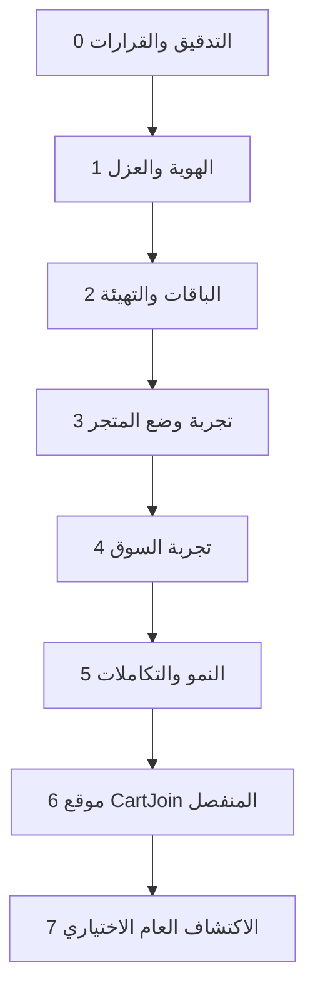

> **للتخطيط فقط.** تقترح هذه المراحل أعمالًا مستقبلية ولا تمثل إذنًا بالتنفيذ أو وعدًا بمواعيد. يبدأ التقدير بعد تدقيق المصدر والاتفاق على معايير القبول.

## ترتيب التسليم

توحيد حساب العميل جزء من الأساس المبكر. يمكن تأجيل موقع CartJoin العام دون مطالبة العملاء بالتسجيل مرة أخرى لكل متجر.

## المرحلة 0 — تدقيق واعتماد نموذج التشغيل

**P0 · مالك المنتج والقائد التقني والتشغيل.** حصر السلوك المنفذ في الخلفية والواجهات الأربع وتسجيل إصدارات المصدر والمسارات والإعدادات والنواقص والمسؤوليات المالية الفعلية. وجود هيكل أو إعداد لا يثبت اكتمال الميزة.

تدقيق تفرد العملاء والمعرفات الموثقة والتكرار وبيانات الدخول ومطالبات JWT وكل استخدام لـ `User.tenant_id` والمفاتيح الخارجية والحذف المتتابع والتقارير والتصدير والبحث. يجب التمييز بين دليل مصدر التسجيل الأول وحقل الملكية القديم؛ لا نخترع إسنادًا عند غياب الدليل.

**بوابة الخروج:** قرارات معتمدة ومصفوفة أوضاع وصلاحيات وخطة مطابقة الترحيل وسياسات تسعير وفوترة واضحة وتجربة محددة ومعايير قبول قابلة للقياس. تحديد مسؤول البيع وإصدار الفواتير والتشغيل قبل تحصيل أموال وفق الشروط الجديدة.

## المرحلة 1 — هوية مركزية وقدرات تحافظ على العزل

**P0 · مسؤولو الهوية والخلفية والواجهات · بعد المرحلة 0.** حساب عميل واحد يدخل إلى كل متجر مؤهل، مع إنشاء علاقة داخلية بين العميل والمتجر تلقائيًا دون تكرار. يبقى `tenant_id` في العميل إسنادًا لمصدر التسجيل الأول فقط، ويمكن أن يكون فارغًا للتسجيل العام. تبقى ملكية سجلات التجارة مرتبطة بمتجرها.

تطبيق سياسة موحدة لقدرات المتجر والسوق تراعي الباقة وحالة المتجر والصلاحية واعتماد البائع. تدقيق الطلبات والمهام الخلفية والتخزين المؤقت والبحث والتصدير والوسائط. واجهة المتجر معزولة ولا يضاف إليها اكتشاف عام.

**بوابة الخروج:** دخول بين المتاجر دون تسجيل جديد ومطابقة معرفات الحسابات القديمة ومنع الدمج غير الآمن وإرجاع 404 للسجل خارج المتجر وعدم تراجع العزل التجاري. مطابقة الأعداد قبل تحويل القراءة. يحفظ التراجع روابط الحسابات والطلبات الجديدة؛ لا تُستعاد قاعدة قديمة فوق مشتريات حية.

## المرحلة 2 — الباقات والتفعيل الموجّه

**P0 · الفوترة والمنتج والتشغيل · بعد المرحلة 1.** بناء باقات بإصدارات وحدود استخدام وحالات اشتراك وسجلات فوترة للمنصة وتهيئة بمساعدة المشغل وتوفير موارد قابل للاستكمال. فصل فاتورة اشتراك CartJoin عن فاتورة شراء العميل وعمولة البائع.

دعم عرض تكلفة الترقية وتأكيد التفعيل والتخفيض المجدول وخدمة الالتزامات عند تقييد المبيعات. تحديد السماح وانتهاء التجربة وإعادة المحاولات والإشعارات والاستثناءات اليدوية المصرح بها قبل الإطلاق.

**بوابة الخروج:** الحدث المكرر للدفع لا يكرر التحصيل أو التهيئة؛ تظهر حالات الدفع دون تفعيل في قائمة معالجة؛ تحافظ القيود على الاسترداد والتنفيذ والمطابقة المصرح بها. تُختبر الاستعادة والتفعيل في بيئات اختبار مزود الدفع خلال التنفيذ.

## المرحلة 3 — تجربة وضع المتجر

**P0 · المتجر والكتالوج والدفع والتنفيذ · بعد المرحلة 2.** تجربة منتجات مملوكة للمتجر ورحلة التصفح والدخول والسلة والتسعير الحديث والشراء والدفع والشحن والإرجاع والاسترداد. اعتماد شراء الضيف فقط عند تفعيله ودعم الرحلة كاملة. تطوير إدارة المحتوى الحالية بالمسودة والمعاينة والنشر بدل افتراض عدم وجودها.

يمكن للشحن اليدوي دعم تجربة معلنة بمساعدة المشغل. ادعاء وجود ربط مباشر بشركة شحن يتطلب إثبات الحجز والملصقات والتتبع والإلغاء ومعالجة الاستثناءات مع مزود فعلي.

**بوابة الخروج:** إكمال المشغلين للرحلات المسموحة ومطابقتها؛ أمان إعادة محاولة المخزون والدفع؛ مراجعة الإنجليزية والعربية والهاتف وإمكانية الوصول. قياس إتمام الشراء والاستثناءات مقارنة بخط أساس معتمد.

## المرحلة 4 — تجربة السوق

**الأساس P0 / الكفاءة P1 · السوق والمالية · بعد المرحلة 3.** تفعيل البائعين المعتمدين لكل متجر وشروط البيع ونشر العروض وتقسيم فاتورة المتجر إلى طلبات بائعين وسياسات العمولات والإرجاع والتسويات واستثناءات الصرف. مراقبة الإرسال والإلغاء مع مراجعة واعتراض.

**بوابة الخروج:** يرى البائع مساحته المعتمدة وسجلاته فقط؛ تتطابق الدفاتر مع الطلبات والاسترداد والصرف؛ يحافظ التعليق والتخفيض على الالتزامات. تجربة الإرجاع المفتوح والرصيد السالب وفشل الصرف قبل التوسع.

## المرحلة 5 — النمو والتكاملات المراقبة

**P1 · النمو والتكامل والتحليلات · بعد استقرار التجارب.** استعادة شراء تحترم الموافقة وقياس مراحل التحويل وتسليم موثوق لأحداث الويب وتقارير استخدام وشاشات تشغيل. تحدد أدلة التجربة الأولوية بدل عدد المزايا.

**بوابة الخروج:** الموافقة التسويقية حسب المتجر والغرض؛ محاولات محدودة ومرئية؛ حماية الأسرار؛ فصل مصدر التسجيل عن المعاملات اللاحقة. لا تكشف تقارير متجر نشاط عميل في متجر آخر.

## المرحلة 6 — موقع منفصل لاكتساب عملاء CartJoin

**P2 · الواجهة العامة والفريق التجاري · بعد إثبات عقود التهيئة والفوترة.** واجهة جديدة لخدمات CartJoin وباقاتها واشتراكاتها وطلبات انضمام المتاجر. إعادة استخدام الهوية المركزية وعقود التهيئة، وعدم تغيير غرض `CartJoin-Storefront-Frontend`.

**بوابة الخروج:** تطابق الباقات العامة عروض الفوترة ذات الإصدارات؛ استكمال التهيئة الجزئية؛ فصل إدارة التاجر عن دخول المشتري. تستمر واجهات المتاجر القائمة باستقلال.

## المرحلة 7 — اكتشاف عام اختياري

**P2 · الاكتشاف والثقة · بعد المرحلة 6 وضوابط النشر.** عرض المتاجر والبائعين والعروض العامة المؤهلة بموافقة صريحة. إتمام الشراء لدى المتجر المختار. يمكن إضافة عرض مشتريات مجمع لصاحب الحساب بعد مراجعة الخصوصية والصلاحيات.

**بوابة الخروج:** انتشار إلغاء النشر والتعليق وتغير السعر والمخزون عبر عملية تحديث وإزالة مقاسة. يعاد التحقق من السعر والتوفر عند الدفع لدى المتجر. لا تدخل بيانات العملاء الخاصة الفهرس العام.

## التوسع يحتاج قرارًا مستقلًا

الشراء الموحد بين المتاجر والأرصدة المالية المشتركة والملكية الموحدة للمنتجات ونقاط البيع وتجارة الشركات والذكاء الاصطناعي المستقل ليست مراحل ملتزمًا بها. تحتاج كل منها طلبًا مثبتًا وجدوى ومسؤول تشغيل وقواعد بيانات ومال مستقلة. الحساب المشترك لا يبرر وحده دمج الأموال أو الطلبات.

## ضوابط الإطلاق والتراجع

تحتاج كل مرحلة مسؤولًا محاسبًا ونطاقًا معتمدًا وإصدار مصدر وتجربة ترحيل ودليل تشغيل وأدلة قبول وتجربة محدودة. هذه فحوص مطلوبة عند التنفيذ لاحقًا، وليست ادعاءً باختبار السلوك المقترح الآن.

تُفعّل القدرات تدريجيًا. يُوقف التفعيل الجديد عند فشل المطابقة أو العزل، مع حفظ خدمة السجلات السابقة للمصرح لهم، وإعادة المهام القابلة للاستعادة بمفاتيح تمنع التكرار. لا يتم التراجع بحذف الدليل المالي أو تحويل تاريخ البائع إلى ملكية المتجر.
