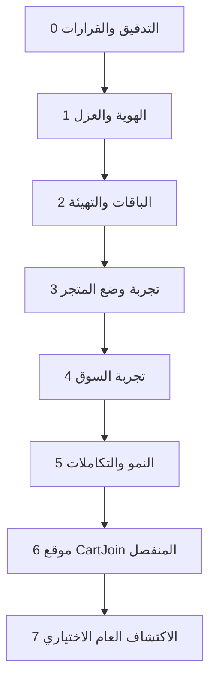

> **نقطة تطوير مختبرة محلياً · ١٨ نوفمبر ٢٠٢٦.** نُفذ الدخول المركزي وفحوص وضع التجارة والفوترة التجريبية ذات الإصدارات وطلبات التجار بمساعدة المشغل. تشمل النقطة الحالية أيضاً التنفيذ الفعلي وتسوية مكافآت التحصيل اللاحق والاسترداد واختيارات التسويق والاكتشاف الاختياري وملخص مشتريات خاصاً بالعميل بين المتاجر. يبقى قبول المراحل كاملةً وأعمال النمو والتكامل والنشر الحي بوابات مستقلة. [الفوترة](/ar/features/subscriptions) · [طلبات التجار](/ar/features/merchant-onboarding) · [اختيارات التسويق](/ar/features/marketing-consent) · [الاكتشاف](/ar/features/global-discovery).

> **خارطة التنفيذ وبوابات الإطلاق.** يوضح ما سبق إنجاز التطوير. تحتفظ المراحل التالية بمتطلبات القبول التشغيلي والتجاري؛ اكتمال المصدر لا يعني تجربة تجارية حية أو نشرًا إنتاجيًا.

> **مرحلة موائمات التطوير · ١٨ نوفمبر ٢٠٢٦.** نُفذت محاكاة دفع العميل المقيدة، والتتبع التجريبي الموقّع وملصقاته الخاصة، والرسائل المحلية المشفرة. نجح ٢٥١ اختبار انحدار للدفع والفاتورة والاسترداد و١٧ اختباراً مركزاً للنتيجة والعرض. جرى اختبار النجاح والرفض بالإنجليزية والعربية في المتصفح. هذا إنجاز لتطوير الموائمات وليس جاهزية لدفع أو شحن حي. [معاينة الدفع](/ar/features/payments).

## ترتيب التسليم

**تقدم عمليات السوق في التطوير · ١٨ نوفمبر ٢٠٢٦:** نُفذ نشر السياسات وقبول
إصدارها المحدد وحوار الحالات المحفوظ والمراجعة الصريحة واعتراض البائع وإسناد
المراجع وثماني قوائم أدلة في الخادم ولوحات المتجر والبائع والمنصة.
[الدليل والجولات](/ar/features/marketplace-operations). لا يغلق ذلك المرحلة؛
نُفذ واختبر إرسال المنتجات وتصحيحها وإعادة إرسالها وإيصالات المراجعة المحفوظة
وصلاحية النشر المستقلة وتقارير الاستيراد الآمنة في اللوحات الثلاث.
[دليل مراجعة المنتج](/ar/features/product-review). تضيف النقطة الحالية ربط أدلة الشحن المحفوظة
بدورة الطلب، وتبقى مؤشرات أداء الإرسال وقبول التجربة التشغيلية بحاجة إلى أدلة.
موافقات التسويق وضوابط نشر الاكتشاف أساس للتطوير، وليست إغلاقاً لمرحلة النمو كاملةً.

**تقدم تنفيذ الطلب في التطوير:** نُفذت التعبئة وحفظ أدلة شركة الشحن وتقييم
التنفيذ حسب الكميات. أصبحت لانتقالات الطلب المحفوظة والمطابقة الخلفية ونشر
الأحداث دون تكرار غير مقصود اختبارات تكامل مقيدة. نُفذ التأكيد الصريح للمتجر
وعرض التقدم الجزئي للعميل مع شاشات الموظفين. يحتفظ الحدث المتأخر بالحالة
المسجلة وقت القرار. يبقى التنفيذ الآلي **معطلاً افتراضياً**؛ ويتطلب تفعيله
بوابة مراجعة مستقلة عن نقطة المصدر وقبول المتصفح واللوحات النهائي. لا يكمل التسليم الجزئي أو تعديل
الحالة أو ادعاء البائع الطلب كله، ولا يستكمل الدليل التجريبي تسليمات فعلية
ناقصة، ويظل وقت الإرسال المجهول مجهولاً. لا يعني التسليم وحده تحصيل الدفع عند
الاستلام أو منح مكافأة لشراء لم تُسوَّ قيمته. [دليل التعبئة الحالي](/ar/features/packing).

**تقدم تذكير التقييم:** يُحفظ موعد الاستحقاق وإقرار إنشاء الإشعار لكل متجر
وطلب. لا يرسل تكرار حدث التسليم التذكير مبكراً ولا ينشئ إشعاراً مقبولاً آخر.
ينتظر التذكير ثلاثة أيام على الأقل، ثم يعيد فحص الطلب والتقييمات المطلوبة
ويستخدم لغة العميل العربية أو الإنجليزية. لا يمنح التسليم التجريبي شارة
شراء موثق. يبقى تعافي وسيلة الإرسال وشاشة إعادة المحاولة للمشغل قيد العمل؛
ولا يعني ذلك إثبات وصول بريد حي. [دليل التقييمات](/ar/features/reviews).

**تقدم تجهيز الدفع عند الاستلام:** أصبح تثبيت رصيد المحفظة وبطاقات الهدايا
والنقاط مع تجهيز المخزون في معاملة واحدة؛ تمنع فحوص المبلغ والصلاحية الرصيد
غير الصالح، ويظل النقد غير مدفوع حتى تسجيل التحصيل. يُمنع استبدال محاولة
الدفع بعد دليل الإرسال المحفوظ. تعالج المطابقة المحفوظة الآن مكافآت التحصيل
اللاحق والاستردادات النقدية والضريبية المتراكمة والإنفاق المؤهل ذي النقاط
الصفرية ومكافأة أول طلب والحدود السالبة والحجوزات المرتبطة المحمية. يوقف
اقتطاع المكافآت غير المكتمل الاستبدال الجديد إلى حين مراجعة المشغل. تستخدم
المشتريات الجديدة أساساً موحداً بإصدار للقيمة المدفوعة فعلياً لكل بند، وتحتفظ
السجلات القديمة بقواعد توافق معلنة. بقاء حجز منتهي المهلة لا يعيد تفويض تحصيله.
[قواعد الدفع](/ar/features/payments) · [مطابقة المكافآت](/ar/features/loyalty) · [الاسترداد](/ar/features/refunds).

**نقطة الموافقات:** يستطيع العميل منح موافقة العروض وتذكيرات السلة أو سحبها
لكل متجر وقناة بشكل مستقل بالعربية والإنجليزية. تبدأ الخيارات متوقفة،
وتحفظ التغييرات نسخة نص الموافقة. لا ترسل هذه الأدوات حملة ولا تكمل استعادة السلة.
[اختيارات العميل](/ar/features/marketing-consent).

**نقطة المنصة المنفصلة والاكتشاف:** أُضيف إلى مقارنة الباقات وطلبات التجار
نشر المتاجر والعروض بمراجعة مستقلة وموافقة البائع لكل مساحة عمل واكتشاف
المتاجر والمنتجات والبائعين علناً. يستطيع العميل الحالي الدخول ورؤية ملخص
مشترياته هو فقط بين المتاجر. يبقى الشراء والأرصدة المالية لدى متجرها.
أصبح التسجيل العام الموثق للعميل واستعادة الحساب دون متجر ضمن
[مسار الحساب المنفصل](/ar/features/global-customer-account). يظل الدخول التلقائي
بين النطاقات والدفع المشترك بين المتاجر خارج هذا النطاق.
[ضوابط الاكتشاف](/ar/features/global-discovery) · [المشتريات الخاصة](/ar/features/cross-store-purchases).

توحيد حساب العميل جزء من الأساس المبكر. يمكن تأجيل موقع CartJoin العام دون مطالبة العملاء بالتسجيل مرة أخرى لكل متجر.

## المرحلة 0 — تدقيق واعتماد نموذج التشغيل

**P0 · مالك المنتج والقائد التقني والتشغيل.** حصر السلوك المنفذ في الخلفية والواجهات الأربع وتسجيل إصدارات المصدر والمسارات والإعدادات والنواقص والمسؤوليات المالية الفعلية. وجود هيكل أو إعداد لا يثبت اكتمال الميزة.

تدقيق تفرد العملاء والمعرفات الموثقة والتكرار وبيانات الدخول ومطالبات JWT وكل استخدام لـ `User.tenant_id` والمفاتيح الخارجية والحذف المتتابع والتقارير والتصدير والبحث. يجب التمييز بين دليل مصدر التسجيل الأول وحقل الملكية القديم؛ لا نخترع إسنادًا عند غياب الدليل.

**بوابة الخروج:** قرارات معتمدة ومصفوفة أوضاع وصلاحيات وخطة مطابقة الترحيل وسياسات تسعير وفوترة واضحة وتجربة محددة ومعايير قبول قابلة للقياس. تحديد مسؤول البيع وإصدار الفواتير والتشغيل قبل تحصيل أموال وفق الشروط الجديدة.

## المرحلة 1 — هوية مركزية وقدرات تحافظ على العزل

**P0 · مسؤولو الهوية والخلفية والواجهات · بعد المرحلة 0.** حساب عميل واحد يدخل إلى كل متجر مؤهل، مع إنشاء علاقة داخلية بين العميل والمتجر تلقائيًا دون تكرار. يبقى `tenant_id` في العميل إسنادًا لمصدر التسجيل الأول فقط، ويمكن أن يكون فارغًا للتسجيل العام. تبقى ملكية سجلات التجارة مرتبطة بمتجرها.

تطبيق سياسة موحدة لقدرات المتجر والسوق تراعي الباقة وحالة المتجر والصلاحية واعتماد البائع. تدقيق الطلبات والمهام الخلفية والتخزين المؤقت والبحث والتصدير والوسائط. واجهة المتجر معزولة ولا يضاف إليها اكتشاف عام.

**بوابة الخروج:** دخول بين المتاجر دون تسجيل جديد ومطابقة معرفات الحسابات القديمة ومنع الدمج غير الآمن وإرجاع 404 للسجل خارج المتجر وعدم تراجع العزل التجاري. مطابقة الأعداد قبل تحويل القراءة. يحفظ التراجع روابط الحسابات والطلبات الجديدة؛ لا تُستعاد قاعدة قديمة فوق مشتريات حية.

## المرحلة 2 — الباقات والتفعيل الموجّه

**P0 · الفوترة والمنتج والتشغيل · بعد المرحلة 1.** بناء باقات بإصدارات وحدود استخدام وحالات اشتراك وسجلات فوترة للمنصة وتهيئة بمساعدة المشغل وتوفير موارد قابل للاستكمال. فصل فاتورة اشتراك CartJoin عن فاتورة شراء العميل وعمولة البائع.

دعم عرض تكلفة الترقية وتأكيد التفعيل والتخفيض المجدول وخدمة الالتزامات عند تقييد المبيعات. تحديد السماح وانتهاء التجربة وإعادة المحاولات والإشعارات والاستثناءات اليدوية المصرح بها قبل الإطلاق.

**بوابة الخروج:** الحدث المكرر للدفع لا يكرر التحصيل أو التهيئة؛ تظهر حالات الدفع دون تفعيل في قائمة معالجة؛ تحافظ القيود على الاسترداد والتنفيذ والمطابقة المصرح بها. تُختبر الاستعادة والتفعيل في بيئات اختبار مزود الدفع خلال التنفيذ.

## المرحلة 3 — تجربة وضع المتجر

**P0 · المتجر والكتالوج والدفع والتنفيذ · بعد المرحلة 2.** تجربة منتجات مملوكة للمتجر ورحلة التصفح والدخول والسلة والتسعير الحديث والشراء والدفع والشحن والإرجاع والاسترداد. اعتماد شراء الضيف فقط عند تفعيله ودعم الرحلة كاملة. تطوير إدارة المحتوى الحالية بالمسودة والمعاينة والنشر بدل افتراض عدم وجودها.

يمكن للشحن اليدوي دعم تجربة معلنة بمساعدة المشغل. ادعاء وجود ربط مباشر بشركة شحن يتطلب إثبات الحجز والملصقات والتتبع والإلغاء ومعالجة الاستثناءات مع مزود فعلي.

**بوابة الخروج:** إكمال المشغلين للرحلات المسموحة ومطابقتها؛ أمان إعادة محاولة المخزون والدفع؛ مراجعة الإنجليزية والعربية والهاتف وإمكانية الوصول. قياس إتمام الشراء والاستثناءات مقارنة بخط أساس معتمد.

## المرحلة 4 — تجربة السوق

**الأساس P0 / الكفاءة P1 · السوق والمالية · بعد المرحلة 3.** تفعيل البائعين المعتمدين لكل متجر وشروط البيع ونشر العروض وتقسيم فاتورة المتجر إلى طلبات بائعين وسياسات العمولات والإرجاع والتسويات واستثناءات الصرف. مراقبة الإرسال والإلغاء مع مراجعة واعتراض.

**بوابة الخروج:** يرى البائع مساحته المعتمدة وسجلاته فقط؛ تتطابق الدفاتر مع الطلبات والاسترداد والصرف؛ يحافظ التعليق والتخفيض على الالتزامات. تجربة الإرجاع المفتوح والرصيد السالب وفشل الصرف قبل التوسع.

## المرحلة 5 — النمو والتكاملات المراقبة

**P1 · النمو والتكامل والتحليلات · بعد استقرار التجارب.** استعادة شراء تحترم الموافقة وقياس مراحل التحويل وتسليم موثوق لأحداث الويب وتقارير استخدام وشاشات تشغيل. تحدد أدلة التجربة الأولوية بدل عدد المزايا.

**الحد الحالي:** نُفذت موافقات المتجر والغرض والقناة. يتبقى تنفيذ الاستعادة
الخلفية دون تكرار، مع إعادة فحص الموافقة الحالية وأهلية الحساب والسلة والشراء
وصحة وسيلة الاتصال عند الإرسال؛ وسجلات محدودة للمحاولات والمنع والمتابعة؛
وقياس نتائج حقيقي. يجب أن تفصل مراحل التحويل ومجموعات الشراء المستندة إلى
حقائق محفوظة مصدر التسجيل عن العلاقة بالمتجر والمشتريات اللاحقة، وتستبعد
النشاط التجريبي ولا تخترع أحداثاً تاريخية. لا تغني بنية التقارير والإشعارات
وأحداث الويب القائمة عن قبول التعافي والتشغيل الكامل لكل تكامل ووسيلة إرسال.
يبقى تعافي إرسال تذكير التقييم وإعادة المحاولة للمشغل عملاً صريحاً.

**بوابة الخروج:** الموافقة التسويقية حسب المتجر والغرض؛ محاولات محدودة ومرئية؛ حماية الأسرار؛ فصل مصدر التسجيل عن المعاملات اللاحقة. لا تكشف تقارير متجر نشاط عميل في متجر آخر.

## المرحلة 6 — موقع منفصل لاكتساب عملاء CartJoin

**P2 · الواجهة العامة والفريق التجاري · بعد إثبات عقود التهيئة والفوترة.** واجهة جديدة لخدمات CartJoin وباقاتها واشتراكاتها وطلبات انضمام المتاجر. إعادة استخدام الهوية المركزية وعقود التهيئة، وعدم تغيير غرض `CartJoin-Storefront-Frontend`.

**الحد الحالي:** توفر المنصة المنفصلة رحلة الباقات والتقديم التجريبية ودخول
العميل الحالي والتسجيل الموثق بالهاتف واستعادة كلمة المرور دون متجر. لا
ينشأ حساب قابل للاستخدام قبل إثبات الوصول، ولا يُضاف متجر أصل وهمي أو
عضوية متجر عند التسجيل العام. تظل محولات التحقق التجريبية محدودة وللاختبار
فقط، وتفعيل المزود منفصل. توحيد بيانات الدخول لا يعني دخولاً تلقائياً بين
النطاقات. [دليل الحساب والجولة الفعلية](/ar/features/global-customer-account).

**بوابة الخروج:** تطابق الباقات العامة عروض الفوترة ذات الإصدارات؛ استكمال التهيئة الجزئية؛ فصل إدارة التاجر عن دخول المشتري. تستمر واجهات المتاجر القائمة باستقلال.

## المرحلة 7 — اكتشاف عام اختياري

**P2 · الاكتشاف والثقة · بعد المرحلة 6 وضوابط النشر.** عرض المتاجر والبائعين والعروض العامة المؤهلة بموافقة صريحة. إتمام الشراء لدى المتجر المختار. يمكن إضافة عرض مشتريات مجمع لصاحب الحساب بعد مراجعة الخصوصية والصلاحيات.

**الحد الحالي:** نُفذت في التطوير موافقات المتجر والبائع والمراجعة المستقلة
للمتجر والعرض وملخص مشتريات العميل الخاص. تتبقى بوابة قبول مراقبة لملكية
النطاق وإعادة مراجعة المحتوى المتغير وإزالة المنسحب أو المعلق وحداثة السعر
والمخزون والانتقال لدفع المتجر في ظروف التشغيل الفعلية. لا تثبت ضوابط النشر
وحدها ضمان حداثة فهرس بحث حي ولا تغلق التجربة التجارية.

**بوابة الخروج:** انتشار إلغاء النشر والتعليق وتغير السعر والمخزون عبر عملية تحديث وإزالة مقاسة. يعاد التحقق من السعر والتوفر عند الدفع لدى المتجر. لا تدخل بيانات العملاء الخاصة الفهرس العام.

## قبول الإصدار المتبقي

يتطلب الإطلاق التجاري أيضاً أسعاراً ومسؤوليات فوترة وضريبة معتمدة وشروط
السماح والتذكير والمحاولات ومسؤولين تشغيليين واختبار قبول لكل مزود. هذه
قرارات وبوابات إطلاق، وليست خصائص إنتاجية نستنتجها من المصدر. تظل نهاية
عمل التطوير المصرح بها مصدراً ووثائق مختبرة؛ والنشر الحي منفصل.

## التوسع يحتاج قرارًا مستقلًا

الشراء الموحد بين المتاجر والأرصدة المالية المشتركة والملكية الموحدة للمنتجات ونقاط البيع وتجارة الشركات والذكاء الاصطناعي المستقل ليست مراحل ملتزمًا بها. تحتاج كل منها طلبًا مثبتًا وجدوى ومسؤول تشغيل وقواعد بيانات ومال مستقلة. الحساب المشترك لا يبرر وحده دمج الأموال أو الطلبات.

## ضوابط الإطلاق والتراجع

تحتاج كل مرحلة مسؤولًا محاسبًا ونطاقًا معتمدًا وإصدار مصدر وتجربة ترحيل ودليل تشغيل وأدلة قبول وتجربة محدودة. هذه فحوص مطلوبة عند التنفيذ لاحقًا، وليست ادعاءً باختبار السلوك المقترح الآن.

تُفعّل القدرات تدريجيًا. يُوقف التفعيل الجديد عند فشل المطابقة أو العزل، مع حفظ خدمة السجلات السابقة للمصرح لهم، وإعادة المهام القابلة للاستعادة بمفاتيح تمنع التكرار. لا يتم التراجع بحذف الدليل المالي أو تحويل تاريخ البائع إلى ملكية المتجر.
