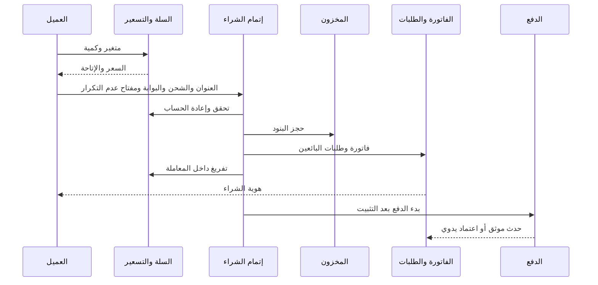
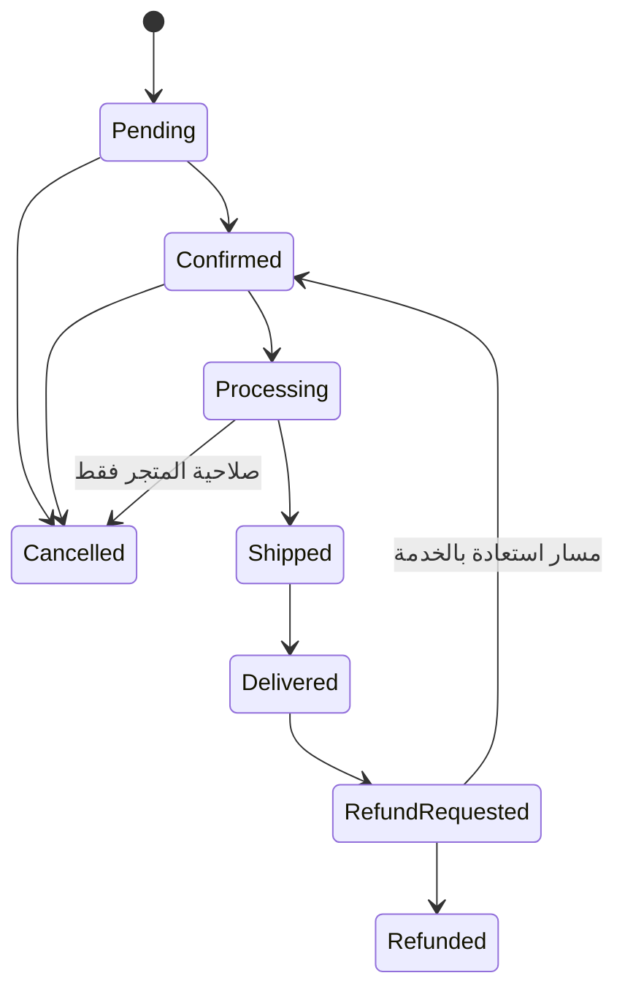

## مثال عملي

اشترى عميل صنفاً من البائع أ وصنفين من ب داخل متجر واحد. تبقى السلة واحدة وينشئ الشراء فاتورة وطلبين. ينفذ كل بائع طلبه، ويتابع العميل الاثنين من سياق الشراء دون إتمام شراء ثانٍ.

## اربط الخطوات بالشاشة

<SystemTour tour="orders" compact />

## تسليم المسؤولية وحدود الفشل

| المرحلة | المسؤول | النتيجة | عند التعذر |
|---|---|---|---|
| الاكتشاف | العميل والكتالوج المنشور | متغير مختار | راجع النشر والمرشحات |
| السلة | العميل والتسعير | بنود وإجماليات جديدة | عالج رسائل الإتاحة والأهلية |
| الشراء | منسق الفاتورة | فاتورة وطلبات وحجوزات | لا يترك الفشل شراء جزئياً |
| الدفع | المزود أو موظف المتجر | محصل أو منتظر أو فاشل | افحص المحاولة ولا تعتمد الرجوع |
| التنفيذ | المتجر والبائع | سجل حالات وطرود | انتقال مسموح وفحص الناقل |
| التسليم | تكامل التنفيذ | دليل تسليم | يتيح خدمات ما بعد البيع المؤهلة |

الخريطة لمسارات خدمة الطلب وليست إتاحة لكل الأطراف. لا يلغي البائع من التجهيز. يلغي العميل عبر إجراء الطلب التابع المؤهل بالفاتورة. متابعة المنصة للطلبات للقراءة فقط.

راجع [السلة](/ar/features/cart) و[الشراء](/ar/features/checkout) و[الطلب](/ar/features/orders) و[الدفع](/ar/features/payments) و[الشحن](/ar/features/shipping).
