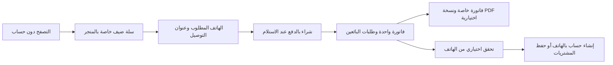

## للعميل: جهّز سلتك

تصفح المتجر أو صفحة المنتج واختر **إضافة إلى السلة** دون الحاجة إلى حساب. افتح **السلة** لتعديل الكميات أو إزالة المنتجات. السلة مرتبطة بهذا المتجر والمتصفح وتنتهي صلاحيتها بعد سبعة أيام. تُراجع الأسعار والمخزون ورسوم التوصيل مرة أخرى قبل إتمام الشراء.

## اشترِ دون بريد إلكتروني

افتح **إتمام الشراء** وأدخل اسم المستلم وعنوان التوصيل و**رقم هاتف صالحاً**. البريد الإلكتروني اختياري. اختر وسيلة توصيل متاحة و**الدفع عند الاستلام**، ثم راجع إجمالي الفاتورة قبل تأكيد الطلب. يجب أن يكون الشراء كضيف مفعلاً للمتجر. إذا كان متوقفاً، سجّل الدخول لإتمام الشراء؛ يمكنك تجهيز السلة كضيف.

المحفظة ونقاط الولاء وبطاقات الهدايا والكوبونات تتطلب تسجيل الدخول. سجّل الدخول لاستخدام مزايا الحساب وطرق الدفع الأخرى المؤهلة. تُضاف سلة الضيف إلى سلة الحساب وفق الأسعار والمخزون الحاليين. المشتريات السابقة لا تُضاف إلى الحساب بمجرد تسجيل الدخول؛ يلزم التحقق من الهاتف.

<SystemTour tour="guest-checkout" compact />

## احتفظ بالفاتورة أو أنشئ حساباً بعد الشراء

تعرض شاشة التأكيد الفاتورة وطلبات البائعين. احفظ نسخة PDF من الفاتورة. تنتهي صلاحية الوصول الخاص بالضيف في المتصفح بعد سبعة أيام؛ لا تشارك المتصفح أو رمز الوصول. استعادة الفاتورة عبر رسالة نصية على جهاز آخر ليست ضمن هذا الإصدار.

اختر **احفظ مشترياتك في حساب** إن رغبت. اطلب رمزاً يصل إلى هاتف الشراء وأدخل الأرقام الستة. للحساب الجديد، اختر كلمة مرور من عشرة أحرف على الأقل؛ لا يلزم بريد إلكتروني. إذا كان الهاتف مرتبطاً بحساب قائم، اترك حقل كلمة المرور الجديدة فارغاً: تُضاف المشتريات بعد التحقق دون تغيير كلمة المرور الحالية. سجّل الدخول بالهاتف وكلمة المرور بعد ذلك. يُلغى وصول الضيف بعد نجاح الحفظ. إنشاء الحساب اختياري ولا يغير الطلب المؤكد.

## لمدير المتجر: تحكم في الشراء كضيف

افتح **واجهة المتجر ← الإعدادات ← الشراء كضيف**. خيار **السماح بعمليات الشراء المؤهلة للضيوف** مفعّل افتراضياً. احفظ الإعداد لتغييره. إيقافه يمنع عمليات الشراء الجديدة للضيوف، مع بقاء تجهيز السلة والوصول إلى الفواتير السابقة خلال مدة الصلاحية. تأكد من تفعيل الدفع عند الاستلام وطرق التوصيل المناسبة. التحقق من الهاتف يتطلب إعداد خدمة الرسائل وتشغيل طابور الإشعارات.

افتح طلب البائع بالطريقة المعتادة. تظل شارة **عملية شراء كضيف** بعد حفظ المشتريات في حساب. استخدم بيانات اتصال التوصيل لترتيب التنفيذ؛ غياب البريد الإلكتروني طبيعي. لا تُحتسب نقاط ولاء بأثر رجعي لطلبات الضيف.

## لمدير المنصة والبائع

**مدير المنصة:** اختر المتجر في **إعدادات واجهة المتجر** لمراجعة حالة الشراء كضيف. شاشة الإشراف للقراءة فقط. تظهر شارة شراء الضيف وحالة الفاتورة والدفع في الطلبات. يلزم هاتف للحسابات الإدارية الجديدة أو المعدلة، والبريد الإلكتروني اختياري. يمكن الدخول بالهاتف وكلمة المرور مع استمرار المعرّفات القديمة المدعومة.

**البائع:** اختر مساحة عمل المتجر المعتمد ثم افتح **الطلبات**. توضح شارة الضيف طريقة الشراء؛ تظل قواعد التنفيذ والمخزون والعمولات والتسويات كما هي. يظل بريد العميل وهاتفه محجوبين عن لوحة البائع. استخدم معلومات الطلب والشحن المسموح بها وإجراءات المتجر التشغيلية. لموظف البائع رقم هاتف دخول مطلوب مستقل عن هاتف العنوان الاختياري. الدعوات البريدية ما زالت تتطلب عنوان بريد إلكتروني.

<SystemTour tour="guest-operations" compact />

## تدفق العمل والبيانات

يحسب الخادم الأسعار والضرائب وحجز المخزون وتقسيم الطلبات. كتابة الهاتف عند الشراء تعني وسيلة اتصال، ولا تثبت ملكية حساب. يلزم رمز صحيح لهاتف الشراء ووصول الضيف المالك لحفظ المشتريات. الوصول المجهول أو المنتهي أو الخاص بمتجر آخر لا يكشف الطلبات.

## ملاحظات المراجعة

يصف الدليل التنفيذ الحالي في المصدر. تستخدم العروض المحلية بيانات تجريبية. وصول الرسائل الحقيقية يعتمد على إعدادات النشر، ولا يوجد رمز تجريبي يتجاوز التحقق. راجع [السلة](/ar/features/cart) و[إتمام الشراء](/ar/features/checkout) و[دليل العميل](/ar/roles/customer).

## تتبع طلب زائر من متصفح آخر

اختر **تتبع طلب زائر** من تذييل المتجر. أدخل رقم طلب البائع ورقم هاتف التوصيل مع رمز الدولة. أدخل رمز التحقق المرسل برسالة نصية لعرض حالة الطلب وكل شحنة. بعد ربط المشتريات بحسابك، سجّل الدخول لعرضها.

<SystemTour tour="guest-tracking" compact />
