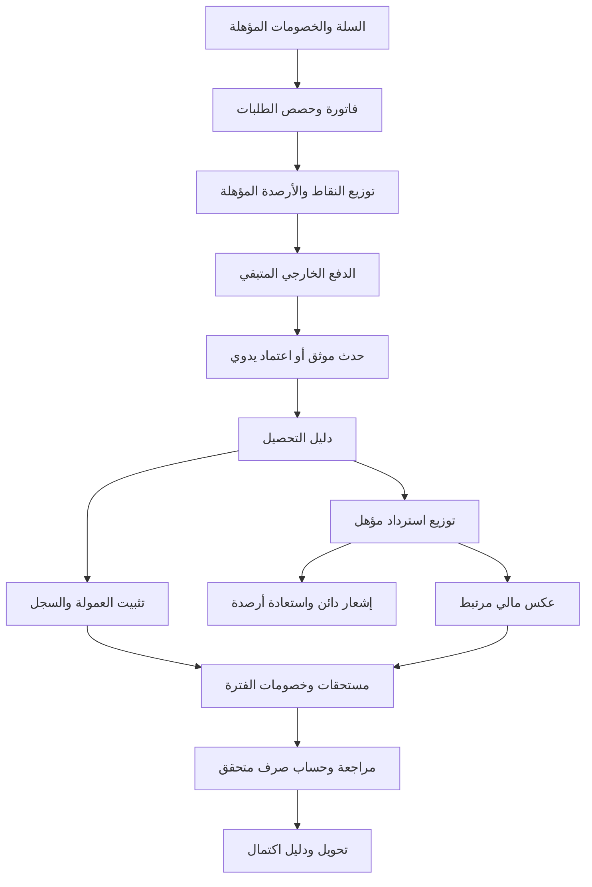

## افصل المفاهيم المالية

يخفض الخصم السعر. تسهم الهدايا والمحفظة في سداد القيمة، ويتبع استخدام النقاط قواعد برنامج الولاء. يبدأ سداد المتبقي الخارجي مقابل الفاتورة. الفاتورة المدفوعة لا تعني وصول مستحقات البائع.

## اربط الخطوات بالشاشة

<SystemTour tour="customer" compact />

## التحويل والدفع عند الاستلام

ينتقل التحويل من انتظار التأكيد إلى انتظار المراجعة عند رفع الإثبات. يقبل موظف متجر مسمى أو يرفض إلى انتظار التأكيد. يتخطى الدفع عند الاستلام الإثبات ويسجل التحصيل. يتأكد الإلكتروني بحدث موثق. لا تستنتج ذلك من تذكرة دعم.

## مثال الاسترداد

فاتورة مدفوعة بقيمة 300 من عملة واحدة تضم طلباً بقيمة 100 وآخر بقيمة 200. لا يسترد الأول 150 لمجرد كفاية الدفعة المشتركة. تحجز الاستردادات المعلقة جزءاً من المتاح. استرداد كامل 100 للأول يجعل الدفعة المشتركة مستردة جزئياً فقط.

## التسوية والصرف

تجمع التسوية قيوداً ثابتة لبائع ومتجر وعملة وفترة واحدة. يثبت الإغلاق البنود، ويتطلب الاعتماد وجهة متحققاً منها مع دفعة واحدة في النطاق الحالي. يرحل السالب أو ما دون الحد. تتبع إعادة المحاولة الدفعة الفاشلة ولا تعيد آثار العمولة والاسترداد.

## قرارات المطابقة

إذا نجح المال وفشل تحديث آخر فافحص السجل ومرجع المزود والأحداث. استخدم المطابقة أو القيد المعاكس المخول. لا تكرر الاسترداد أو التحويل لمجرد تحديث الشاشة.

راجع [الاسترداد](/ar/features/refunds) و[المحفظة](/ar/features/wallet) و[الولاء](/ar/features/loyalty) و[العمولة](/ar/features/commission) و[التسويات](/ar/features/settlements).
