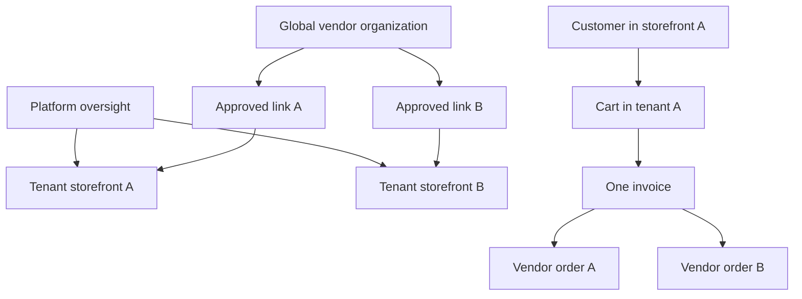
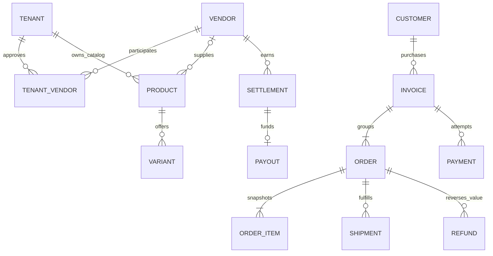

## Four actors, different responsibilities

| Actor | Scope | Responsibility | Boundary |
|---|---|---|---|
| Platform admin | Authorized platform-wide oversight | Organizations, platform controls, investigation | Does not gain every tenant operational mutation |
| Tenant operator | One resolved tenant | Store catalog, partners, orders, finance and content | Cannot browse another tenant’s private records |
| Vendor | Vendor + approved active tenant | Own products, orders, fulfillment and earnings | No sibling vendor’s lines or customer invoice identity |
| Customer | Own account in storefront tenant | Shopping, purchase history and post-purchase requests | No staff or other customers’ records |

## Rules that apply everywhere

The following is a business relationship map, not a complete database schema. Arrows show ownership and purchase links; tender allocations and ledger tables are summarized.

- Tenant identity comes from resolved context, not a submitted business form.
- A wrong-tenant record is treated as not found (404), not an invitation to switch IDs. A permission denial (403) is a separate case.
- Vendor identity and approved tenant workspace are both checked. Being approved in A does not approve B.
- Business identifiers such as SKU, slug and coupon code are tenant-specific.
- Price, discount, tax and shipping calculations are server-authoritative. Existing orders preserve purchase snapshots.
- Payment status, order status, shipment state and payout status describe different events.
- Corrections to financial history use refunds, credit notes, adjustments or compensating entries rather than overwriting evidence.
- Long-running jobs and integration deliveries may complete after the requesting screen returns.

## What is shared and what is isolated?

Vendor organizations and geographic reference data may be global. The tenant-vendor relationship, storefront catalog, cart, operational orders and tenant financial context are scoped. A global vendor does not imply a global product listing shared across tenants.

## Terms used in the guides

| Term | Meaning |
|---|---|
| Variant / SKU | The purchasable option of a product |
| Invoice | Customer purchase document spanning one or more vendor orders |
| Order | Fulfillment unit belonging to one vendor group |
| Reservation / hold | Value or stock temporarily committed but not yet consumed |
| Refund | Reversal of captured purchase value |
| Return | Physical post-delivery request and inspection process |
| Settlement | Period statement of vendor credits and deductions |
| Payout | Transfer attempt against an approved settlement |
| Idempotency | Replaying the same command does not create a duplicate result |

Source: backend constitution, Tenant/Vendor/Invoice/Order modules and four frontend route trees. For engineering paths and version evidence see [source evidence](/en/evidence).
