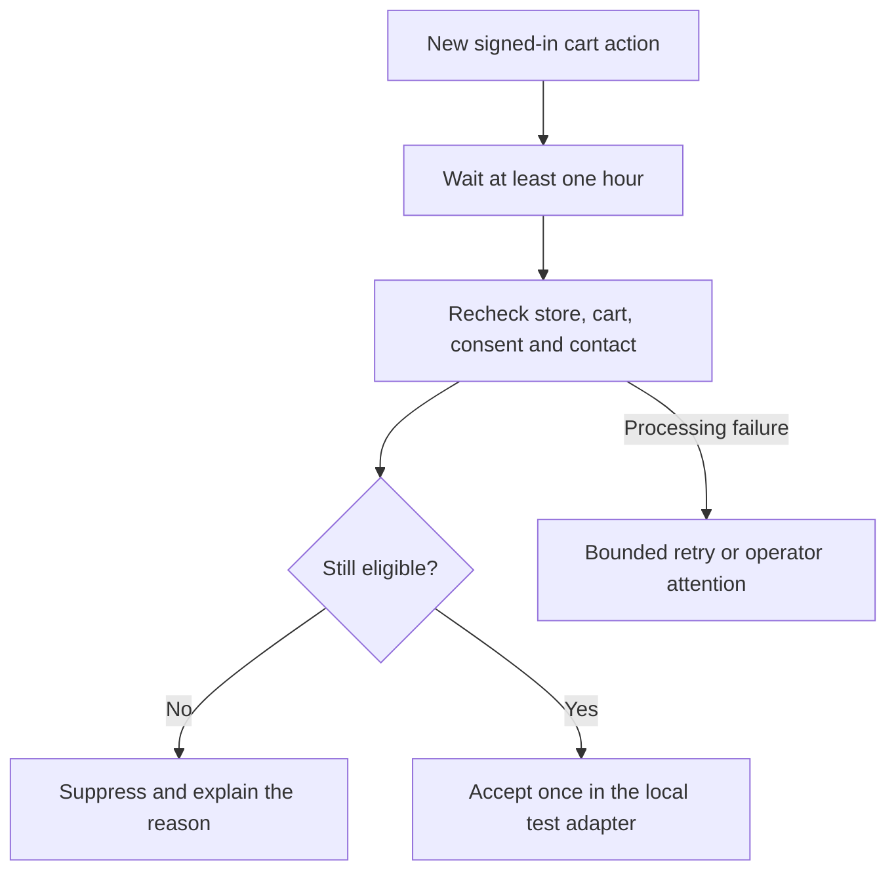

## What this feature does

The tenant dashboard includes **Cart recovery checks**, a controlled test of cart reminder eligibility. It is disabled by default. A test acceptance is a local record: it does not mean an SMS was delivered, an order was recovered or revenue was earned.

Only a new cart action by a signed-in customer can start a reminder episode. Opening the cart or refreshing prices does not count as shopping activity, and old baskets are not filled with invented activity dates.

## For the customer

Use **Account → Profile & addresses → Your marketing choices** to allow or withdraw **Cart reminders → SMS** for this store. Your choices at other stores stay independent. Allowing email offers does not permit an SMS cart reminder.

The check requires an explicitly verified phone. Turning permission off before processing stops the reminder. A changed cart, expired cart or later order attempt at this store also stops the old episode. Your original registration store remains a statistic; it does not restrict your account to that store.

## How to use it

Open **Cart recovery checks** with the appropriate staff permission. Each row explains the basket reference, last observed action, processing attempts, fixed deadline and outcome. Reasons distinguish withdrawn permission, changed contact/cart, unavailable stock, unavailable vendor offers, store maintenance or billing restrictions.

The first check waits at least one hour after the customer's action. An episode expires 24 hours after that action and gets at most three processing attempts. At most one test acceptance is permitted for the same customer in your store per rolling day.

<video style={{ width: "100%", height: "auto" }} controls playsInline preload="none" poster="/docs/screenshots/tenant-cart-recovery-en-checks.webp" aria-label="Read cart reminder checks and review a retry safely">
  <source src="/docs/videos/tenant-cart-recovery-en-tour.mp4" type="video/mp4" />
  <track kind="captions" src="/docs/videos/tenant-cart-recovery-en.vtt" srcLang="en" label="English" default />
</video>

> **Guided screenshot tour, with captions and no audio.** Captured on 19 November 2026 in Cairo from a controlled local Tenant preview with synthetic examples. The feature is disabled by default. The demonstration reads outcomes and opens a retry confirmation, then cancels it; no retry is submitted. A test acceptance does not prove message delivery, an order or revenue.

| Outcome | Meaning | What to do |
| --- | --- | --- |
| Waiting for worker | An episode is durably queued. | Refresh after the worker runs. |
| Accepted by test adapter | All checks passed and a local test record was accepted. | Do not count it as a delivered message or sale. |
| Suppressed | A business or permission check prevented the attempt. | Read the reason. A retry cannot bypass the restriction. |
| Waiting for bounded retry | Processing failed temporarily, with budget remaining. | Review the issue; an authorized operator may retry with a reason. |
| Operator attention required | The attempt budget was exhausted. | Investigate; do not repeatedly reset the episode. |
| Deadline expired | The fixed reminder window ended. | No further retry is allowed for this episode. |

## Data flow and outcome

## Retry safely

Only staff with retry permission can retry a temporary failure. Enter a short explanation of what you reviewed. Avoid phone numbers, emails or secrets. Retry preserves the original deadline and remaining attempt budget and rechecks every rule. It cannot reactivate a suppressed, expired or accepted episode.

Review the confirmation before proceeding. Cancel if the selected basket or explanation is wrong. Confirming requests another eligibility check; it never guarantees acceptance or message delivery. After a successful request, refresh the row and read the new recorded outcome rather than assuming that the customer received a reminder.

<SystemTour tour="feature-cart-recovery" />

## Restrictions and decisions

This release supports a guarded local SMS test adapter. It does not send live campaigns. Email reminders, campaign design, delivery tracking and marketing conversion reports remain planned. Cancelled or unpaid order attempts may conservatively suppress a reminder; they are never presented as a successful conversion.
