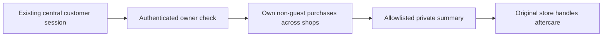

## How to use it

### Sign in once with your existing customer account

Open **Customer sign-in** on the separate CartJoin platform website and use the same customer credentials you use in its stores. You do not create another account for every tenant. Merchant applications and staff dashboard login are separate journeys.

After signing in, **Your purchases, across stores** shows your account's purchases, grouped as individual store order records. Each entry shows the store, order reference, order/payment/delivery state, original purchase total and currency, and placement time. Use the page buttons when more purchases are available.

When **View at store** is available, open it to find that order in the owning store’s account. Sign in there with the same customer account if prompted.

<SystemScreenshot src="/docs/screenshots/platform-purchases-en.png" alt="The signed-in customer's private cross-store overview lists store identity, order reference, states and original purchase total without operational notes or addresses." />

<video style={{ width: "100%", height: "auto" }} controls playsInline preload="none" poster="/docs/screenshots/platform-purchases-en.png" aria-label="Customer private purchase overview walkthrough">
  <source src="/docs/videos/platform-purchases-en.mp4" type="video/mp4" />
  <track kind="captions" src="/docs/videos/platform-purchases-en.vtt" srcLang="en" label="English" default />
</video>

> **Guided screenshot tour, with captions and no audio. Development capture.** The screenshot and walkthrough show seeded local demonstration purchases. They do not show a live payment or provider delivery.

## Read the summary correctly

| What you see | What it means |
|---|---|
| Several orders for one purchase | A marketplace can split one store purchase into seller orders |
| Separate currencies/totals | Original order amounts; they are not a combined balance or a converted global total |
| Delivery and payment shown separately | A delivery state does not prove that cash was collected |
| A store that is no longer in discovery | Your owned purchase remains in this private summary even when the store is nonpublic or inactive |
| No guest purchase | Guest orders are not silently linked by matching email or phone |

For detailed invoices, delivery, support, returns and balances, use the store where you purchased and its authorized servicing process. Each store's policies and recorded purchase terms apply.

## Restrictions and decisions

Only the authenticated owner can use this overview. Another customer or a tenant operator cannot choose a customer ID to inspect it. It contains no address snapshot, staff notes, private file, carrier evidence, payment credentials, vendor statement, loyalty balance or wallet balance.

Your first-registration `tenant_id` remains signup statistics only. Signing in or buying elsewhere never changes it or restricts the purchases included here. Store-private relationships and financial records keep their owning store.

The platform session belongs to the current browser tab. Sign out when finished. If loading fails, retry; if your session expired, sign in again. A globally blocked/inactive/deleted account cannot use the summary. A local store restriction is not a global customer suspension.

See [discover participating stores](/en/features/global-discovery) and [central account boundaries](/en/roadmap/global-platform).

## When an order is missing

Check that you signed in with the account used for the purchase. Keep its store and order reference when contacting the owning store. Guest purchases use their receipt/tracking process; matching contact text does not merge them into this account. A shop being absent from discovery does not remove your owned purchase summary.

## If loading or sign-out fails

Use Retry after a temporary loading failure. For an expired session, reload the account page and sign in again with your existing account. If sign-out reports a failure, retry it; do not assume closing a page completed sign-out. Use the owning shop’s authorized recovery/support process when you cannot access your credentials.

## Data flow and outcome

The central session identifies you. The server selects only purchases owned by your account and returns a bounded summary with public store names and permitted order fields. It does not filter by your first-registration tenant, combine balances, move purchases or grant merchant access to other stores. Detailed servicing stays with the original store.

