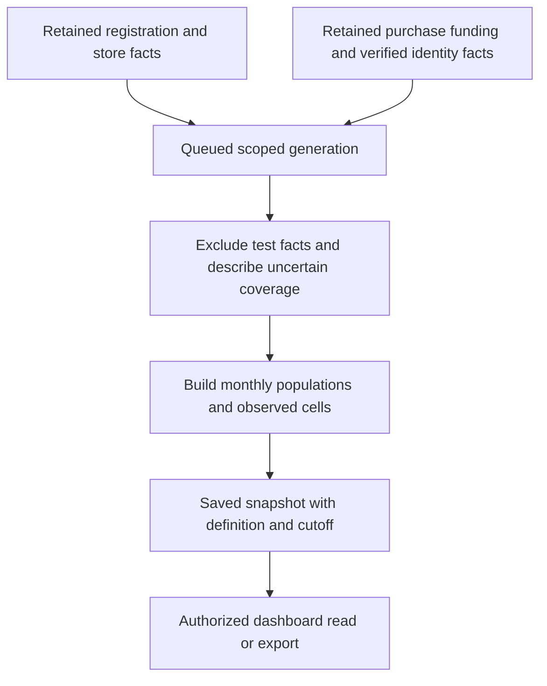

> **Development release · 19 November 2026.** The report is published in the backend and three staff dashboards, with English/Arabic browser checks. These local walkthroughs use controlled synthetic data; they do not demonstrate live customer activity or a live rollout.

## What this report helps you decide

Use a purchase cohort to understand whether buyers return in later months. Each row groups customers by their earliest qualifying funded purchase supported by retained evidence within the selected scope. This describes known history, not proof of a first-ever purchase when legacy evidence is missing. Later columns show how many of those same customers purchased again. A second vendor parcel from the same checkout does not create a repeat purchase.

This is a customer-count report. Use the financial reports to understand revenue, refunds and profit.

## Keep three milestones separate

| Milestone | What it means |
| --- | --- |
| Account registration | A central CartJoin customer account was created. Its first registration store is an attribution statistic. |
| First store relationship | The system first recorded a relationship between that customer and this store. This does not prove a purchase. |
| First retained qualifying purchase | The earliest qualifying funded purchase supported by known, retained evidence in the report's scope. |

A customer can register at Store A, later visit Store B and buy first at Store B. Store B must not receive the customer's private activity at Store A. An existing-account guest claim creates no new registration.

## How to use it

Open **Reports → Customer cohorts** in the appropriate dashboard. Select the supported monthly window and check the report's scope, generation time and observation cutoff before comparing rows. An authorized operator can request a queued generation; wait for its result rather than treating a queued or failed report as an empty report.

Read a row from left to right. **Cohort buyers** is its cohort population. **M1** is the following calendar month, **M2** the month after that, and so on. The later month counts each buyer at most once even if they make several purchases.

For example, a cohort of 20 buyers with five returning in the next fully observed month has a 25% repeat-purchase rate for M1. Those five may differ from the buyers who return in M2; the columns do not describe an unbroken subscription or streak.

## Read incomplete cells correctly

| Cell or report state | How to interpret it |
| --- | --- |
| Complete month, zero returning buyers | A valid zero among the qualified population. |
| Partially observed month | A count so far; no final percentage. |
| Future month | Not observed; do not interpret it as zero retention. |
| Provisional cohort population | The cohort month is still incomplete, so its denominator can grow. |
| Missing snapshot | No saved report is available; this is not proof of no customers. |
| Queued or failed generation | The new request is not ready. Any previous saved snapshot keeps its own observation cutoff. |
| Coverage warning | Some historical timing, identity or funding evidence cannot support a reliable classification. |

Months and the observation cutoff use UTC. The cutoff is exclusive 00:00 UTC at the start of the observation day: only facts known before that instant are included, so the current UTC day is excluded. A delayed queued job keeps its original request cutoff; its later generation time does not extend the observation window. The supported window is bounded to twelve cohort months.

## What qualifies as a purchase

A qualifying purchase needs retained proof of completed genuine funding, including valid internal tenders where applicable. Unpaid cash on delivery, incomplete funding and test purchases do not qualify. A failed test attempt alone must not disqualify a later independently genuine funded purchase.

An invoice counts once across its child orders. Legacy purchases without an invoice use an order-specific group. A later full refund does not erase the historical fact that a funded purchase occurred; this is why this report cannot substitute for net revenue.

Missing funding time is not replaced with order placement or update time. A buyer with unresolved earlier purchase evidence cannot be confidently assigned a first-purchase cohort. Missing or unlinked legacy history is reported as incomplete coverage, not reconstructed from current ownership. Read that information before comparing stores or periods.

## Dashboard walkthroughs

These local previews use synthetic purchases. The captioned clips use actual screenshots; they do not show real payments or deliveries.

### Platform admin: compare the selected population

Check the header scope before reading acquisition totals or the matrix. Store relationships do not represent separate central accounts.

<SystemTour tour="feature-customer-cohorts-admin" />

### Tenant: understand your store's repeat buyers

Read registration attribution separately from relationships and purchase cohorts. Three registrations and four relationships do not mean seven unique buyers.

<SystemTour tour="feature-customer-cohorts-tenant" />

### Vendor: compare your own qualifying purchases

The approved workspace limits this report. Another seller's payment cannot qualify your canceled unpaid child order. Registration and relationship counts are unavailable here.

<SystemTour tour="feature-customer-cohorts-vendor" />

## Restrictions and decisions

Removing the requesting staff account or store blocks access immediately. A retained private file keeps its original 24-hour expiry; scheduled cleanup removes it even when its owner no longer exists.

Tenant operators see their store's acquisition and purchase facts. Vendor operators see purchase cohorts for their own frozen seller lines inside the currently approved tenant workspace; they do not receive signup-origin breakdowns, customer identities or other-store activity. Their own selected child order needs retained proof of completed settlement. Another seller's funded child does not qualify a canceled, unpaid child belonging to this vendor. Platform operators must distinguish a store-specific population from a global population: adding store buyer counts does not produce a global unique-customer count.

Verified guest claims can link purchases only when retained proof supports that link and the report cutoff includes the claim. The report must not guess past identity from a matching phone number or mutable current order ownership.

## Data flow and outcome

Reading a report must not change purchases, identity, balances or consent. Background generation and reconciliation keep report preparation separate from viewing a page. Viewing, requesting generation and exporting require separate permissions: `reports.show`, `reports.generate` and `reports.export`. A viewing permission alone does not authorize generation or export. Exports use an existing saved snapshot and remain private to the requesting staff account for 24 hours from the export request. Current permissions, scope and vendor workspace approval are checked again when accessing the export; there is no public download link.

## If something goes wrong

Check the selected scope and dates first. Generation has at most three automatic attempts, with at least a five-minute delay after a failed attempt. A queued request may be waiting for this retry. After the budget is exhausted, ask an administrator to investigate. Repeating **Generate** for the same scope, monthly window and UTC cutoff returns the same work; it cannot reset an exhausted budget. A new UTC observation day permits a new generation. A coverage warning is a reason to investigate source evidence, not permission to fill unknown cells with zero. Use the financial reports when the question concerns money rather than repeat buyers.

Related: [Reports and exports](/en/features/reports) · [Central customer accounts](/en/features/global-customer-account).
