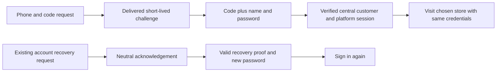

<SystemTour tour="feature-global-customer-account" />

## How to use it

Open **Customer sign-in** on the separate CartJoin platform. Existing customers can sign in with their usual credentials. To create an account, choose **Create an account**, enter a mobile phone with its country code and request a verification code. Enter the delivered six-digit code, your name and a new password with its confirmation. A successful completion signs you in to the platform.

You do not need to supply an email address. Registration does not enroll you in marketing or open a merchant application. Do not share your verification code with another person.

<SystemScreenshot src="/docs/screenshots/global-customer-en-signup.webp" alt="The customer account creation form asks for a phone, separately from existing-customer sign-in." />

After requesting a code, keep the same contact and use the latest message. Enter the code, your name and matching passwords in the proof step. The demonstration deliberately leaves secret fields blank.

<SystemScreenshot src="/docs/screenshots/global-customer-en-proof.webp" alt="The verification step shows code, name and password fields with no verification code or password displayed." />

<video style={{ width: "100%", height: "auto" }} controls playsInline preload="none" poster="/docs/screenshots/global-customer-en-signup.webp" aria-label="Create or recover a central customer account">
  <source src="/docs/videos/global-customer-en-tour.mp4" type="video/mp4" />
  <track kind="captions" src="/docs/videos/global-customer-en.vtt" srcLang="en" label="English" default />
</video>

> **Guided screenshot tour, with captions and no audio.** These actual local development screens show a synthetic customer's signup, empty account and neutral recovery acknowledgement. Codes, passwords and tokens are absent. The recovery demonstration stops before password reset; no real message provider or live purchase is demonstrated.

## One identity across stores

Your customer identity is central. Use the same credentials when shopping at participating tenant stores. Each website keeps its own browser session: signing in on the platform does not silently sign you in on another domain. Orders, support, returns and store balances remain with their owning store.

A customer first registered through the global platform has no first-registration tenant. For a customer first registered at a tenant store, the original registration store remains attribution for statistics only. Neither value restricts where that customer can sign in. A global registration alone does not create membership in every store; store relationships follow a trusted visit or purchase in that store.

<SystemScreenshot src="/docs/screenshots/global-customer-en-account.webp" alt="The newly created synthetic customer is signed in, with an empty private purchase summary and no store balance displayed." />

## Set or reset your password

Choose **Set or reset password** and enter the phone or email associated with your account. Use the same option if a store created an account for you and you need to choose your first password. If an eligible account matches and delivery is available, use the code you receive to choose and confirm a password. When the password is saved, return to sign-in and use it there.

If an invitation already gave you a code, enter the contact that received it and select **I already have a code**. This opens the verification step and keeps the existing code usable until it expires.

Use your password manager with the labelled password fields. Merchant onboarding recovery and staff login are separate journeys.

<SystemScreenshot src="/docs/screenshots/global-customer-en-recovery.webp" alt="The customer recovery form accepts the phone or email of an existing account." />

The acknowledgement is the same for eligible and unmatched requests. Wait for the code to arrive at your own phone or email before continuing. The screenshot shows the acknowledgement and the fields you complete next.

<SystemScreenshot src="/docs/screenshots/global-customer-en-ack.webp" alt="A neutral recovery acknowledgement and blank reset fields do not reveal whether a customer account exists." />

## Change your sign-in contact

In the storefront, open **Account → Profile → Change sign-in contact**. Enter the new phone number or email and your current password. Enter the six-digit code sent to the new contact and confirm with your current password. The code expires after five minutes. The update ends your existing sessions. You can then sign in with the new contact.

To close your account, confirm the action in your storefront profile with your current password. Closure ends your sessions and stops push delivery. Account and purchase records are retained. Platform support can restore a closed account through the platform admin workflow.

Open **Signed-in sessions** in your storefront profile or on the platform account page to end an individual session or sign out everywhere. Older sessions may only appear after you sign in again. Signing out everywhere also ends those older sessions.

Use **Download your data** in your storefront profile to request a JSON file with your account details, addresses, store relationships, orders, wallet and loyalty account balances, reviews, group memberships and consent settings. Confirm with your current password and return to check the export status. The file is available for up to 24 hours.

Authorized platform staff can preview a duplicate-account case by entering two customer IDs. The case records which domains contain data that needs review and flags overlapping reviews and financial obligations. The preview does not combine accounts or move balances.

In the storefront profile, use the case and surviving customer IDs supplied by support. Sign into each account separately and approve the same surviving customer ID within 15 minutes. Authorized staff can move eligible purchase and review history and saved addresses to the surviving account. Open obligations, internal tender, store restrictions and unresolved moderation can keep a case open. The surviving account keeps its own marketing preferences and group privileges.

Authorized platform staff can erase the profile of a closed account after open obligations clear. The action clears credentials, saved addresses, push registrations, and other profile data, and withdraws the customer's public reviews and questions. Required financial and operational records stay under the relevant retention schedule. A profile that has been erased cannot be restored.

Where enabled, choose **Link Google** in your storefront profile. Use your current password, finish verification at Google and return to confirm. Use the same verified email for both accounts.

For account cleanup, the operator reviews open orders, returns, refunds, disputes, and wallet and loyalty obligations before removing any data. Keep the records needed for accounting and claims under the applicable retention schedule. Remove reusable credentials, tracking data, and other optional profile data when their purpose ends. For duplicate accounts, verify control of both accounts and resolve financial obligations through their existing ledgers. When both accounts reviewed the same product in the same store, retain the surviving account's approved verified-purchase review when available and review the other submission for any open moderation decision.

## Restrictions and decisions

Phone verification is required before global signup can create a customer or issue a session. A challenge is an opaque temporary proof, not an authenticated account. It cannot be reused after completion. Registering a phone already associated with an account never overwrites that account: use sign-in or recovery instead.

The registration code expires after five minutes, allows a bounded number of attempts and has a resend delay. Sending another code replaces the previous challenge. The screen shows when another request is available; the server independently enforces contact and network limits. A temporary delivery failure does not create an unverified account.

No wallet value, loyalty balance, store order or tenant customer record moves between stores because you register or reset your password. There is no cross-store checkout.

## When verification fails

Check the contact and code, including the country code for signup. If the code expires, request a new one and use only the newest message. Wait for the countdown after too many requests. When message delivery is temporarily unavailable, retry later. The screen does not expose a development outbox or a suggested code.

If you already have an account, return to sign-in or recovery. A generic recovery acknowledgement is not proof of account creation or proof that a message reached your device.

## Data flow and outcome

The platform requests a short-lived registration challenge for your phone. After delivered-code proof and valid account details, the server creates one global customer without a tenant origin and returns a limited platform session. Recovery separately validates proof for an existing account, changes its password and returns you to sign-in. Store visits and purchases remain tenant-scoped.

## Related journeys

Message delivery requires the appropriate SMS or email provider to be configured for the channel. The local tour demonstrates the screens with synthetic data. It provides no live delivery or rollout evidence.

See your [private purchase overview](/en/features/cross-store-purchases) or [discover participating stores](/en/features/global-discovery).
