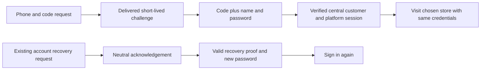

<SystemTour tour="feature-global-customer-account" />

## How to use it

Open **Customer sign-in** on the separate CartJoin platform. Existing customers can sign in with their usual credentials. To create an account, choose **Create an account**, enter a mobile phone with its country code and request a verification code. Enter the delivered six-digit code, your name and a new password with its confirmation. A successful completion signs you in to the platform.

You do not need to supply an email address. Registration does not enroll you in marketing or open a merchant application. Do not share your verification code with another person.

<SystemScreenshot src="/docs/screenshots/global-customer-en-signup.png" alt="The customer account creation form asks for a phone, separately from existing-customer sign-in." />

After requesting a code, keep the same contact and use the latest message. Enter the code, your name and matching passwords in the proof step. The demonstration deliberately leaves secret fields blank.

<SystemScreenshot src="/docs/screenshots/global-customer-en-proof.png" alt="The verification step shows code, name and password fields with no verification code or password displayed." />

<video style={{ width: "100%", height: "auto" }} controls playsInline preload="none" poster="/docs/screenshots/global-customer-en-signup.png" aria-label="Create or recover a central customer account">
  <source src="/docs/videos/global-customer-en-tour.mp4" type="video/mp4" />
  <track kind="captions" src="/docs/videos/global-customer-en.vtt" srcLang="en" label="English" default />
</video>

> **Guided screenshot tour, with captions and no audio.** These actual local development screens show a synthetic customer's signup, empty account and neutral recovery acknowledgement. Codes, passwords and tokens are absent. The recovery demonstration stops before password reset; no real message provider or live purchase is demonstrated.

## One identity across stores

Your customer identity is central. Use the same credentials when shopping at participating tenant stores. Each website keeps its own browser session: signing in on the platform does not silently sign you in on another domain. Orders, support, returns and store balances remain with their owning store.

A customer first registered through the global platform has no first-registration tenant. For a customer first registered at a tenant store, the original registration store remains attribution for statistics only. Neither value restricts where that customer can sign in. A global registration alone does not create membership in every store; store relationships follow a trusted visit or purchase in that store.

<SystemScreenshot src="/docs/screenshots/global-customer-en-account.png" alt="The newly created synthetic customer is signed in, with an empty private purchase summary and no store balance displayed." />

## Recover an existing account

Choose **Forgot password?** and enter the phone or email already associated with your account. The response deliberately does not confirm whether an account exists. If an eligible account matches and delivery is available, follow the recovery instructions, enter the code and choose a new password with confirmation. After a successful reset, sign in with the new password; recovery does not issue a new platform session automatically.

Use your password manager with the labelled password fields. Keep your contact access up to date through the account's authorized servicing process. Merchant onboarding recovery and staff login are separate journeys.

<SystemScreenshot src="/docs/screenshots/global-customer-en-recovery.png" alt="The customer recovery form accepts the phone or email of an existing account." />

The acknowledgement below is deliberately neutral. It does not prove that an account exists or that delivery succeeded. Use the received instructions only if they reach your own contact; the screenshot is not a completed password reset.

<SystemScreenshot src="/docs/screenshots/global-customer-en-ack.png" alt="A neutral recovery acknowledgement and blank reset fields do not reveal whether a customer account exists." />

## Restrictions and decisions

Phone verification is required before global signup can create a customer or issue a session. A challenge is an opaque temporary proof, not an authenticated account. It cannot be reused after completion. Registering a phone already associated with an account never overwrites that account: use sign-in or recovery instead.

The registration code expires after five minutes, allows a bounded number of attempts and has a resend delay. Sending another code replaces the previous challenge. The screen shows when another request is available; the server independently enforces contact and network limits. A temporary delivery failure does not create an unverified account.

No wallet value, loyalty balance, store order or tenant customer record moves between stores because you register or reset your password. There is no cross-store checkout.

## When verification fails

Check the contact and code, including the country code for signup. If the code expires, request a new one and use only the newest message. Wait for the countdown after too many requests. When message delivery is temporarily unavailable, retry later. The screen does not expose a development outbox or a suggested code.

If you already have an account, return to sign-in or recovery. A generic recovery acknowledgement is not proof of account creation or proof that a message reached your device.

## Data flow and outcome

The platform requests a short-lived registration challenge for your phone. After delivered-code proof and valid account details, the server creates one global customer without a tenant origin and returns a limited platform session. Recovery separately validates proof for an existing account, changes its password and returns you to sign-in. Store visits and purchases remain tenant-scoped.

## Related journeys

Use [your private purchase overview](/en/features/cross-store-purchases) to interpret your owned orders across stores, or [discover participating stores](/en/features/global-discovery). This guide describes the approved development implementation. Real message-provider activation and live deployment remain separate release work; no public test code is available in the interface.
