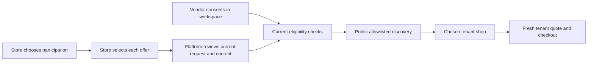

> **Development guide · 18 November 2026.** These captures use seeded local demonstration accounts. Publication controls are implemented; this does not claim live commercial launch or provider acceptance.

The short videos below are guided screenshot tours of actual development screens, with captions and no audio. Reviewer tours stop before submitting a decision.

Production publication requires an approved HTTPS store origin. These local acceptance captures may use an exact HTTP loopback origin; it is accepted only in local/testing and is rejected by production reads and writes.

## How to use it

Start with your role below. Shoppers browse public offers; store staff choose publication; vendors control workspace consent; platform reviewers decide whether current content may be listed.

## For shoppers: discover, then enter the store

Open **Explore stores** on the CartJoin platform. The **Stores** tab lists approved shops, including those that have yet to share products. Choose **Visit store** to browse a shop. The **Products** tab lists shared items, and **Sellers** shows the independent sellers behind those items. Use **More stores** or **More shared products** to continue browsing.

Choose **View in store** to open the selected store in your language. Check its current price, available options, delivery and terms there before buying. The directory does not quote a checkout price. Use your existing customer account; registering again for each shop is unnecessary.

<SystemScreenshot src="/docs/screenshots/platform-discovery-en.jpg" alt="CartJoin discovery shows explicitly selected products, their store and seller, and links to the owning store for current pricing." />

<video style={{ width: "100%", height: "auto" }} controls playsInline preload="none" poster="/docs/screenshots/platform-discovery-en.jpg" aria-label="Explore products, stores and sellers on CartJoin">
  <source src="/docs/videos/platform-discovery-en.mp4" type="video/mp4" />
  <track kind="captions" src="/docs/videos/platform-discovery-en.vtt" srcLang="en" label="English" default />
</video>

<SystemScreenshot src="/docs/screenshots/platform-discovery-en-handoff.png" alt="The selected tenant storefront displays its own current product details, options and pricing in the local development preview." />

Each store has its own basket, checkout, invoice, payment, delivery, returns and balances. A seller appearing through one store is not approved to sell through every store. See [your private purchase overview](/en/features/cross-store-purchases).

## For tenant staff: choose your store and offers

Open **Global discovery** in your tenant dashboard. You need permission to manage discovery publication.

1. Choose whether to allow the store to appear. Enter the store's approved HTTPS domain without a page path, query or sign-in information, then save.
2. Search for a product, select it and choose **Submit selected offer**. Repeat only for products you want to share publicly.
3. Review the displayed decision and reason. Store/domain approval and each offer's approval are separate.
4. For a vendor product, ask that vendor to permit discovery in this same workspace. Participation approval alone is insufficient.

<SystemScreenshot src="/docs/screenshots/tenant-discovery-en.png" alt="Tenant publication controls separate store consent, product selection and individual offer review outcomes." />

<video style={{ width: "100%", height: "auto" }} controls playsInline preload="none" poster="/docs/screenshots/tenant-discovery-en.png" aria-label="Tenant discovery publication walkthrough">
  <source src="/docs/videos/tenant-discovery-en.mp4" type="video/mp4" />
  <track kind="captions" src="/docs/videos/tenant-discovery-en.vtt" srcLang="en" label="English" default />
</video>

Turning the store choice off hides its discovery offers immediately. **Withdraw offer** removes just that offer. Neither action changes existing purchases or the shop's own catalog. Renewed opt-in or a different domain requires a fresh store review.

If the platform rejects your store, address the review reason, keep participation enabled and save the store choice again—even when the domain is unchanged. The request returns to pending review and stays hidden until a new approval. Saving an unchanged pending or approved request does not restart its review.

## For vendors: consent separately in each workspace

Choose the approved store workspace, then open **Global discovery**. Enable or withdraw permission for your eligible offers in that workspace and save. You need the discovery-consent permission. Your other store workspaces retain their own choices.

<SystemScreenshot src="/docs/screenshots/vendor-discovery-en.png" alt="Vendor discovery consent applies to the selected approved store workspace and lists only that vendor's selected offers." />

<video style={{ width: "100%", height: "auto" }} controls playsInline preload="none" poster="/docs/screenshots/vendor-discovery-en.png" aria-label="Vendor discovery consent walkthrough">
  <source src="/docs/videos/vendor-discovery-en.mp4" type="video/mp4" />
  <track kind="captions" src="/docs/videos/vendor-discovery-en.vtt" srcLang="en" label="English" default />
</video>

Your consent permits consideration; the tenant must still select each offer and the platform must approve it. Withdrawing consent hides your offers from global discovery immediately. It does not cancel marketplace participation, orders or settlement obligations.

## For platform reviewers: inspect the current request

Open **Global discovery** with review permission. Review the store's identity and confirm that the submitted domain belongs to it and serves the correct tenant. Inspect the current product, public content and seller ownership before reviewing an offer. Record a clear reason, confirm your verification and save **Approve** or **Reject / withdraw approval**.

<SystemScreenshot src="/docs/screenshots/admin-discovery-en.png" alt="Platform review separates store-domain decisions from individual offers and retains review reasons and eligibility checks." />

<video style={{ width: "100%", height: "auto" }} controls playsInline preload="none" poster="/docs/screenshots/admin-discovery-en.png" aria-label="Platform discovery review walkthrough">
  <source src="/docs/videos/admin-discovery-en.mp4" type="video/mp4" />
  <track kind="captions" src="/docs/videos/admin-discovery-en.vtt" srcLang="en" label="English" default />
</video>

If the request or product changed during review, refresh and inspect it again. A stale approval cannot approve the replacement content. The system retains review decisions. Changed product name, image, link, seller ownership, product-review revision or variant price/active state requires a fresh offer review.

## Restrictions and decisions

### Why an approved offer may be hidden

| Check | What to do |
|---|---|
| Store consent or independent approval missing | Save the intended choice and request platform review |
| Vendor consent, workspace approval or active seller missing | Correct the same workspace's participation and consent |
| Product unpublished, changed since review, or no purchasable stocked option | Correct the catalog/stock; obtain fresh review after material changes |
| Store suspended, in maintenance or unable to start sales under billing | Resolve the store's operational or billing restriction |
| Worker has not refreshed the projection | Refresh after the maintenance worker catches up; ask operations to inspect failures |

The directory rechecks eligibility on each request and hides stale or revoked records while a worker waits. Background reconciliation is scheduled every minute, with bounded retries. This is a schedule, not a guaranteed delay when workers are stopped. Reviewers can inspect the last eligibility check and diagnostic state.

## Data flow and outcome

Store and seller choices remain private operating records until independent review and current eligibility permit an allowlisted public offer. Following it enters the owning shop for fresh pricing and tenant checkout. A failed check hides the public offer and leaves existing purchases unchanged.

Private customer details, stock quantities, costs, documents, statements and operational notes never become directory fields. Discovery does not publish a tenant's entire catalog automatically.
