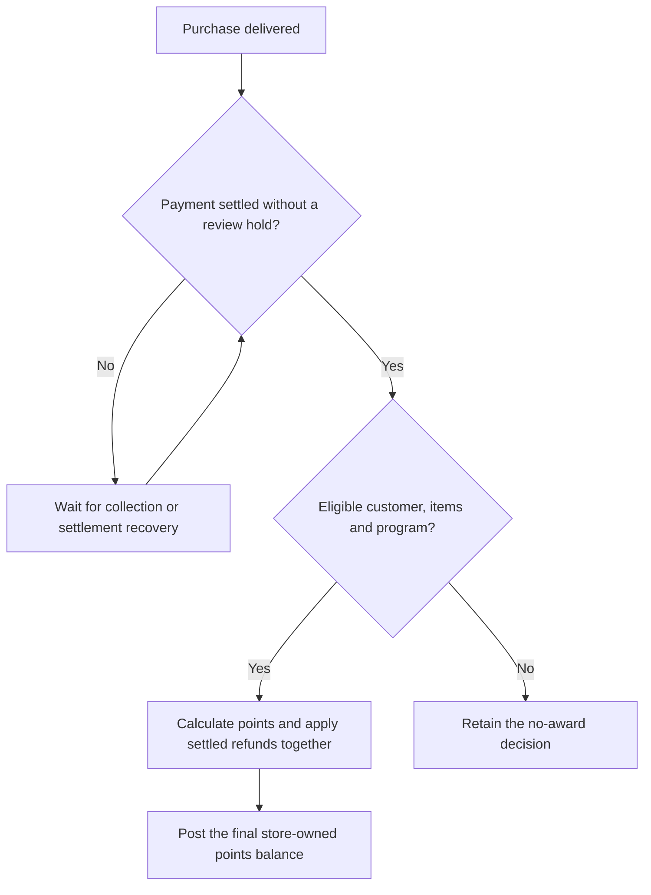

## How to use it

Tenant operators review the program, tiers, accounts, adjustments and reports. Customers open Account → Loyalty to inspect points and expiries, preview redemption, then apply the current allowed value in the cart.

<SystemTour tour="feature-loyalty" compact />

## Restrictions and decisions

Points are not a wallet cash balance. Preview must match the current policy before applying. Reserved points are not freely available a second time. Payment settlement and delivery together determine earning. Dispatch, cancellation and refunds can consume, release or adjust points.

## When points appear after delivery

A customer account works across CartJoin stores, but each store keeps its own loyalty program and points. Your first-registration store does not limit where you can earn. Points never move automatically between stores.

An eligible purchase earns only after **physical delivery and completed payment settlement**, with no financial review hold. For cash on delivery, a delivered parcel can still be unpaid. Points wait until the payment is collected and settled. Test deliveries, test payments, guest purchases and fully refunded purchases do not earn real points.

**Example:** an eligible 100-unit purchase at one point per currency unit is delivered before COD collection. It earns no points yet. After collection settles, a previously completed 50-unit refund leaves 50 qualifying points. Duplicate payment or delivery updates do not grant them again. This is an explanation of the rule, not a screenshot of a real transaction.

## Refunds, held points and the first purchase bonus

A monetary adjustment can reduce earned points even when no item is physically returned. The system combines completed refunds before calculating the retained reward, using the original award's rounding and rule snapshot. It restores points redeemed on returned units independently from reversing points earned on that purchase.

A complete return/refund removes that purchase's first-order bonus once. A bonus-only first purchase cannot grant another first-order bonus on the next purchase. A previously completed reward decision is not recalculated to grant extra points when the store changes its program.

If you already spent the points, the store's configured negative-balance limit applies. Future credits first repay any negative balance. A refund may release a cart points reservation if its backing is no longer available; recheck your cart before paying. Funding already attached to another purchase remains protected. If the limit prevents a full reversal, new redemptions pause for operator review and a restricted risk record is retained. Earned history remains visible. An authorized operator can resume the account after reviewing the unresolved adjustment; a customer cannot unlock it by cancelling a different purchase. Existing ledger history remains retained.

A partial physical handoff also protects attached points holds from automatic release. An expired authorization stays reserved for financial review; physical proof does not renew its expiry or automatically charge points. Unattached cart reservations keep their normal expiry.

## For tenant operators: failed reward checks

Open **Customers → Loyalty → Loyalty reports → Order reward checks**. Operators with the reconciliation permission can review up to 50 failed checks, their attempt count, next retry time, and cases that need attention. Normal unpaid or undelivered purchases are waiting for evidence; they are not reported as processing failures.

<SystemTour tour="feature-order-reward-checks" compact anchor="reward-check-screen-guide" />

The screenshot is the real local demo screen on 18 November 2026. Its empty state is accurate; it does not demonstrate a failed production payment.

1. Investigate the order's payment, delivery and refund records and correct the underlying problem.
2. Select **Request another check**, enter what was investigated or corrected, then confirm.
3. Refresh the panel. The queued check re-reads current evidence; it does not collect payment, mark delivery, or award the same points twice. The request and operator's reason are audited.

Automatic processing makes at most five attempts for unchanged facts. New evidence can resume a waiting check; repeated identical events cannot reset an exhausted retry budget. Vendors and customers cannot run tenant reward retries. Platform staff use existing loyalty risk monitoring; they cannot silently edit a customer's balance through this panel.

## Data flow and outcome

Program version → earning lots/account → preview and reservation → per-order allocation → consume/release → expiry and refund adjustments.

## When something goes wrong

Check workspace, permission, record state and field errors first. If an action times out, inspect the record and its history before retrying. Escalate with the screen, record identifier and time; omit passwords and payment secrets.

## Evidence and verification limits

Authored from module documentation, dashboard routes and backend source. Route presence does not mean every action was exercised live. See [screen coverage](/en/coverage) and [source evidence](/en/evidence) for paths and fields. Screenshots illustrate local demo accounts; each walkthrough states its capture date. They are not production results.

`Modules/Loyalty/` · `documentation/modules/`

Screen paths and source references

{/* SCREEN_MAP */}
## Where this feature appears

A route proves navigation, not permission to perform every action. Related-record detail tabs can expose additional entry points.

| Dashboard | Frontend entry paths |
|---|---|
| [admin](/en/roles/admin) | `/loyalty` |
| [tenant](/en/roles/tenant) | `/loyalty` |
| [customer](/en/roles/customer) | `/account/loyalty` |

[Exact route, field and enum source trail](/en/evidence/loyalty)
{/* /SCREEN_MAP */}

