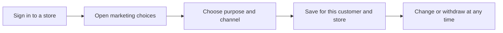

## How to use it

Sign in to the store, then open **Account → Profile & addresses → Your marketing choices**. Choose email or SMS separately for **Store offers** and **Cart reminders**. Each change saves immediately; wait for “Your choice has been saved for this store.” If saving fails, your previous choice stays in place.

Every option starts off. You can turn it off again at any time. Permission for an offer by email does not permit an SMS or a cart reminder.

<SystemScreenshot src="/docs/screenshots/customer-marketing-consent-en.png" alt="The customer marketing choices panel, with separate offers and cart reminder options." />

<video controls playsInline preload="none" poster="/docs/screenshots/customer-marketing-consent-en.png" width="1280" height="720">
  <source src="/docs/videos/customer-marketing-consent-en-tour.mp4" type="video/mp4" />
  <track src="/docs/videos/customer-marketing-consent-en.vtt" kind="captions" srcLang="en" label="English" default />
  <track src="/docs/videos/customer-marketing-consent-ar.vtt" kind="captions" srcLang="ar" label="العربية" />
</video>

This 12-second guided screenshot tour shows actual saved demo states: all off → SMS cart reminder allowed → withdrawn. It is a sequence of screenshots captured from the local system on 18 November 2026, rather than a continuous recording. No message was sent. Enable captions for the explanation.

## One account, independent choices

You use the same CartJoin customer account at different stores. Each store has its own marketing choices. Agreeing to messages at Store A gives Store B no permission. The store where you first registered remains an attribution statistic; it does not control which stores you can shop with.

## Data flow and outcome

A confirmed change is recorded for the current store, customer, purpose and channel. The record includes when it changed and which notice you reviewed.

## Essential messages continue

Order updates, receipts, payment notifications and account security messages are transactional. They continue independently of these optional marketing choices. Marking a notification as read or subscribing to an inbox topic does not grant marketing permission.

## Restrictions and decisions

Customers control these choices themselves. Admins, tenants and vendors cannot opt a customer in through this screen. The system records changes with the consent notice version and time; identical retries do not create repeated change events. A blocked, deleted, inactive or guest account is not eligible for marketing permission checks.

The controls save preferences; they do not launch a campaign or send a reminder. Cart recovery and provider activation are separate work. This release sends no live marketing email or SMS. Consent is permission to consider a message, not a guarantee of delivery.

## If something goes wrong

If choices cannot load, use **Try again**; no permission has changed. If a save fails, retry after your connection returns. If the notice has changed, refresh the page and review it before choosing again. Check you are at the intended store before changing a choice.

Related: [Notifications and attention queues](/en/features/notifications).
