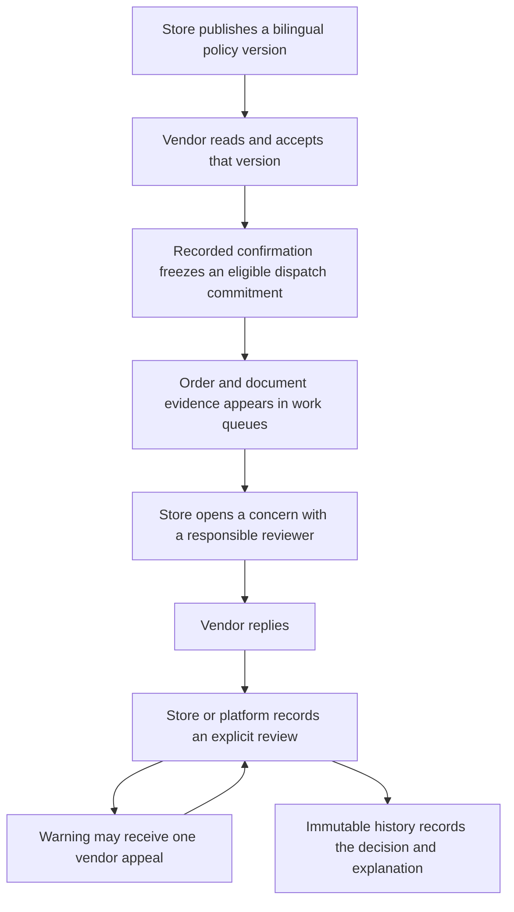

Marketplace operations connects a store's service expectations to vendor acceptance,
recorded concerns and source evidence. Choose **Marketplace operations** in your
dashboard. Your role determines which actions appear. These screens are available
in the tested development build; live deployment remains separate.

## How to use it

**Store team:** publish an English and Arabic policy with the required document
types and optional dispatch hours. Each publication creates an immutable version.
Choose only requirements you intend to operate. Publishing a version hides existing
external offers and blocks new purchases until each vendor accepts that version
in this store and has the required valid documents. Earlier acceptances remain
in history.

Open a case for an eligible participating vendor, choose a responsible reviewer,
and explain the concern. Where applicable, select the related order or document.
Read the evidence before recording a warning, resolution or dismissal. A case
deadline tracks follow-up; it is separate from an order's dispatch commitment.

Before activating or republishing an external vendor offer, the system checks
the current store policy acceptance and its required documents. Evidence must
be approved, backed by a stored file, unexpired and dated where required. A
blocked publication explains what is missing and leaves the draft unpublished.
Ask the vendor to accept the policy or supply evidence for authorized review.
Where no service policy exists, existing mode, entitlement and participation
rules still apply. Staff can correct offers or stock, unpublish products and
service earlier orders. The new policy preserves recorded order commitments,
commissions and payouts.

<SystemTour tour="tenant-marketplace-operations" compact />

## Reply or appeal as a vendor

Confirm the workspace, open **Marketplace operations**, then read **Current
policy** before accepting. The case list contains only this vendor's cases in
that workspace. Open one to read the conversation and submit a clear reply.
Your draft stays when refreshing the same case; leaving asks you to handle it.

An appeal asks reviewers to reconsider a recorded warning. One appeal is allowed
per warning, including after resolution; a new recorded warning may permit a
new appeal. A dismissed warning cannot be appealed again. After submitting,
wait for a human review rather than assuming the warning was overturned.

<SystemTour tour="vendor-marketplace-operations" compact />

## Platform review and work queues

**Platform admin:** confirm the store filter, find the case, and read **Case
history** before deciding. Named actors and timestamps show who recorded each
entry. Choose an explicit outcome and write an explanation. Assignment is a
separate recorded action using eligible reviewers from the owning store.

An unchanged deadline keeps its exact recorded value. To edit it, enter both
local date and time; clear both to remove it. If another reviewer changes the
case first, refresh, retain your draft and reconsider against the latest revision.
The platform does not publish a store's policy or accept it for a vendor.

<SystemTour tour="admin-marketplace-operations" compact />

Use work queues to find late dispatch evidence, expiring documents, missing
required evidence, participation needing follow-up, offers under review, open
returns and payout exceptions. Open the original record where a detail screen
exists. A queue row is a reason to investigate, not proof of vendor fault.
Amounts retain their own currency; do not add unrelated currencies together.

The late-dispatch work queue clears when the whole order is dispatched. Its
original deadline and dispatch evidence remain in history, and any open case
still requires an explicit review. A completed late delivery is not unfinished
dispatch work. Cancellation attribution checks the recorded actor against the
order's store, vendor or buyer; a customer's signup store is not used.

## Restrictions and decisions

- Store users see their own store. Vendors need their approved active workspace
  and see only their organization. Platform staff need the operation and review
  permissions. A case owner must be eligible staff of its owning store.
- Policies, acceptances and conversation events preserve their original history.
  Reviews require an explicit outcome and at least ten characters of explanation.
- A warning or dismissal does not suspend a vendor, refund an order, change a
  commission, debit money or alter a payout. Use the relevant authorized workflow.
- Document approval, expiry, store participation and policy acceptance are
  separate. Missing or undated evidence is not a guarantee of permanent validity.
- Dispatch monitoring uses a policy accepted before recorded confirmation. Later
  acceptance never rewrites an old promise. A label or one parcel is not proof
  that the entire order dispatched. Missing historical evidence stays unknown.
- Under-review offers are not rejected offers. The publication-corrections queue
  uses actual returned/invalidated review receipts. [Use the product review workflow](/en/features/product-review).
  Carrier-to-order lifecycle integration remains work.

## Data flow and outcome

Each case remains attached to its store and vendor. Staff history identifies
resolved reviewers; vendor history shows team roles without staff identifiers.
Queue results expose safe references rather than buyer, bank or compliance-file
secrets. Case changes never rewrite the original order economics.

## When something goes wrong

Check workspace, permission, policy version and current case state. For a revision
conflict, refresh before deciding again. An interrupted retry reuses its receipt
when the explanation and decision are unchanged. Read history after a timeout.
A visible pending-projection notice means order monitoring is still catching up;
it must not be interpreted as no late orders.

## Evidence and verification limits

Screenshots captured 18 November 2026 use an explicitly synthetic local policy
and case. Replies, appeal, assignment and dismissal were exercised without real
allegations, financial changes or live provider calls. The short clips are silent,
captioned screenshot walkthroughs, not live screen recordings. Backend isolation,
policy snapshots, revisions and privacy have focused tests; the remaining roadmap
is tracked separately in [implementation phases](/en/roadmap/phases).

[Store handbook](/en/roles/tenant) · [Vendor handbook](/en/roles/vendor) ·
[Platform handbook](/en/roles/admin) · [Document review](/en/features/vendors)
