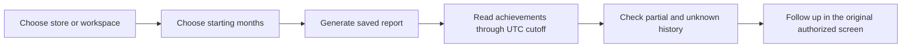

> **Development checkpoint · 19 November 2026.** The screens below were checked in the English and Arabic local dashboards with synthetic data, including private downloads. They use a controlled 21 November clock with facts dated 19 November. Live deployment, real provider payments and further mobile/accessibility acceptance remain separate. The short clips are guided still-image walkthroughs, not continuous recordings.

## How to use it

Open **Reports → Merchant lifecycle** when available to your role. Select one to twelve calendar months and confirm the store or workspace. Choose **Generate**, wait for completion, then read the saved result. Use **Export** only if you have export permission. The private download expires after 24 hours and still requires your current access.

The selected months identify when an application was submitted, a business was provisioned or a seller workspace was first approved. Later achievements are included through the report's observation cutoff; they are not restricted to those starting months. Generating a report records no purchase, shipment or payment.

## Choose the correct population

| Dashboard | What you can compare |
|---|---|
| Platform admin | Platform or selected-store applications, businesses, workspaces and their permitted histories |
| Tenant staff | Their own business and the vendor workspaces approved in that store, as separate groups |
| Vendor staff | Their own currently approved workspace in the selected store |

One vendor approved in two stores has two workspaces. Reapproval, package renewal and a mode change do not start a new merchant cohort. A submitted application is not yet a provisioned business. The report does not count visitors who never submit, unfinished forms or an invented final onboarding drop-off rate.

Customers have one central account across stores. Their first-registration store remains a signup statistic only; it does not assign their purchases, merchant activity or other stores' customers to that store. This report counts merchant businesses and workspaces, not customer registrations.

Platform admin — Read the saved scope and private export

Review platform or selected-store scope, the saved UTC cutoff, ready generation and private export. These counts are controlled local examples.

<SystemScreenshot src="/docs/screenshots/merchant-lifecycle-admin-scope-en.webp" alt="Read the saved scope and private export: Review platform or selected-store scope, the saved UTC cutoff, ready generation and private export. These counts are controlled local examples." />

Tenant staff — Review this store’s saved result

Check this store, the saved UTC cutoff and the ready private export. Business and seller-workspace populations stay separate.

<SystemScreenshot src="/docs/screenshots/merchant-lifecycle-tenant-scope-en.webp" alt="Review this store’s saved result: Check this store, the saved UTC cutoff and the ready private export. Business and seller-workspace populations stay separate." />

Vendor staff — Check the selected approved workspace

Review your selected store, saved UTC cutoff and ready private export. Tenant application results are not applicable, not a zero population.

<SystemScreenshot src="/docs/screenshots/merchant-lifecycle-vendor-scope-en.webp" alt="Check the selected approved workspace: Review your selected store, saved UTC cutoff and ready private export. Tenant application results are not applicable, not a zero population." />

## Read the seven sections

1. **Applications:** recorded submissions and their provisioned, rejected, open or unknown outcomes.
2. **Businesses:** provisioned stores grouped by their starting month.
3. **Workspaces:** first-approved store/vendor relationships grouped separately.
4. **Activation:** owner access, eligible offer, funded purchase, complete dispatch, complete delivery and reconciled vendor statement.
5. **Commercial activity:** monthly qualifying purchase activity and repeat activity for each starting cohort.
6. **Billing recovery:** separate renewal gaps, initial payment failures and paid-but-not-applied exceptions.
7. **Coverage:** which histories support the result and where evidence is missing or uncertain.

**Not applicable** means the measure does not belong to that population or role. A business does not need a vendor statement to activate; use its workspace section for that measure. Workspace owner access is not measured from a global vendor login. Vendors do not receive tenant applications, owner access, platform bills, store totals or other sellers' histories. An unavailable section is not a measured zero.

## Understand milestones and timing

Milestones are independent achievements, not a compulsory sequence. An eligible offer means a recorded publicly visible product with a positive-priced active variant and the required selling permissions; it does not guarantee stock or checkout success. A qualifying funded purchase requires the relevant seller order's supported commercial funding. An unpaid cash-on-delivery order, a free order, a package invoice or a failed payment is not that milestone.

Complete dispatch and complete delivery are separate. A label, partial parcel or edited status does not prove whole-order delivery. The vendor-statement milestone requires an explicit successful check of the statement and its original financial evidence. Closing, approving or paying a statement does not substitute for that check, and verification itself transfers no money.

A recorded achievement may be known even when its first-ever date is uncertain. First-achievement timing uses only proven starting and achievement times. The report shows the sample size with the median and 90th-percentile time; missing samples are not zero seconds.

Platform admin — Read independent recorded achievements

Business milestones are independent. Read observed, unknown, applicability and supported samples. This frame shows part of the achievement table, not the retention table.

<SystemScreenshot src="/docs/screenshots/merchant-lifecycle-admin-activity-en.webp" alt="Read independent recorded achievements: Business milestones are independent. Read observed, unknown, applicability and supported samples. This frame shows part of the achievement table, not the retention table." />

Tenant staff — Keep achievements and proof separate

Read this business’s independent milestones and supported timing samples. Known achievements do not make all history complete; only part of the table is visible.

<SystemScreenshot src="/docs/screenshots/merchant-lifecycle-tenant-activity-en.webp" alt="Keep achievements and proof separate: Read this business’s independent milestones and supported timing samples. Known achievements do not make all history complete; only part of the table is visible." />

Vendor staff — Read only your workspace’s milestones

Business metrics are not applicable. Your workspace’s owner-access row is not applicable; the eligible offer has its own evidence. Other sellers are not included.

<SystemScreenshot src="/docs/screenshots/merchant-lifecycle-vendor-activity-en.webp" alt="Read only your workspace’s milestones: Business metrics are not applicable. Your workspace’s owner-access row is not applicable; the eligible offer has its own evidence. Other sellers are not included." />

## Read months, activity and uncertainty

All months and the observation cutoff use **UTC**. The cutoff is the start of the day on which generation was requested, excluding that instant and later observations. A delayed job keeps the original cutoff. The current month is partial; a report from a previous observation day can need regeneration.

The table shows twelve monthly offsets from each starting month. **Activity share** divides merchants with a qualifying funded purchase that month by the starting cohort. **Repeat activity** divides members active in both the starting month and the later month by the starting-month active group. A merchant first selling in month three can add to activity there, but cannot become a retained starting-month seller. Refunds do not erase a historically qualifying purchase.

Partial months, future months and incomplete relevant history have no final percentage. Unknown history is not zero sales, churn or proof of failure. A currently active account or completed setup checklist does not reconstruct old milestones. Trusted test activity is excluded; a failed test attempt alone does not invalidate an independently supported genuine purchase.

## Interpret billing recovery separately

A renewal gap belongs to an original paid service-period boundary, not each retry. Intentional cancellation at period end and a debt-free trial expiry are not failed renewals. Initial payment failure and paid-but-not-applied cases have their own groups. The episode view follows cases opened in the selected months; event counts describe events occurring in those months, so the totals answer different questions.

**Payment recovered**, **term applied** and **access restored** are different facts. An applied term means the related package period was accepted; it does not override an independent administrative suspension. Paying during grace may apply a term while selling access was already available. The recovery section's applied-service outcome must therefore not be read as proof that a blocked store reopened. No-charge resolution is separate from genuine captured payment, and a notice does not prove it caused recovery. Current payment simulations do not represent commercial cash recovery.

Platform admin — Check what the evidence cannot prove

An applied term and no-charge resolution differ from restored access. Coverage is incomplete; known counts do not prove complete history or recovered cash.

<SystemScreenshot src="/docs/screenshots/merchant-lifecycle-admin-coverage-en.webp" alt="Check what the evidence cannot prove: An applied term and no-charge resolution differ from restored access. Coverage is incomplete; known counts do not prove complete history or recovered cash." />

Tenant staff — Read incomplete history honestly

The source-coverage warning remains meaningful even with known counts. Applying a term or a no-charge resolution does not prove access restoration or cash recovery.

<SystemScreenshot src="/docs/screenshots/merchant-lifecycle-tenant-coverage-en.webp" alt="Read incomplete history honestly: The source-coverage warning remains meaningful even with known counts. Applying a term or a no-charge resolution does not prove access restoration or cash recovery." />

Vendor staff — Separate unavailable scope from missing evidence

Tenant billing is not applicable. Read only your workspace’s coverage. Incomplete evidence is not zero activity or proof of a lost merchant.

<SystemScreenshot src="/docs/screenshots/merchant-lifecycle-vendor-coverage-en.webp" alt="Separate unavailable scope from missing evidence: Tenant billing is not applicable. Read only your workspace’s coverage. Incomplete evidence is not zero activity or proof of a lost merchant." />

## Restrictions and decisions

View, generate and export permissions are separate. Changing workspace or losing its approval removes access, including to downloads. The report contains aggregate counts and timings, not customer contacts, private billing amounts or payout references. Use [subscription details](/en/features/subscriptions), [commission records](/en/features/commission) and [settlements](/en/features/settlements) for authorized operational follow-up.

## Data flow and outcome

## Watch the role-specific walkthrough

<SystemTour tour="feature-merchant-lifecycle-admin" compact />

<SystemTour tour="feature-merchant-lifecycle-tenant" compact />

<SystemTour tour="feature-merchant-lifecycle-vendor" compact />

## When something goes wrong

For **Not generated**, request generation. For a pending job, wait for its recorded result before requesting another. If a file expires, request a new export. For unexpected zero or missing values, check population, scope, cutoff and coverage before concluding that a merchant failed or stopped selling.
