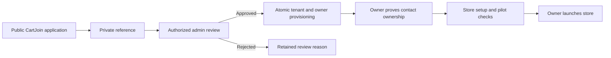

## Where this journey starts

The **CartJoin platform website** introduces services, Store/Marketplace modes and published packages. It is a separate application from the **tenant customer storefront**. A merchant application is not a customer purchase or a new customer password account.

The local preview provides English and Arabic package comparison and assisted applications. Public discovery remains a separate eligibility-controlled step; private tenant catalogs are not automatically published.

The application has three steps. Enter contact details, choose a mode and package, then review before submitting. Save the receipt reference. Open **Application status** and enter that reference and the original application phone. The result shows the current review state. A mismatch returns a single lookup error.

<SystemTour tour="feature-merchant-onboarding" compact />

## Choose a mode and package

Store mode is for selling your own inventory. Marketplace adds approved sellers, seller workspaces, commissions, and settlement tracking. On **Plans**, compare the published terms in your currency. Annual offers show the full bill and the monthly equivalent. Savings appear when monthly and annual offers have matching terms. Open the application from the offer to carry its exact version into the form. Preview offers are marked **Test**.

Choose **Help me choose** if you want help selecting a package. Marketplace seller approvals take place after store setup.

The standard free trial starts at approval and provisioning. Once you meet your launch requirements, you can sell within the accepted plan’s limits until the trial ends. You can choose paid activation from your store’s billing screen. Existing purchases remain available for servicing after the trial.

## How to use it

Enter business and owner names, a reachable phone, optional email, intended mode, and optional package. Submit once and keep the receipt reference. If the response is interrupted, retry with the same details to recover the original reference. If a selected offer is withdrawn before submission, your contact details stay in the form. Select another published offer or choose **Help me choose** before submitting.

The receipt means **received for review**, not approved, paid or launched. Application contact data is private. Submission does not subscribe you to marketing.

## Platform review

Authorized platform staff open **Administration → Merchant applications**. Review the business, requested mode, requested package version, and owner contact. If the requested version is unavailable, explicitly select an eligible replacement and record the reason. The application keeps a record of the submitted and approved selections.

Approval atomically creates the tenant, owner role/account, package trial and requested eligible mode. A repeated approval returns the original result. A rejected application needs a new application for fresh review. A provisioned store is managed through its servicing lifecycle rather than rejected afterward.

After the store is created, the applicant opens **Application status** and selects **Send verification code**. Enter the six-digit code sent to the application phone and choose a password. This verifies the phone and reveals the workspace code. Use that code on the merchant sign-in page, or follow the offered sign-in link when the deployment has configured one.

### Provision an assisted store directly

Authorized platform staff can open **Tenants → Create** and select **Set up the initial owner and package**. Choose the selling mode, select an eligible package version, then enter the initial owner's name and phone. The owner phone can differ from the store contact phone. Save once to create the staged store, owner account and subscription together.

Copy the **Owner setup reference** from the confirmation and share it with the initial owner through your approved contact channel. The owner uses **Application status** with that reference and their own phone to choose a password after verification. In a sandbox, use the configured test delivery channel. If a submission times out, retry the same details before changing the form to recover the original provisioning result.

<SystemScreenshot src="/docs/screenshots/admin-subscription-plans-en.webp" alt="Platform package versions: create a new version for changed terms and retire an offer without rewriting existing contracts." />

## Finish tenant setup

Open **Subscription & setup** for the verified-state checklist: business profile, owner sign-in, currency, shipping origin, payment method, publishable catalog and package enrollment. Each item reflects stored system state; it cannot be completed merely by ticking a box.

Prepare price/stock, payment and shipping eligibility, customer policies and both languages. Then test the full customer purchase, payment, fulfillment, return and refund cycle appropriate to the pilot. Manual/test providers are labeled and do not prove live integration.

New stores open in setup. When the required checks pass, the owner uses **Launch store**. Launch is separate from the application approval and does not override billing or selling restrictions. The live invoice payment button appears only where online subscription billing is configured and the invoice is eligible.

## Restrictions and decisions

The public application cannot choose tenant_id, self-approve, expose owner credentials or grant staff permissions. Only authorized reviewers provision merchants. Customer identities remain centralized, while the new tenant's products, content, orders and billing remain private.

An existing merchant is not forced to create a duplicate store or pay again through this form. Use the current tenant's billing and setup workflows. Marketplace seller onboarding, verification and payout-account review remain separate approvals.

## Data flow and outcome

## If something fails

Keep the application reference when asking the review team for help. Do not submit passwords, gateway secrets or unnecessary financial documents. If approval is retried after a network failure, inspect the existing result first. If owner recovery fails, verify the workspace and contact identity through the authorized support path; never share a reusable secret in the public application.

[Subscription and invoice guide](/en/features/subscriptions) · [Merchant/vendor operating plan](/en/roadmap/onboarding)
