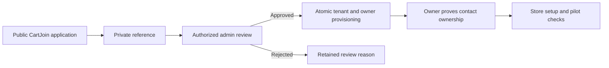

## Where this journey starts

The **CartJoin platform website** introduces services, Store/Marketplace modes and published packages. It is a separate application from the **tenant customer storefront**. A merchant application is not a customer purchase or a new customer password account.

The local preview provides English and Arabic package comparison and assisted applications. Public discovery remains a separate eligibility-controlled step; private tenant catalogs are not automatically published.

The application has three steps. Enter contact details, choose a mode and package, then review before submitting. Save the receipt reference. Open **Application status** and enter that reference and the original application phone. The result shows the current review state. A mismatch returns a single lookup error.

<SystemTour tour="feature-merchant-onboarding" compact />

## Choose a mode and package

Store mode is for selling your own inventory. Marketplace adds approved external sellers to the same tenant. Review the package version, currency, billing cycle, trial and capacity. Preview packages are clearly marked test offers; sample prices are not a commercial commitment.

You can ask the review team to help choose a package. Selecting Marketplace does not approve a vendor or enable paid entitlements by itself.

## How to use it

Enter business and owner names, a reachable phone, optional email, intended mode and optional package. Submit once and keep the receipt reference. A retry with unchanged details is replay-safe. Corrected details use a fresh request key so they do not silently overwrite a previous submission.

The receipt means **received for review**, not approved, paid or launched. Application contact data is private. Submission does not subscribe you to marketing.

## Platform review

Authorized platform staff open **Administration → Merchant applications**. Review the business, requested mode, eligible package version and owner contact; record a clear reason before approving or rejecting.

Approval atomically creates the tenant, owner role/account, package trial and requested eligible mode. A repeated approval returns the original result. A rejected application needs a new application for fresh review. A provisioned store is managed through its servicing lifecycle rather than rejected afterward.

The owner secret is random and never returned in the API or guide. Supply the tenant workspace code through the approved owner handover and use the existing phone/email password recovery flow to prove contact ownership and choose a password. Approval does not falsely verify the phone.

<SystemScreenshot src="/docs/screenshots/admin-subscription-plans-en.jpg" alt="Platform package versions: create a new version for changed terms and retire an offer without rewriting existing contracts." />

## Finish tenant setup

Open **Subscription & setup** for the verified-state checklist: business profile, owner sign-in, currency, shipping origin, payment method, publishable catalog and package enrollment. Each item reflects stored system state; it cannot be completed merely by ticking a box.

Prepare price/stock, payment and shipping eligibility, customer policies and both languages. Then test the full customer purchase, payment, fulfillment, return and refund cycle appropriate to the pilot. Manual/test providers are labeled and do not prove live integration.

## Restrictions and decisions

The public application cannot choose tenant_id, self-approve, expose owner credentials or grant staff permissions. Only authorized reviewers provision merchants. Customer identities remain centralized, while the new tenant's products, content, orders and billing remain private.

An existing merchant is not forced to create a duplicate store or pay again through this form. Use the current tenant's billing and setup workflows. Marketplace seller onboarding, verification and payout-account review remain separate approvals.

## Data flow and outcome

## If something fails

Keep the application reference when asking the review team for help. Do not submit passwords, gateway secrets or unnecessary financial documents. If approval is retried after a network failure, inspect the existing result first. If owner recovery fails, verify the workspace and contact identity through the authorized support path; never share a reusable secret in the public application.

[Subscription and invoice guide](/en/features/subscriptions) · [Merchant/vendor operating plan](/en/roadmap/onboarding)
