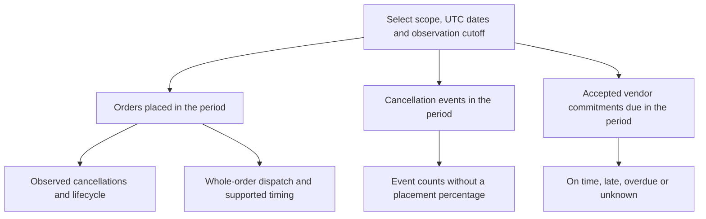

> **Development checkpoint · 19 November 2026.** Reporting and the three staff dashboards are implemented and tested locally, including English/Arabic browser checks, private exports, workspace isolation and mobile keyboard access. The 24 actual screenshots and six captioned 24-second clips use controlled synthetic data; the clips are guided screenshot sequences. Live rollout remains separate.

## What you can learn

Use this report to investigate how orders progress after placement, how many cancellations have been observed and whether accepted vendor dispatch commitments were met. It counts child orders, not customers, invoices or revenue. One checkout containing store-owned and vendor products can create several child orders.

Your customers keep one central account across stores. Their first-registration store does not decide which store owns an order or which staff may view it.

## How to use it

The dashboard location is **Reports → Order operations**. Start by checking your store or approved vendor workspace. Platform administrators can review a selected store or a global aggregate. Tenants see their own store-owned and vendor orders; vendors see only their original order participation in their current approved workspace.

1. **Check the scope.** Confirm the selected store or vendor workspace before reading any totals.
2. **Choose the dates.** Select up to 93 inclusive UTC days, ending no later than yesterday. The default is the last 30 completed UTC days.
3. **Generate and wait.** Request generation when a matching snapshot is unavailable. Queued or failed work does not mean there were no orders.
4. **Read the saved cutoff and coverage.** Then compare the counts and available percentages. Export only the snapshot for the scope and dates you intend to review.

Every snapshot has an exclusive observation cutoff at 00:00 UTC. For example, a cutoff of 20 November includes evidence retained before 20 November begins. The worker keeps that cutoff even when generation finishes later. A late-arriving, backdated fact cannot rewrite a snapshot with an earlier cutoff.

## Keep the three populations separate

| Population | Which records belong? | What question does it answer? |
| --- | --- | --- |
| Orders placed | Child orders placed within the selected days | What happened to these orders by the observation cutoff? |
| Cancellation events | Cancellations occurring within those days, including older orders | How many cancellation events occurred during this period? |
| Commitments due | Original accepted vendor dispatch commitments due within those days | Were these recorded commitments met? |

A cancellation of an older order can appear in cancellation events without belonging to the selected placement cohort. Do not divide that event count by the number of newly placed orders.

## Worked example: the same day in three dashboards

This is a **controlled synthetic example**, not live trading activity. The selected period is **10 November 2026** (`from` and `to` are both 10 November). The saved cutoff is **19 November 2026 at 00:00 UTC, exclusive**: only evidence retained before that instant is considered. The selected day and observation cutoff answer different questions—when orders were placed, and how much of their later history was known.

| Dashboard and scope | Eligible orders placed on 10 November | Store-owned orders | Vendor orders | Those placed orders cancelled by the cutoff | Observed cancellation share | Cancellation events on 10 November |
| --- | --- | --- | --- | --- | --- | --- |
| Platform admin, all stores | 9 | 2 | 7 | 2 | 22.22% (`2 ÷ 9`) | 3 |
| Tenant, Store A | 8 | 2 | 6 | 2 | 25.00% (`2 ÷ 8`) | 3 |
| Vendor A, approved Store A workspace | 6 | Not shown | 6 | 2 | 33.33% (`2 ÷ 6`) | 3 |

**Why do the totals differ?** The platform view includes one eligible order from Store B. Store A's tenant view includes only its own eight orders. Vendor A's view includes only its six original vendor orders in Store A. The vendor dashboard does not show a store-owned order row; this is a scope restriction, not a claim that Store A has zero store-owned orders. One retained test order is excluded from each applicable population; excluded tests are not additional eligible orders.

**Why are there three cancellation events but only two cancelled placements?** Two cancelled orders were placed on 10 November. Another order was placed on **5 October** and cancelled on **10 November**, 36 days later. Its cancellation belongs in the day's event count, but the order does not belong in the day's placement denominator. Therefore, the tenant cancellation share is **2 out of 8**, not 3 out of 8. That older cancellation can still be counted when reviewing its original October placement cohort.

### An unknown commitment outcome is not a zero

In this example, Store A and Vendor A have **six accepted vendor commitments due during 10 November**. One supported cancellation before the deadline, with no prior handoff, is excluded from assessed timeliness. Of the remaining five commitments, two were on time, one was dispatched late, one became overdue without recorded whole-order dispatch, and one has an unknown outcome.

The on-time percentage is **unavailable because relevant evidence is incomplete**. It is not 0%, and the two known on-time outcomes do not justify publishing a complete 2-out-of-5 score. Store A's two store-owned orders remain in order progress and cancellations, but do not gain an invented vendor deadline.

## Data flow and outcome

The selected dates create three separate evidence populations. Generation saves their supported outcomes at one fixed cutoff.

## Read observed cancellations

The cancellation share answers: **How many of these placed orders had a supported cancellation by the cutoff?** It is not the final probability that an order will be cancelled. Open orders remain in the population, so a later cutoff can legitimately show a higher share.

There is no 30-day cancellation limit. A supported cancellation 45 days after placement can still count for that placement cohort. Refunds are separate financial events and do not automatically mean cancellation.

Read the initiation categories as **customer, vendor, tenant staff, platform staff, system or unknown**. Vendor ownership does not prove that the vendor initiated a cancellation or caused a problem. Unknown attribution does not become a system action. The report does not expose staff IDs, customer details or private cancellation comments.

The report also distinguishes cancellations before and after confirmation, with an explicit unknown category when their ordering cannot be established. A zero denominator or incomplete relevant evidence produces an unavailable percentage, not 0%.

## Read lifecycle and dispatch

Lifecycle describes each order at the saved cutoff: open, terminal at that time or unknown. Terminal is a description of recorded state, not a promise about every later return or refund.

Whole-order dispatch requires retained proof covering the complete required order. A shipping label, one dispatched parcel or a delivery timestamp alone cannot supply an exact whole-order dispatch time.

Read recorded whole-order dispatch separately from its timing. An order may have dispatch proof with an unknown exact time. Missing proof and known incomplete dispatch are different outcomes.

Timing summaries show supported placement-to-dispatch and confirmation-to-dispatch samples. Check the sample count beside the median and 90th percentile. Durations are rounded down to whole seconds; percentiles use the nearest-rank method. Missing clocks never become zero-duration deliveries.

## Read accepted vendor commitments

This section uses commitments **due during the selected period**, not the placement population. It compares the original accepted vendor policy and deadline with retained dispatch evidence. There is no universal 48-hour promise.

Store-owned orders remain visible in order progress and cancellations. They are explicitly unmonitored for this vendor commitment measure because no first-party dispatch commitment setting exists. An editable shipping estimate is not a dispatch deadline. Vendor orders can also be unmonitored when accepted policy or confirmation evidence is missing, or the dispatch clock was disabled.

| Outcome | Meaning |
| --- | --- |
| On time | Supported whole-order dispatch occurred at or before the original due time. |
| Late dispatch | Supported whole-order dispatch occurred after that deadline. |
| Overdue without recorded dispatch | The deadline passed without supported whole-order dispatch; this can include a later-cancelled order. |
| Cancelled before due | Supported cancellation occurred before or at the deadline, with proof of no earlier handoff; it is excluded from assessed timeliness. |
| Unknown | The evidence cannot support a fair outcome or its ordering. |

A cancellation after the deadline does not erase a missed commitment. When ordering at the same timestamp cannot be established, the result remains unknown. No eligible commitments means the rate is unavailable, not perfect performance.

These measures do not automatically penalize a seller, change ranking, block payouts or alter approval.

## Check evidence coverage before acting

Read coverage and availability before interpreting a percentage. Forward collection cannot reconstruct older lifecycle, ownership or dispatch facts from today's editable records. Unknown placement time, missing original commitments, contradictory physical proof and bounded source limits must remain visible.

Trusted retained payment or shipping evidence excludes test activity. Unpaid or cash-on-delivery orders can still belong to operational populations; full payment is not a requirement. A failed test-payment attempt alone does not exclude a separately genuine order.

If the relevant evidence is incomplete, use the supported counts to investigate and keep unavailable rates unavailable. Do not interpret unknown evidence as zero activity, successful delivery or seller fault.

## Dashboard walkthroughs

These actual local screens were captured on 19 November 2026. Each 24-second captioned video is a guided screenshot sequence, not a continuous recording or live trading activity. Follow the steps for your dashboard using the synthetic example above. Start with scope, then placements and cancellations, and finish with dispatch evidence and accepted commitments.

### Platform admin: compare stores without mixing populations

Start with the selected scope. The global example shows **9 eligible placements and 2 observed cancellations (22.22%)**. Its 2 store-owned and 7 vendor orders are child-order totals. Narrowing to Store A changes the placement total to 8; it does not mean an order disappeared. Check the separate cancellation-event section before interpreting its count of 3. Use a store-specific view when investigating a store's process, and keep unknown deadline outcomes visible.

<SystemTour tour="feature-order-operations-admin" anchor="order-operations-admin-walkthrough" />

### Tenant: review your store's process

Check that Store A is selected, then read its **8 eligible placements: 2 store-owned and 6 vendor orders**. The **2 observed cancellations produce 25.00%** for those placements. Review cancellation initiation and order state to decide where to investigate; an order owned by a vendor is not automatically a vendor-caused cancellation. Check dispatch evidence and sample counts before comparing speed. The separate count of 3 cancellation events includes the older October order.

<SystemTour tour="feature-order-operations-tenant" anchor="order-operations-tenant-walkthrough" />

### Vendor: review your own approved workspace

Confirm the approved Store A workspace first. Vendor A sees **6 own eligible placements and 2 observed cancellations (33.33%)**. Store-owned orders and other sellers' orders are outside this view; the missing store-owned row is intentional. Check your accepted due commitments and the explanation for an unknown result. These counts do not expose customers' activity in other stores, and an unknown result does not create an automatic penalty.

<SystemTour tour="feature-order-operations-vendor" anchor="order-operations-vendor-walkthrough" />

## Restrictions and decisions

View, generate and export permissions are separate. An export belongs to the requesting staff account, has a private expiring link and expires after 24 hours. Current permissions and vendor workspace approval are checked again when work runs and when the file is downloaded.

Changing scope or dates requires the corresponding snapshot. Do not compare a stale snapshot's label with a newly selected period. Global child-order totals do not identify unique global customers.

## Related guides

- [Marketplace operations](/en/features/marketplace-operations): policies, acceptance and individual operational cases.
- [Packing](/en/features/packing) and [Shipping](/en/features/shipping): the physical work behind dispatch evidence.
- [Reports](/en/features/reports): broader reporting access and exports.
- [Customer cohorts](/en/features/customer-cohorts) and [Shopping funnel](/en/features/shopping-funnel): different populations and business questions.

[Source evidence and API boundaries](/en/evidence/order-operations).
