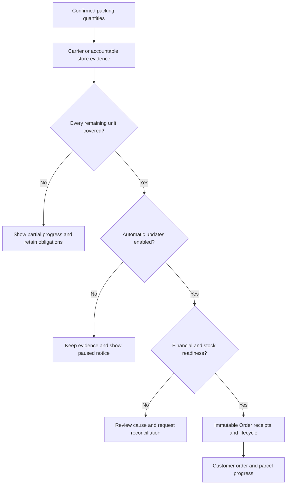
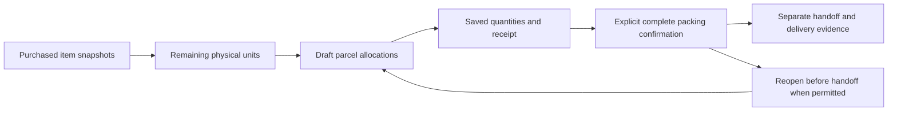

## What this screen does

Open an order → **Packing and parcels**. Store operators work within their store;
vendors work within their selected approved workspace and their own seller group.
Platform admins inspect packing without changing it. Check the store, seller and
order number before working.

Packing answers **which units belong in which parcel**. Confirming it does not
book a carrier, dispatch the order, prove delivery or collect payment.

## How to use it

1. Compare **Purchased**, **Refunded units** and **Still required**. Only settled
   physical-unit refunds reduce the packing target. A monetary adjustment alone
   does not remove a unit from the parcel.
2. Inspect **Order parcels**. With parcel-creation permission, choose **Add empty
   parcel** and confirm. This creates an unbooked parcel without allocating items.
   If creation has an uncertain result, refresh and inspect the list before adding
   another parcel.
3. Choose **Add allocation**, select the parcel and purchased item, and enter a
   positive whole quantity. You can split one item across different parcels. Each
   parcel/item pair may appear once; assigned units cannot exceed the remaining
   quantity.
4. Write an explanation of 10–4,000 characters and choose **Save packing draft**.
   Partial drafts are allowed. Check the new revision and receipt. Removing every
   allocation and saving deliberately clears the draft; it does not delete a parcel.

## Confirm, reopen or void

**Confirm complete packing** becomes available after the saved draft allocates
every remaining unit and every active parcel contains an item. Review the saved
quantities, enter a new explanation and confirm. Unsaved edits must be saved first.

Confirmation freezes that revision. Before any handoff, an authorized operator
can explain why and choose **Reopen packing**. Earlier receipts remain available.
New parcels cannot be added behind a confirmed packing record.

For an unused parcel, explain why and choose **Void unused parcel**, then read the
confirmation. The parcel remains in history and its current allocations are
removed. A handed-off or booked parcel cannot be voided this way. This action
does not cancel a carrier booking or delete a private label file.

## Work safely with another operator

If the order, parcels, tracking or settled refunded quantities change after your
read, the server can reject an outdated command. Your quantities and explanation
stay on screen. Choose **Refresh from server**, confirm replacing unsaved quantities
when asked, and review the current record. Refresh keeps your explanation; it does
not automatically apply old quantities to the new version.

Switching between English and Arabic updates the packing readiness explanation
without refreshing the record or replacing your unsaved quantities and explanation.

After an interrupted save, an unchanged retry reuses the same command receipt.
Changing the explanation or quantities creates a different command. Inspect
**Packing receipts** rather than assuming a timeout means nothing was recorded.

<SystemTour tour="packing-manifest" compact />

## Read carrier evidence separately

**Handoff evidence is retained** means an observation remains independently of
editable parcel status. Changing the status does not make a handed-off parcel
unused again. Reopening and voiding stay blocked by retained handoff evidence.
New observations can also require you to refresh an older packing snapshot.

**Test observation — no live carrier action** identifies a local test-adapter
observation. It is not proof of a real carrier booking, delivery or payment.
The store, vendor and platform views show the same notices within their own
permissions. Packing quantities may be read-only while a separately permitted
parcel action remains available.

Authenticated carrier observations and explicit store confirmations now feed
whole-order readiness. Automatic order updates remain paused until the release
gate is approved. A parcel update alone does not prove that every purchased unit
was dispatched or that COD was collected.

<SystemTour tour="carrier-evidence" compact />

## Read partial dispatch and delivery

**Physical fulfillment** shows required units, units handed to the carrier and
units received by the customer. For example, **1 / 3 received** means one unit
has qualifying delivery evidence while two still await confirmation. It does not
mean that the whole order is delivered. Read each parcel line to compare its
allocated units and physical outcome. Actual times stay unknown when the source
only establishes delivery without a known carrier handoff time.

The **Test evidence** notice stays visible for preview examples. Test observations
cannot fill missing live deliveries. **Automatic order updates are paused** means
the evidence is saved, while the whole-order status waits for activation and
readiness; it is not a failed save.

<SystemTour tour="physical-fulfillment" compact />

## Record an accountable store confirmation

A store reviewer with the separate physical-confirmation permission can use
**Record store confirmation** after complete packing is confirmed:

1. Inspect the parcel and the customer's physical proof or carrier handoff record.
2. Choose the correct parcel and outcome: **Handed to carrier** or **Received by customer**.
3. Enter the known actual event time in your local time. Do not substitute today's
   time for an unknown historical handoff.
4. Explicitly choose **Live physical event** or **Test / preview event**, and write
   a 10–4,000 character explanation of how you verified the fact.
5. Choose **Save physical confirmation**. Inspect the refreshed unit counts.
   A retry of the unchanged request returns the original confirmation.

A vendor can inspect its own parcel progress and pack its purchased quantities;
its manual claim cannot supply the independent store delivery confirmation.
Platform oversight is read-only. The generic order-status menu no longer offers
Shipped or Delivered; use the evidence workflow instead. Confirmation does not
approve bank transfer, collect COD, change the purchased seller or move a unit
to another parcel after handoff.

## Recover a waiting or failed update

Read the reconciliation state and explanation first. Missing parcel proof needs
physical verification; a payment/stock hold needs a store review. After resolving
the cause, a separately permitted store operator can write a reason and choose
**Request reconciliation again**. The original evidence, earlier failure snapshot
and retry receipt remain retained. Refresh a conflicting record deliberately;
do not repeatedly send changed commands from an old revision.

Once any parcel has retained handoff evidence, cancellation and replacement
payment attempts are blocked even while the whole order still says Confirmed.
Attached stock and credit holds remain obligations for review; their expiry is
not permission to free already dispatched units. Use the appropriate correction,
return or reconciliation workflow with the store.

## Restrictions and decisions

- Reading shipments and creating parcels are separate permissions from managing
  packing. An account can inspect a record without being allowed to change it.
- Platform oversight is read-only. Customers receive parcel tracking information,
  without packing explanations, staff history or internal commands.
- Pending, cancelled, refunded or delivered orders cannot start new packing work.
  A settlement review or failed/refunded payment can also block it. Unpaid eligible
  orders retain their payment state when packing is confirmed.
- Legacy shipment claims do not become trusted historical evidence merely because
  someone opens this screen. A vendor cannot adopt an existing handoff into a new
  packing plan.
- Explanations are shared with permitted store, vendor and platform operators.
  Keep customer contact details and private documents out of them.

## Data flow and outcome

Whole-order updates require a current complete packing record, qualifying
evidence for every remaining unit and financial readiness. Packing alone never
collects payment or awards points. The development coordinator remains paused.

Continue with [shipping configuration and tracking](/en/features/shipping) or
[provider labels and test carriers](/en/features/shipping-providers).
