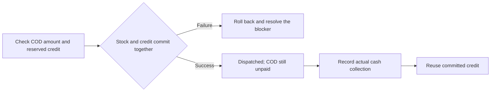

## How to use it

Customers choose an enabled payment method at checkout. For bank transfer, use the payment proof upload and wait for review. Tenant operators inspect Payments and evidence before approving or rejecting. For COD, record collection only after collection occurred.

For Egyptian stores with an enrolled Paymob account, the checkout payment step lists the hosted options configured by the merchant. Choose Paymob, place the order, then continue to its hosted page. After paying you come back to the store's payment-return page, which refreshes the payment status automatically. valU, Sympl and Apple Pay availability depends on the merchant setup and buyer eligibility. Guest checkout uses cash on delivery. Keep gateway credentials out of receipts, screenshots and support messages.

When your store enables saved cards on Paymob, you can choose to save a card there. At your next signed-in checkout, Paymob can offer cards saved on your last paid hosted purchase from the same store and merchant account. If none appear, enter your card on Paymob.

On a supported device, signed-in shoppers at an enrolled store can select delivery and choose **Review order with Apple Pay**. Check the address and total before placing the order and completing payment on Paymob.

### Continue payment for an existing invoice

Open the confirmation page or **Account → Invoices and orders → Invoice**, then choose **Continue to payment** if the invoice offers it. While the provider result is still being checked, the payment status refreshes on its own; you do not need to reload the page. For a bank transfer awaiting proof, open **Upload proof** and wait for the store’s review.

**Upload proof** opens the eligible bank transfer for that invoice, including older payments. The store checks that the payment still belongs to the invoice and can accept proof. Payments, refunds, and credit notes each have their own pages in **Account → Payments**.

If the invoice PDF is preparing, try the download again once the file is ready.

<SystemTour tour="feature-checkout" compact startAt={2} />

<SystemTour tour="feature-payments" compact />

Detailed task walkthrough

<SystemTour tour="customer" compact startAt={2} />

## Restrictions and decisions

With finance access, open **Marketplace Operations** and select **Payment reconciliation**. Open the case to see its amount, reason and history, assign it to yourself, or request a check. If you have a stored event ID or provider reference, submit it for verification. A reference alone cannot confirm payment. While verification is pending, the buyer's payment status refreshes itself on the payment-return and invoice pages. Another charge remains blocked until the outcome is established.

Online payment success requires a verified provider webhook, never the browser return alone. After the gateway, shoppers land on a payment-return page that refreshes the status automatically and shows paid, pending, failed or expired. An open online attempt expires after the store's configured window; the payment then shows as **expired**, reserved holds are released, and a new attempt can start because the invoice stays payable. A declined attempt does not cancel the order: the shopper can start a new attempt until the retry window closes, and orders are cancelled only when that window expires. Bank transfer needs proof and pending approval; rejection returns to awaiting confirmation. COD skips proof. The chosen inactive/unsupported gateway is rejected rather than silently replaced.

## COD with wallet credit, gift cards or points

Internal credit and cash collection are separate. When an eligible COD order is
prepared for dispatch, the system commits its reserved wallet credit, gift-card
value and redeemed points together with stock preparation. If stock preparation
fails, those changes roll back. Repeating the step or recording cash later does
not spend the credit again. An expired or mismatched reservation blocks dispatch;
ask the store to resolve it rather than changing the agreed purchase amount.

If a small number of high-value points cannot be divided across your selected
sellers without losing part of a discount, checkout stops before charging. Remove
points to continue or purchase each seller's items separately.

COD stays **awaiting collection** until an authorized operator records actual
collection. Bank-transfer proof awaiting approval does not qualify as COD.
After dispatch, a new payment method or attempt cannot replace the recorded
collection, even if an editable order status was reset. Contact the store for
reconciliation. Vendors cannot approve the customer's payment through a shipping
status change.

In the Egypt pilot, the store records buyer cash collection and checks the courier’s transfer separately. Vendors can follow their settlement records. Live Bosta collection and remittance still require pilot acceptance.

## Data flow and outcome

Invoice amount → payment intent → provider verification or named manual approver → payment status → invoice and child-order payment projections. Proof files remain protected.

## When something goes wrong

Check workspace, permission, record state and field errors first. If an action times out, inspect the record and its history before retrying. Escalate with the screen, record identifier and time; omit passwords and payment secrets.

## Evidence and verification limits

Authored from module documentation, dashboard routes and backend source. Route presence does not mean every action was exercised live. See [screen coverage](/en/coverage) and [source evidence](/en/evidence) for paths and fields. Screenshots illustrate demo accounts on 17 November 2026, not production results.

`Modules/Payment/` · `documentation/modules/`

Screen paths and source references

{/* SCREEN_MAP */}
## Where this feature appears

A route proves navigation, not permission to perform every action. Related-record detail tabs can expose additional entry points.

| Dashboard | Frontend entry paths |
|---|---|
| [admin](/en/roles/admin) | `/payments` |
| [tenant](/en/roles/tenant) | `/payments`, `/payment-gateways` |
| [customer](/en/roles/customer) | `/account/payments` |

[Exact route, field and enum source trail](/en/evidence/payments)
{/* /SCREEN_MAP */}

## If an online payment is declined

A confirmed decline keeps the failed attempt in the payment history and leaves the order open for a retry. Choose **Continue to payment** to start a new attempt on the same invoice until the retry window closes; once the window closes, the orders are cancelled and **Continue shopping** is the way to place a new order at current prices and stock levels. If the connection dropped while payment was open, the payment-return page shows the updated status automatically.

For bank transfers requiring a correction, upload new proof and wait for approval. Check the refund status to see whether funds have settled.

## Development preview: no real charge

The following English/Arabic walkthrough uses local test invoices. **Simulate success** and **Simulate decline** appear only for eligible test attempts when a development adapter is enabled. They never ask for card details, contact Paymob or collect money. These controls are unavailable in production. Platform subscription simulation is a separate feature, with separate invoices.

<SystemTour tour="feature-test-payments" compact anchor="test-payment-screen-guide" />

Success records a test payment and updates the invoice and child-order payment projections. Decline keeps the failed attempt in payment history and leaves the unpaid purchase open for a retry until the retry window closes. On a connection problem, check Payments before starting a new attempt. Retrying the same outcome is safe. A finished attempt keeps its recorded outcome.

## Carrier COD statement review

Tenant finance staff can preview a version 2 synthetic CSV in the carrier COD
reconciliation view. Use the approved store’s carrier account binding and the
same statement reference throughout the file. Each line has its own reference,
tracking number, date, EGP amount and type. The types cover cash collection,
transfer, fee and adjustment. Preview shows the comparison before you save.
Reimporting identical evidence shows the original import results.
If a saved statement is waiting for verified collection or payment evidence,
recheck it after that evidence arrives. This adds the new matching result to
the original statement.

Expected transfer equals verified collection less fees plus signed adjustments.
Compare it with the total transferred for that shipment. Investigate a short or
excess transfer using the linked source records if you have access to them.
Platform finance can view exceptions for a selected store. The import records
remittance evidence. Payment approval and vendor payouts follow their usual
authorized workflows.

The local workflow uses synthetic files for single-seller, single-parcel EGP
orders. A live carrier file or bank feed requires separate verification. Before
expanding the pilot, complete two consecutive remittance cycles with zero
unexplained variance.
