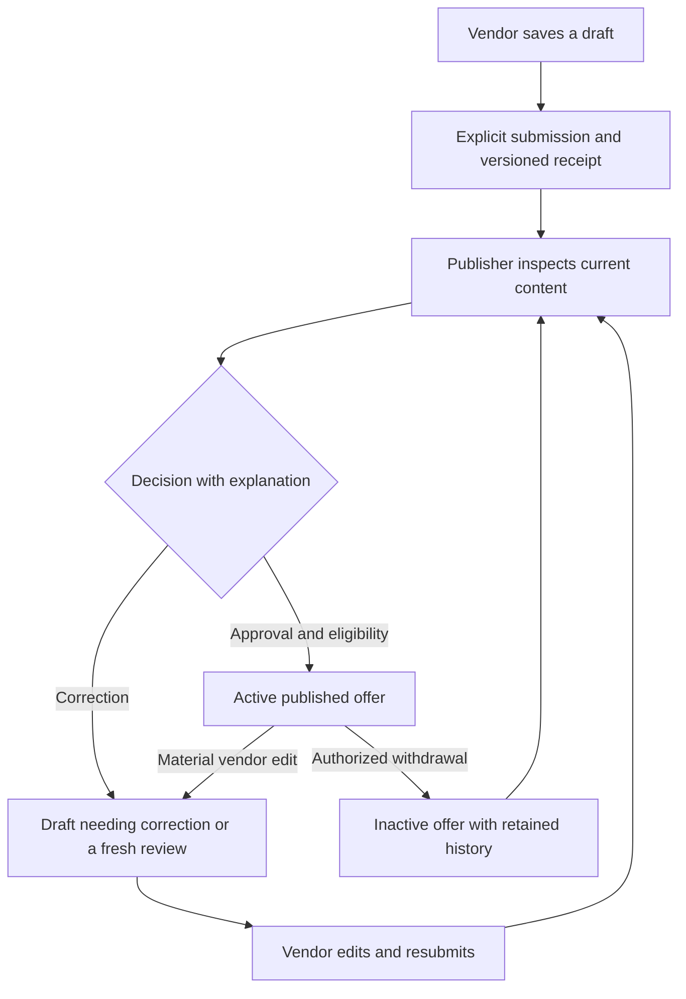

## Before you begin

Use an approved vendor workspace and an account with the permission for your task.
The customer storefront shows eligible published catalog content, without private
review explanations or staff history.

## How to use it

A vendor prepares the offer; an authorized store or platform publisher decides
whether to publish it. **Publication review** keeps the submission, explanation
and decision together. A saved draft is not an approved offer.

### Vendor: submit, correct and resubmit

1. Select the correct store workspace. Save the product's English and Arabic
   content, images and variants. Check prices and stock separately.
2. Open the product → **Publication review**. Explain what is ready, then choose
   **Submit current content**. Confirm **Under review** and a submission receipt.
3. If the offer is returned for correction, read the store team's explanation in
   **Review history**. Edit the requested content and save it.
4. Return to the review tab, describe the correction and submit again. The store
   reviews the new version; earlier explanations remain in the history.

<SystemTour tour="vendor-product-review" compact />

Changing material public content or images on a pending or published vendor
offer returns it to **Draft** and invalidates the previous review. It needs a
deliberate new submission. Ordinary price and stock updates retain the review.
An unsent explanation survives switching detail tabs in the current page; it is
not a saved submission and is not kept after closing or reloading the page.

### Tenant: inspect and record a clear decision

1. Open the vendor's product and check the vendor shown in its header.
2. Open **Publication review** → **Compare submitted and current content**. The
   comparison summarizes catalog references. Inspect the actual descriptions,
   images and variant options in their tabs before deciding.
3. Write a useful explanation of 10–4000 characters. Choose **Return for
   correction** for an offer awaiting review, or **Approve and publish** when the
   content and publication requirements are ready.
4. Check the new receipt and status. Approval retains prior corrections and
   submissions. It does not create inventory or guarantee that a variant can be
   purchased.

<SystemTour tour="tenant-product-review" compact />

### Platform admin: keep the store boundary visible

Check the product's **Store** and **Vendor** links. A list filter does not change
who owns an offer. Use the same content inspection and explanation workflow as a
publisher. If another reviewer changes the offer first, the screen blocks the
outdated decision and retains your explanation. Choose **Refresh review**, read
the current content and history, and reconsider before trying again.

To withdraw a published offer, choose **More → Withdraw from publication** and
read the confirmation. The offer becomes **Inactive**. Existing purchases and
review receipts remain available; republication requires current eligibility.

<SystemTour tour="admin-product-review" compact />

### Tenant: follow an import to its result

Choose **Products → Import**, select the spreadsheet and start the import. Keep
the report URL so you can return to its progress. The report identifies processed
rows and rows needing attention; a completed run can still have corrections.
Row numbers include the header. The first 100 correction messages are shown.

SKU identifies an existing product in this store. Blank optional type, status
and featured cells preserve its values. New rows default to Simple, Draft and
not featured. Use recognized type/status names or integer values; fractional
values are rejected. An external activation request stays a draft and directs
you to explicit product review. Import does not replace the translation, image,
price or stock screens. Correct failed rows deliberately in a new import.

## Restrictions and decisions

- Viewing or editing a product does not grant publisher authority. Vendors can
  submit their own workspace offers and cannot approve themselves.
- Current store policy acceptance, required approved documents, expiry and
  commercial entitlement can block publication. Read the displayed requirements;
  do not treat a missing document as permanent approval.
- **Offers awaiting review** and **Publication corrections** are different work
  queues. Corrections require an actual returned/invalidated review receipt;
  ordinary drafts and inactive products are not automatically rejected.
- Review compares the version you inspected. A conflict requires a fresh read.
  After an interrupted response, inspect history; an unchanged retry reuses its
  receipt rather than recording a second decision.
- Historical purchase descriptions and prices remain snapshots. Review does not
  suspend a vendor, change commissions, refund money or alter payouts.

## Data flow and outcome

## When something goes wrong

For a conflict, refresh and inspect before deciding again. If a requirement blocks
publication, the vendor can still correct the draft and supply the missing
evidence. An import report from another store is not found. For a failed run,
check its report before uploading a new file; repeating a completed job does not
reprocess its rows.

## Evidence and verification limits

Screens captured 18 November 2026 show a local synthetic lamp and import. The
vendor submitted, received a correction, edited both languages and dimensions,
resubmitted, and received tenant approval. A concurrent outdated platform
approval was rejected; platform withdrawal retained the history. The example was
withdrawn after verification. The import worker used local fake storage, with no
live cloud upload. Clips are silent, captioned screenshot walkthroughs, not live
screen recordings. Automated tests cover authorization, scope, revisions,
imports and retry behavior. These examples do not prove production deployment.

[Products and variants](/en/features/products) ·
[Store policies and work queues](/en/features/marketplace-operations) ·
[Vendor evidence](/en/features/vendors)
