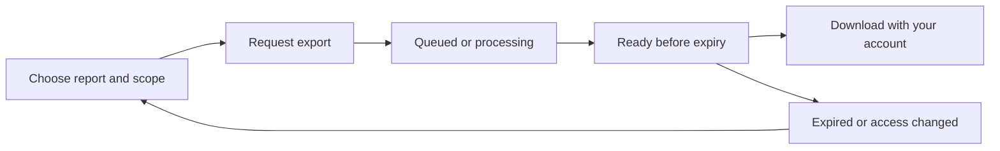

## Read financial activity by currency

Profit and Admin Commission Reports group figures by currency. The fee
figures use recognized commissions and documented original-line reversals.
Manual vendor adjustments, closed statement movement, and recorded transfers
are distinct figures. If the first Profit snapshot is still being prepared,
use **Refresh** to check the requested dates. Each snapshot shows when it was
generated.

## How to use it

Open Reports, choose the report and available date/filter parameters, review the currency and scope, then request an export if permitted. Use the relevant job/export status screen and download only when complete. Platform operators can inspect Jobs where available.

<SystemTour tour="feature-reports" compact />

## Choose the report that answers your question

Use [customer cohorts](/en/features/customer-cohorts) for retained purchase groups and [shopping funnels](/en/features/shopping-funnel) for optional measured journeys. The [recorded order-operations guide](/en/features/order-operations) explains child-order cancellations, whole-order dispatch and original vendor commitments; that feature has a tested local development checkpoint, with live rollout kept separate. These populations are different and should not be added together.

## Review coupon performance

Choose **Coupons** to see reserved uses, confirmed uses, discounts, and settled refunds by code and currency. Store and platform users can also see each seller's share. A split invoice counts once in the store totals even when it appears for multiple sellers.

Reserved uses are pending holds created during the selected dates. Discount costs are confirmed savings, and refunds are shown on the date they settled. An authorized export refreshes the report for the selected dates.

Generated codes show their batch name in the per-code table. Use **Coupon batch performance** to review grouped results by currency, and **Coupon batch performance by vendor** to review each seller’s share. The [coupon batch guide](/en/features/coupons) shows how to generate and download the codes.

## Download a private report

1. Select the report, period and filters. Check the workspace before choosing **Export**.
2. Wait while the export is queued or processing. You can keep reading the report while it runs.
3. When the file is ready, choose **Download**. The dashboard downloads the JSON attachment using your signed-in account.
4. Save the file securely. It may contain customer or business information; downloading it does not make it public.

The file is available for **24 hours from the export request**, not from the moment you first download it. After expiry, request a new export. If your permissions or workspace approval change, an earlier export may become unavailable before that time. A copied job identifier or download address does not grant another operator access.

| Your dashboard | What the file includes |
|---|---|
| Platform admin | The scope and filters selected when the export was requested. Changing a filter does not change an existing file. |
| Tenant | Your current tenant's report. Another tenant cannot retrieve it. |
| Vendor | Your vendor's report within the selected approved tenant workspace. Switch workspace before requesting another report. |

If a download is unavailable, check that you are signed in to the account that requested it, still have export permission, and have selected the correct workspace. Then request a new export if needed. A failed export is not a completed file. Older profit exports using an unsupported calculation definition remain unavailable; generate a current result before exporting again.

This development checkpoint includes backend acceptance and actual English/Arabic browser export downloads for all three staff dashboards. The walkthroughs use isolated synthetic data; they do not represent live deployment or production results.

## Follow your dashboard

Actual local demo screenshots, captured 19 November 2026. Synthetic accounts and figures; controlled system clock: 21 November. Captioned screenshot walkthrough, not a continuous recording or a production transaction.

### Platform admin

<SystemTour tour="feature-report-exports-admin" compact anchor="private-report-admin" />

### Store staff

<SystemTour tour="feature-report-exports-tenant" compact anchor="private-report-tenant" />

### Vendor staff

<SystemTour tour="feature-report-exports-vendor" compact anchor="private-report-vendor" />

## Restrictions and decisions

A queued request is not a finished file. Read permission does not automatically grant export. Different report definitions can count placed orders, paid revenue or current balances; compare matching measures and periods.

## Data flow and outcome

Scoped filters → report query/aggregate → queued export → completion metadata/file → authorized download.

## Merchant lifecycle: a separate question

The [merchant lifecycle guide](/en/features/merchant-lifecycle) explains applications, business and seller-workspace activation, commercial activity and billing exceptions. This is a pre-release development feature awaiting final release acceptance. Choose it to understand merchant progress; customer cohorts count buying groups, shopping funnels count optional measured journeys, and order operations count retained order facts. None of these populations is a substitute for another.

A package payment, vendor fee, manual vendor credit and payable balance are different financial measures. Profit summaries show manual vendor adjustments separately from platform fees; a credit to a vendor does not increase platform commission. Older cached profit results require a fresh supported result before they can be treated as current evidence.

## Export history

Open **Export history** from a report. The page lists your report exports for the current workspace. Cancel a queued export immediately or request cancellation of a running export before the worker publishes the file. Retry a failed export while it is still within its availability window. A retry appears as a new row linked to the original. Export permission is required.

## When something goes wrong

Check workspace, permission, record state and field errors first. If an action times out, inspect the record and its history before retrying. Escalate with the screen, record identifier and time; omit passwords and payment secrets.

## Evidence and verification limits

Authored from module documentation, dashboard routes and backend source. Route presence does not mean every action was exercised live. See [screen coverage](/en/coverage) and [source evidence](/en/evidence) for paths and fields. Screenshots illustrate demo accounts on 17 November 2026, not production results.

`Modules/Reports/` · `documentation/modules/`

Screen paths and source references

{/* SCREEN_MAP */}
## Where this feature appears

A route proves navigation, not permission to perform every action. Related-record detail tabs can expose additional entry points.

| Dashboard | Frontend entry paths |
|---|---|
| [admin](/en/roles/admin) | `/reports`, `/jobs` |
| [tenant](/en/roles/tenant) | `/reports` |
| [vendor](/en/roles/vendor) | `/reports` |

[Exact route, field and enum source trail](/en/evidence/reports)
{/* /SCREEN_MAP */}

