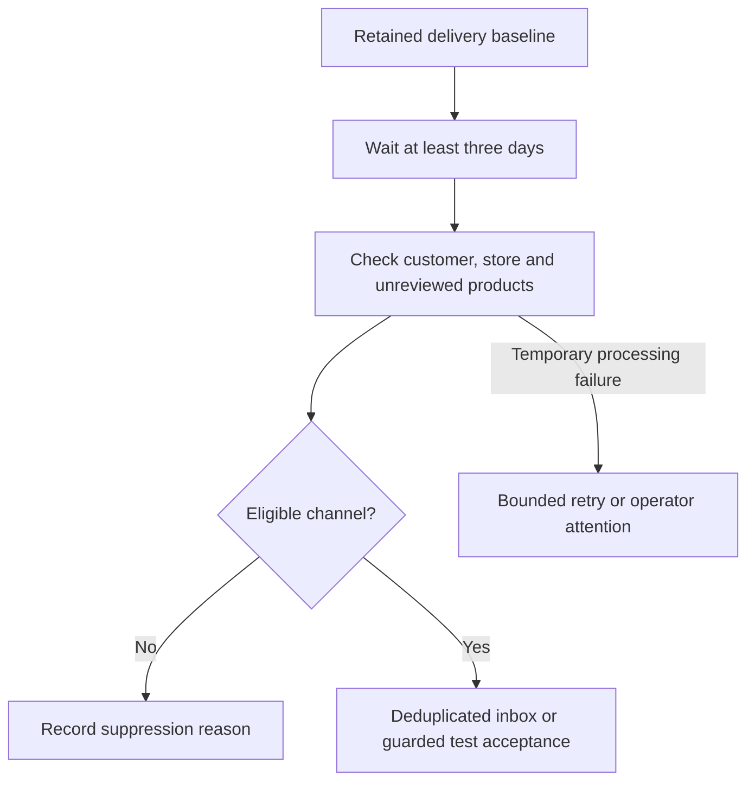

> **Test-only development release.** Reminder processing and tenant operator controls have been tested locally. Processing remains disabled by default and the external path uses a guarded SMS test adapter. This page does not claim a live reminder service.

## What this feature does

A review invitation helps a customer find products they can still review after delivery. It does not change the order, award a verified-purchase badge or publish a review automatically. The earliest invitation is three days after the retained delivery baseline.

## For the customer

In **Account → Profile & addresses → Your marketing choices**, purchase-feedback permission is separate from store offers and cart reminders. Choose each store and channel independently. A saved choice grants permission to consider an invitation; it does not prove a message was sent.

The new external test path uses SMS and requires a verified, unchanged phone and current purchase-feedback permission. Selecting email does not activate email delivery. Essential order/security messages and the transactional inbox have their own rules.

Open **Account → Notifications** to read an available invitation. **Mark read** changes its unread state; it does not post a review or opt you into messages. Existing invitation text retains its creation language when you switch the interface language. See the [customer walkthrough](/en/features/marketing-consent#find-and-read-a-review-invitation) for the saved choices, withdrawal and read-state video.

<SystemScreenshot src="/docs/screenshots/customer-review-feedback-en-inbox.png" alt="The synthetic customer inbox displaying an available review invitation and its full message." />

## How to use it

An authorized tenant operator opens **Review reminders**, reads the recorded outcome and inspects its channel attempts. Check the fixed deadline, remaining attempt budget and reason before requesting a retry. A retry requires its own permission and an explanation without customer contact details or secrets.

Review the confirmation carefully. Cancel if the selected reminder or explanation is wrong. Confirming requests another eligibility check; it never guarantees acceptance or message delivery.

<video style={{ width: "100%", height: "auto" }} controls playsInline preload="none" poster="/docs/screenshots/tenant-review-reminders-en-checks.png" aria-label="Inspect review reminders and cancel a retry confirmation">
  <source src="/docs/videos/tenant-review-reminders-en-tour.mp4" type="video/mp4" />
  <track kind="captions" src="/docs/videos/tenant-review-reminders-en.vtt" srcLang="en" label="English" default />
</video>

> **Guided screenshot tour, with captions and no audio.** Actual Tenant screens captured on 19 November 2026 in Cairo from an isolated local test preview with synthetic records. Processing is disabled by default; this private preview explicitly enables the guarded local test path to demonstrate its controls. Both retry confirmations were cancelled and no retry was submitted. Neither in-app availability nor SMS test acceptance proves external delivery, a submitted review or revenue.

## Read channel outcomes

The request's summary is not a delivery receipt. **Processing completed** means the channel checks reached their recorded outcomes; inspect each channel before interpreting it.

| What the operator sees | What it means |
| --- | --- |
| Waiting for processing | Work is scheduled; this does not mean a message was sent. |
| Available in app | An inbox request is available, without proving that the customer read it. |
| Accepted by the SMS test adapter | A controlled local test result, without external delivery proof. |
| Suppressed | A current business or permission rule prevents the attempt. Read the reason. |
| Waiting for a bounded retry | A temporary failure may be rechecked while the original budget and deadline allow it. |
| Operator attention required | Investigate the recorded failure or exhausted budget; do not restart its limits. |
| Deadline expired | The original window ended and no further retry is offered. |
| Legacy transport outcome unknown | Historical acknowledgement is not external delivery evidence. The record is read-only. |

<SystemTour tour="feature-review-reminders" />

## Restrictions and decisions

The worker must recheck the current customer, store relationship, review permission and products still eligible for review. A review for the same product at this store counts even if it belongs to an earlier order. A guest claim, changed recipient or changed phone must not retarget an old invitation.

Retries retain the original deadline and shared processing budget. They cannot restart an accepted, suppressed, exhausted or expired invitation. Historical notification acknowledgements have unknown transport status; they are not automatically replayed or relabelled as delivered messages. Test purchase evidence cannot qualify a real review invitation.

## Data flow and outcome

An inbox record, a test-adapter acceptance and confirmed external delivery are different outcomes. The test release must show them separately and must not count invitations as orders, sales or review submissions.

## If something goes wrong

Read the reason before acting. Withdrawn permission or a product already reviewed is not a transport outage. An unknown historical outcome is not proof of failure. If the reminder cannot be retried, investigate the recorded history instead of creating another invitation to bypass its limits.

Related: [Your store-specific choices](/en/features/marketing-consent) · [Reviews and moderation](/en/features/reviews).
