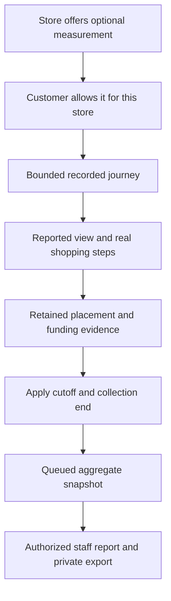

> **Development checkpoint · 19 November 2026.** Optional measurement and the three staff reports are implemented and tested locally, including English/Arabic browser checks. These walkthroughs use controlled synthetic data; the videos are captioned screenshot sequences. Live rollout is separate.

## What this feature helps you understand

The shopping funnel shows where recorded journeys progress from a reported product view to a qualifying funded purchase. It helps a store investigate friction between steps. It counts measured journeys, not verified people, unique customer accounts, revenue or recovered sales.

Customers keep one central account across stores. Measurement permission is a separate choice for the current store and browser.

## How to use it

**Customer:** open the shopping-measurement control in the store footer. When the store makes this optional feature available, you can allow measurement or keep it off. You can return to this control to withdraw. Store availability alone does not grant your permission; an earlier marketing or cookie choice does not grant this separate permission.

Withdrawing stops this browser from sending new shopping measurements and product-view reports immediately. If the store cannot confirm the stop because the connection fails, the panel shows a pending confirmation and a retry action. Keep the choice off and retry when connected. A pending message means the store has not confirmed the stop yet.

The store stops accepting measurements when it confirms withdrawal or when the temporary measurement permission expires. Until then, payment evidence already linked to the journey may still qualify within that time limit. If the panel says the pending stop could not be saved for reload, keep the page open and retry; closing it may lose the pending request.

### Customer walkthrough: choose, view, stop and retry

Follow the four chapters to distinguish your browser choice from server confirmation. The local demonstration uses a synthetic product and a controlled connection failure. The 24-second video is a guided screenshot sequence, not a recording of a live purchase.

<SystemTour tour="feature-shopping-funnel-customer" anchor="screen-guide" />

**Tenant operator:** use the dedicated measurement control in storefront settings to enable or disable availability. Changes have a notice version. Existing customer permissions cannot silently carry over to a changed version. This control does not opt customers in.

**Staff:** open **Reports → Shopping funnel**. Check the selected store or vendor workspace, entry dates, observation cutoff and coverage before interpreting the stages. Request generation if no snapshot exists; queued work is not an empty report. Export requires its own permission and produces a private, expiring file.

## Read the five stages

| Stage | Meaning |
| --- | --- |
| Product viewed | The browser reports a displayed eligible product after rendering. This is an observation, not verified human attention. |
| Item added | A real server cart operation increases quantity. Reading, recalculating, removing items and copying a merged basket do not invent additions. |
| Checkout submitted | A validated checkout request reaches the checkout service. Business validation can still prevent placement. |
| Purchase placed | One umbrella invoice commits with its child orders. A later payment-initialization error does not erase this stage. |
| Purchase funded | Retained funding evidence qualifies the placed purchase within the measurement horizon and collection boundary. Unpaid cash on delivery does not qualify. |

A journey has a fixed 24-hour horizon from its admission. Multiple purchases or split seller orders do not multiply the journey at a stage. A later refund preserves the historical funded event; financial reports explain refund amounts and net revenue separately.

## Understand the populations and rates

**Admitted** means the store started a measurement journey after permission. **Observed** means the journey has at least one retained stage observation. Admission alone is not a view.

The ordered funnel requires an earlier qualifying stage in the same journey. Checkout and placement also need matching cart and submission receipts. A later stage cannot fill an unobserved earlier one. Raw stage counts and missing-prior counts are separate diagnostics; do not add them to the ordered funnel.

Rates from view use the ordered product-view population. Rates from the preceding stage use that ordered stage's population. For example, ten funded journeys among 100 measured viewed journeys would mean 10%, only when the window and coverage support a final rate. A zero denominator has no percentage.

## Read time and coverage correctly

Entry dates are the UTC days when journeys were admitted, rather than the days payments arrived. A report supports up to 93 inclusive entry days. The default selects 30 mature entry days ending two UTC days ago. Yesterday is selectable, but some journeys can still have unfinished horizons.

The cutoff is exclusive 00:00 UTC at the start of the observation day. Queued work retains that cutoff even if it finishes later. Read the saved cutoff and freshness notice; the screen is not a live counter.

Unfinished horizons, early collection stops, histories reaching the 200-event limit per journey, or incomplete source coverage can leave final rates unavailable. This does not mean zero conversion or proven abandonment. Missing evidence before rollout or after the 180-day raw-data retention boundary is also explicit. Old carts and temporary recently-viewed lists cannot reconstruct missing browsing history.

Canonical test activity is excluded using trusted retained evidence. A missing test marker does not prove that a browser observation represents a genuine human. Failed test payment attempts alone do not taint a separately qualifying genuine capture. Late backdated test-shipping evidence cannot rewrite an earlier cutoff.

## Platform admin walkthrough: global scope and coverage

Compare the selected scope, the synthetic global stage counts and explicit evidence limits. The 18-second guided screenshot clip counts journeys across stores, not unique people.

<SystemTour tour="feature-shopping-funnel-admin" anchor="admin-walkthrough" />

## Tenant walkthrough: availability, stages and early stopping

Select a chapter to connect the store control, measured stages and the separate withdrawal example. These are actual local screenshots of synthetic data; the clip is an 18-second guided screenshot sequence.

<SystemTour tour="feature-shopping-funnel-tenant" anchor="tenant-walkthrough" />

## Restrictions and decisions

| Dashboard or choice | Boundary |
| --- | --- |
| Customer | Optional permission is store-specific and versioned; account login, shopping and marketing choices remain separate. |
| Tenant | The report contains the selected store's measured journeys only. |
| Vendor | Only frozen participation by that seller in its approved workspace is included. Another seller's paid child cannot qualify a canceled unpaid child. Store-wide visitor or signup denominators are unavailable here. |
| Platform admin | Distinguish a store-specific population from the global aggregate. Adding store journeys does not identify unique global customers. |
| Withdrawal or changed policy | New optional collection stops at its retained end boundary; later essential payment data cannot silently extend the measured journey. Earlier snapshots keep their historical cutoff. |
| Export | View, generate and export permissions are separate. Download access rechecks the requesting staff account, scope and current vendor approval; private files expire after 24 hours. |

The feature retains no IP address, user-agent fingerprint, contact details or full browsing URLs for measurement. Staff reports expose aggregates rather than customer-level trails or measurement tokens. Essential purchases remain serviceable when measurement is off or unavailable.

## Vendor walkthrough: scope, stages and evidence limits

Check the approved workspace first, then compare the seller-only stage chain with its coverage and exclusions. The 18-second screenshot clip shows no customer-level trails or live payment evidence.

<SystemTour tour="feature-shopping-funnel-vendor" anchor="vendor-walkthrough" />

## Data flow and outcome

## If something goes wrong

Keep shopping if optional measurement is unavailable. For withdrawal, distinguish local stopping from pending server confirmation and use its retry action. For a report, check the scope, entry window, saved cutoff and coverage reason first. Repeated generation cannot reset an exhausted three-attempt budget for the same scope, window, cutoff and definition. Ask an operator to investigate the recorded failure rather than replacing unknown values with zero.

Related: [Customer cohorts](/en/features/customer-cohorts) · [Marketing choices](/en/features/marketing-consent) · [Reports and exports](/en/features/reports).
