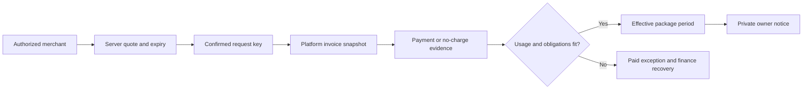

## What this feature does

A CartJoin package controls the store's service period, product capacity, active staff seats, approved vendors and Marketplace entitlement. Open **System → Subscription & setup** in the tenant dashboard. Platform staff use **Administration → Subscription & setup**, then select the merchant.

This is implemented development functionality. The captured prices are local test examples. Test buttons simulate evidence and never charge real money; live provider activation and deployment remain separate.

<SystemTour tour="feature-subscriptions" compact />

## Read the current agreement

Check the package **version**, service end, usage and limits. Products include drafts; staff usage includes active nonremoved accounts and the owner; vendor usage counts approved relationships. **Unlimited** differs from zero. Existing merchants without a subscription retain legacy access until explicitly enrolled; no trial or price is imposed automatically.

The setup checklist reads actual configuration. A green payment or catalog check is a setup signal, not certification that a live purchase, carrier booking or owner handover succeeded. Finish a full permitted commerce cycle before launch.

## How to use it

1. Select a published package version and request a server quote.
2. Read the amount, currency, effective date and expiry. Quotes last 15 minutes.
3. Confirm the reviewed quote once. A retry of that confirmation uses the same request key.
4. Inspect the separate platform invoice and recorded result.

Eligible same-cycle, same-currency upgrades use exact remaining-period proration. Lower prices, reduced limits, currency/cycle changes and Marketplace removal are scheduled at renewal. There is no automatic currency conversion. A zero-amount invoice needs no payment event.

A scheduled Marketplace exit closes new seller exposure while preserving first-party sales and authorized servicing. Cancelling the scheduled change restores only the capabilities still allowed by the current package and approvals.

## Select features for a package version

In the admin dashboard, open **Packages & versions** and choose **Create next version** to copy a published package. Select the features for tenant staff, vendors and customers, then publish the new version. Vendor features require a Marketplace package. Current subscriptions remain on their accepted versions.

In **Subscription & setup**, choose a tenant to see which features its current package includes and how its service status, store mode and defaults affect availability. A quote shows added and removed features. On a paid subscription, removal takes effect when the renewal on the new version settles.

In the tenant dashboard, open **System → Feature controls**. Choose a feature and set its default. For vendor and customer features, search for a person or vendor in this store and choose **Allow**, **Deny**, or **Inherit**. Turning off the store-wide switch disables the action for everyone in the store. The package and existing permissions limit what an exception can grant. Customers can still view and remove existing wishlist items and stock alerts, and staff can continue servicing existing orders.

Additional controls cover catalog spreadsheet exports, product questions and answers, new coupons, flash sales and webhook subscriptions, and new customer reviews and votes. Older packages inherit access to the newly controlled actions. Published versions created with the expanded catalog use their saved selection. Existing coupon use, review editing and order servicing follow their current rules.

## Platform invoices and recovery

These are **CartJoin service bills**, separate from customer order invoices, commissions and vendor payouts. Retiring a package hides it from new enrollment and preserves accepted terms and historical invoice snapshots.

A simulated decline is recorded; it does not remove an existing paid period. A paid invoice with an activation problem remains paid and shows a provisioning exception. Ask authorized platform finance to resolve the listed usage/obligation problem and retry **paid activation**. Replaying an old invoice cannot restore an older package.

Platform finance may void an **unpaid** invoice with a retained reason. A paid invoice cannot be voided through this action. Resolve the current unpaid change invoice before requesting another change.

## Cancellation and restrictions

Cancellation is scheduled for period end and may be revoked before it takes effect. Renewal creates one invoice and a configured grace period. After grace, CartJoin blocks new sales and capacity expansion while keeping authorized fulfillment, returns, refunds, history and finance available. Billing does not deactivate the tenant identity or erase records.

The owner receives private English/Arabic in-app notices, including trial reminders seven days and one day before expiry. Notices are queued and replay-safe. Delivery problems stay pending for operational recovery; they do not reverse a recorded billing action.

## Restrictions and decisions

Changing packages requires subscription-management permission. A product permission alone cannot authorize billing. All amounts and limits are checked on the server, including imports and queued work. Store mode cannot accept new vendor offers; Marketplace requires both an eligible package and approved seller relationship.

A Marketplace-to-Store change is blocked by approved sellers, active vendor catalog, open vendor orders/returns, unexpired return windows, unresolved refunds and unsettled vendor money. Do not delete evidence or change historical seller ownership to pass a check. Contact finance or operations with the record IDs and the blocker.

## Data flow and outcome

The tenant dashboard acts only on its resolved store. Selecting another merchant is a platform-admin operation; a body field cannot choose the tenant. Customer and vendor dashboards cannot manage platform bills.

## If something fails

For an expired quote, request a fresh one. For an unchanged network retry, inspect the current invoice before confirming again. For a quota failure, reduce new usage or select an eligible package. For **paid but not activated**, preserve the invoice and ask platform finance to reconcile; do not pay again to hide the exception.

[Merchant activation guide](/en/features/merchant-onboarding) · [Mode rules](/en/roadmap/modes)
