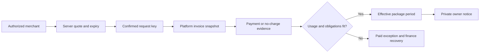

## What this feature does

A CartJoin package controls the store's service period, product capacity, active staff seats, approved vendors and Marketplace entitlement. Open **System → Subscription & setup** in the tenant dashboard. Platform staff use **Administration → Subscription & setup**, then select the merchant.

CartJoin currently uses assisted onboarding for the merchant pilot. Test payment buttons simulate a payment record without charging a payment method. Screenshots may show test offers.

<SystemTour tour="feature-subscriptions" compact />

## Read the current agreement

| Package | Monthly | Billed annually | Annual savings | Products | Active staff | Approved vendors |
|---|---:|---:|---:|---:|---:|---:|
| Store | EGP 499 | EGP 4,990 | EGP 998 | 500 | 3 | 0 |
| Marketplace | EGP 1,499 | EGP 14,990 | EGP 2,998 | 5,000 | 10 | 25 |

The standard offers include a 14-day free trial and seven days of grace after the end of a paid period. The public comparison shows the annual total and its monthly equivalent. For example, annual Store billing is one EGP 4,990 charge for the year, equivalent to about EGP 415.83 per month. Payment processor fees and vendor commissions are separate from the CartJoin bill.

Check the package **version**, service end, usage and limits. Products include drafts; staff usage includes active nonremoved accounts and the owner; vendor usage counts approved relationships. **Unlimited** differs from zero. Existing merchants without a subscription retain legacy access until explicitly enrolled; no trial or price is imposed automatically.

The setup checklist reads actual configuration. A green payment or catalog check is a setup signal, not certification that a live purchase, carrier booking or owner handover succeeded. Finish a full permitted commerce cycle before launch.

## Use the free trial

The trial starts when CartJoin approves and provisions your store. The selected plan’s features and limits apply during the trial. You can sell after your store meets its launch requirements. **Subscription & setup** shows the exact deadline. Changing the selected offer or retrying enrollment does not restart the trial.

At expiry, CartJoin pauses new sales and capacity increases. To continue selling, review and confirm a paid activation quote. The paid period starts after settlement, including when you activate before expiry. An expired trial does not issue a bill on its own. You can still service existing orders and access authorized billing records.

## How to use it

1. Select a published package version and request a server quote.
2. Review the amount due now, the next billing amount, any feature changes, and the effective date. Quotes last 15 minutes.
3. Confirm the reviewed quote once. A retry of that confirmation uses the same request key.
4. Inspect the separate platform invoice and recorded result.

Eligible same-cycle, same-currency upgrades use exact remaining-period proration. Lower prices, reduced limits, currency/cycle changes and Marketplace removal are scheduled at renewal. There is no automatic currency conversion. A zero-amount invoice needs no payment event.

A scheduled Marketplace exit closes new seller exposure while preserving first-party sales and authorized servicing. Cancelling the scheduled change restores only the capabilities still allowed by the current package and approvals. Switching an active monthly Store subscription to annual billing is also scheduled for renewal. Under the standard terms, the annual EGP 4,990 becomes due at that renewal.

## Select features for a package version

In the admin dashboard, open **Packages & versions** and choose **Create next version** to copy a published package. Choose the features for tenant staff, vendors, and customers. Preview the price, billing cadence, limits, and feature changes before confirming publication. Vendor features require a Marketplace package. Current subscriptions remain on their accepted versions.

In **Subscription & setup**, choose a tenant to see which features its current package includes and how its service status, store mode and defaults affect availability. A quote shows added and removed features. On a paid subscription, removal takes effect when the renewal on the new version settles.

In the tenant dashboard, open **System → Feature controls**. Choose a feature and set its default. For vendor and customer features, search for a person or vendor in this store and choose **Allow**, **Deny**, or **Inherit**. Turning off the store-wide switch disables the action for everyone in the store. The package and existing permissions limit what an exception can grant. Customers can still view and remove existing wishlist items and stock alerts, and staff can continue servicing existing orders.

Additional controls cover catalog spreadsheet exports, product questions and answers, new coupons, flash sales and webhook subscriptions, and new customer reviews and votes. Older packages inherit access to the newly controlled actions. Published versions created with the expanded catalog use their saved selection. Existing coupon use, review editing and order servicing follow their current rules.

## Platform invoices and recovery

These are **CartJoin service bills**, separate from customer order invoices, commissions and vendor payouts. Retiring a package hides it from new enrollment and preserves accepted terms and historical invoice snapshots.

A simulated decline is recorded; it does not remove an existing paid period. A paid invoice with an activation problem remains paid and shows a provisioning exception. Ask authorized platform finance to resolve the listed usage/obligation problem and retry **paid activation**. Replaying an old invoice cannot restore an older package.

Confirm a fresh quote when an unpaid invoice has expired or its terms have changed. CartJoin voids the old invoice and keeps it in your history. If the current unpaid invoice is still valid, use it or ask platform finance to void it before confirming a different change.

## Read recovery in merchant reports

The pre-release [merchant lifecycle report](/en/features/merchant-lifecycle) separates payment recovery from application of the related service term. Applying a term does not override a separate administrative suspension. Renewal during grace can apply the next term without restoring access, because access was already allowed. Use the current subscription screen to check what the merchant can do now.

A zero-amount resolution is not captured cash. A paid invoice that could not be applied is different from an unpaid first activation or a renewal gap. The report follows each original obligation rather than counting every failed retry as another merchant. Trial expiry without debt and intentional period-end cancellation are not failed paid renewals. Existing test payment simulations remain test activity, not commercial recovery.

## Cancellation and restrictions

Cancellation is scheduled for period end and may be revoked before it takes effect. Renewal reuses the current invoice for the same service period and terms. After the recorded grace deadline, CartJoin blocks new sales and capacity expansion while keeping authorized fulfillment, returns, refunds, history and finance available. Billing does not deactivate the tenant identity or erase records.

Shoppers can still browse, review or reduce their cart, and access existing purchases. The storefront explains when it cannot accept an addition or a new checkout and rechecks availability every minute in a visible tab while purchases are paused. Vendors see availability for optional actions in their selected workspace and can continue servicing existing orders with their assigned permissions.

## Choose billing notifications

In **Subscription & setup**, the store owner can choose **In-app only** or **In-app plus email** and select finance delegates who have permission to view billing. Each recipient verifies their current account email before receiving email notices. In-app is the default. Enabling email applies to new notices once platform mail is enabled.

Trial reminders arrive seven days and one day before expiry when there is enough time. Notices also cover renewal, the end of paid grace, planned changes, billing exceptions, access restoration, and reaching 80% or 100% of a finite quota. Open the notification to review the next step in your authenticated billing screen. Platform finance can inspect delivery outcomes and retry known failures.

## Restrictions and decisions

Changing packages requires subscription-management permission. A product permission alone cannot authorize billing. All amounts and limits are checked on the server, including imports and queued work. Store mode cannot accept new vendor offers; Marketplace requires both an eligible package and approved seller relationship.

Staff see the relevant plan limits and reasons next to actions they have permission to use. An approved vendor sees their own workspace availability. A shopper sees whether the store can accept new purchases or the current action. Authorization to view billing and change the plan stays with merchant staff and platform operators who hold those permissions.

A Marketplace-to-Store change is blocked by approved sellers, active vendor catalog, open vendor orders/returns, unexpired return windows, unresolved refunds and unsettled vendor money. Do not delete evidence or change historical seller ownership to pass a check. Contact finance or operations with the record IDs and the blocker.

## Data flow and outcome

The tenant dashboard acts only on its resolved store. Selecting another merchant is a platform-admin operation; a body field cannot choose the tenant. Customer and vendor dashboards cannot manage platform bills.

## If something fails

For an expired quote, request a fresh one. For an unchanged network retry, inspect the current invoice before confirming again. For a quota failure, reduce new usage or select an eligible package. For **paid but not activated**, preserve the invoice and ask platform finance to reconcile; do not pay again to hide the exception.

[Merchant activation guide](/en/features/merchant-onboarding) · [Mode rules](/en/roadmap/modes)
